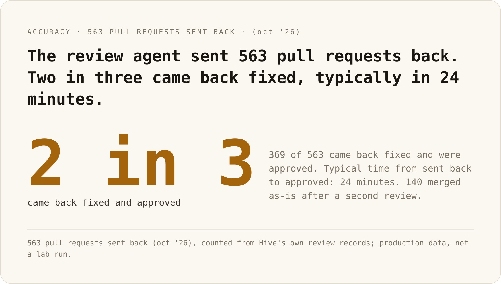
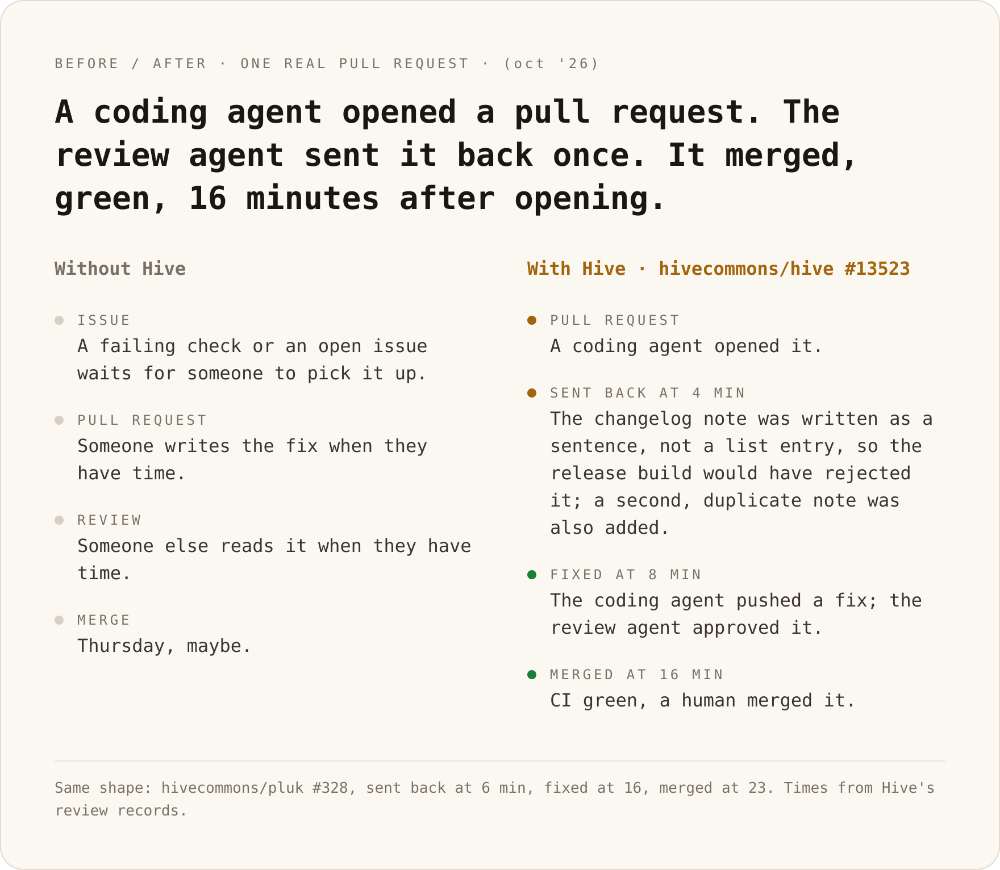
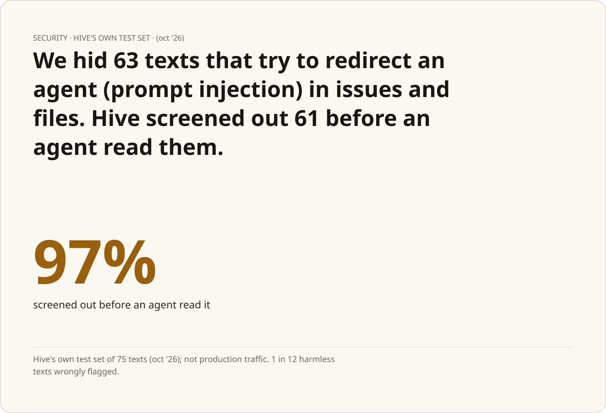
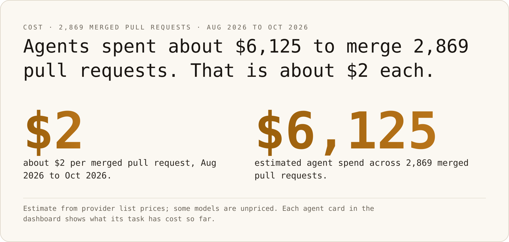
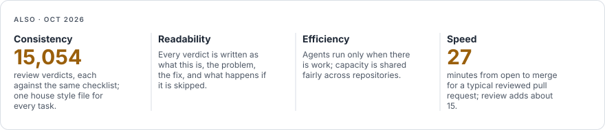
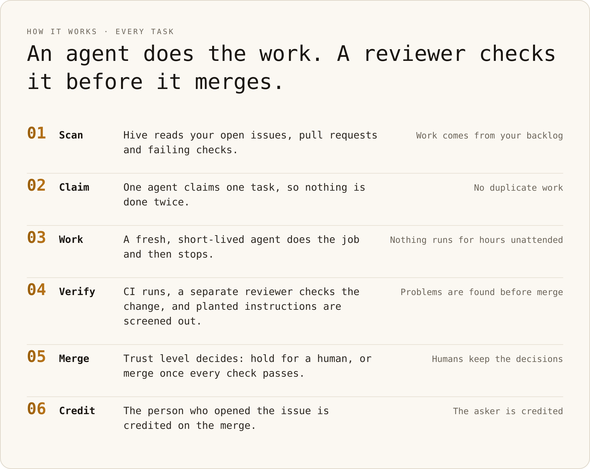

<p align="center">
  
</p>

# Hive

[](https://www.bestpractices.dev/projects/14261)
[](LICENSE)

Every team has one: the maintainer who reads every pull request, never lets red merge, and sends work back in one line. Hive puts that person between your coding agents and your main branch.

Hive is like a CI system, except the job is an AI coding agent and the gate is an AI review plus your existing CI.

<!-- outcomes:start -->
<!-- generated by src/scripts/outcome-benchmark.sh --readme; do not edit by hand. Report: src/docs/benchmarks/outcomes-2026-10.md -->
Numbers below: 11,571 pull requests, 10 repositories, 15,054 AI reviews (oct '26).

## Accuracy

<picture><source media="(prefers-color-scheme: dark)" srcset="src/docs/benchmarks/assets/outcomes-2026-10-card-accuracy-dark.svg"></picture>

Humans still merge; what reaches them has passed review and CI. Start at "open PRs only"; once you trust it, turn the [setting](src/docs/acmm-policy-matrix.md) up to merge on green, like a merge queue.

<picture><source media="(prefers-color-scheme: dark)" srcset="src/docs/benchmarks/assets/outcomes-2026-10-card-stories-dark.svg"></picture>

## Security

Hidden instructions in issues or files are screened out before an agent reads them; agents run as a GitHub App, not your PAT.

<picture><source media="(prefers-color-scheme: dark)" srcset="src/docs/benchmarks/assets/outcomes-2026-10-card-prompt-injection-dark.svg"></picture>

## Cost

Tracked like CI minutes; each job's cost is on the dashboard.

<picture><source media="(prefers-color-scheme: dark)" srcset="src/docs/benchmarks/assets/outcomes-2026-10-card-cost-dark.svg"></picture>

## Also

<picture><source media="(prefers-color-scheme: dark)" srcset="src/docs/benchmarks/assets/outcomes-2026-10-card-also-dark.svg"></picture>

Production data, not a lab run; counts regenerate from live records. Reverts are too new to report. [How we count →](src/docs/benchmarks/outcomes-2026-10.md)
<!-- outcomes:end -->

## How it works

<p align="center">
<picture><source media="(prefers-color-scheme: dark)" srcset="src/docs/benchmarks/assets/outcomes-2026-10-card-how-it-works-dark.svg"></picture>
</p>

## Run it

```bash
git clone https://github.com/hivecommons/hive.git && cd hive
cp src/hive.yaml.example src/hive.yaml   # set project.org, project.repos and dashboard.port 3002
printf 'HIVE_GITHUB_TOKEN=ghp_...\nHIVE_DASHBOARD_TOKEN=%s\n' "$(openssl rand -hex 32)" > src/.env && chmod 600 src/.env
docker compose -f src/docker-compose.yaml up -d
```

Each line is explained in the [quick start](src/docs/quickstart-docker-compose.md); [Podman and Kubernetes](src/docs/what-is-hive.md#run-it).

## Learn more

[Overview](src/docs/what-is-hive.md) · [Architecture](src/docs/architecture.md) · [Security model](src/docs/security-model.md) · [Terminal UI](src/docs/hivectl.md#tui--live-terminal-dashboard) · [Integrations](src/docs/integrations.md) · [Contribute compute](src/docs/contributor-relay.md) · [Contributing](CONTRIBUTING.md) · [Code of Conduct](CODE_OF_CONDUCT.md) · [Adopters](ADOPTERS.md) · [Repositories](docs/repositories.md) · [Changelog](CHANGELOG.md) · [Vulnerabilities](SECURITY.md) · [Telemetry](src/docs/telemetry.md) · [Hosted service](https://hive.hivecommons.dev)

That maintainer now reads every repo. Only run images from `ghcr.io/hivecommons/hive`.

---

Apache-2.0. Hive is a [Cloud Native Computing Foundation](https://www.cncf.io/) sandbox project ([onboarding status](src/docs/cncf-sandbox-onboarding.md)) and follows the [CNCF Code of Conduct](CODE_OF_CONDUCT.md). Copyright The Linux Foundation and Hive contributors; trademarks are used per the [Linux Foundation Trademark Usage page](https://www.linuxfoundation.org/legal/trademark-usage).
