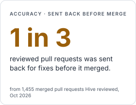

<p align="center">
  
</p>

# Hive

[](https://www.bestpractices.dev/projects/14261)
[](LICENSE)

Hive points short-lived coding agents at a repository's issues, pull requests and failing checks, reviews what they produce, and leaves the decisions to humans.

<!-- outcomes:start -->
<!-- generated by src/scripts/outcome-benchmark.sh --readme; do not edit by hand. Report: src/docs/benchmarks/outcomes-2026-10.md -->
Measured on 11,571 pull requests across 10 repositories and 15,054 review verdicts, as of 2026-10-27.

## Accuracy

A separate reviewer reads every pull request an agent opens and can send it back before it merges.

<p align="center">
<picture><source media="(prefers-color-scheme: dark)" srcset="src/docs/benchmarks/assets/outcomes-2026-10-card-sent-back-dark.svg"></picture>
</p>

<p align="center">
<picture><source media="(prefers-color-scheme: dark)" srcset="src/docs/benchmarks/assets/outcomes-2026-10-card-stories-dark.svg"></picture>
</p>

Pull requests merged without review come from other repositories and periods, not a controlled comparison, so differences may not be caused by review. Revert rates are not distinguishable so far.

## Security

Agents work with short-lived, task-scoped access; pull requests from untrusted authors are held for a human; every merge is signed off and credits the issue author.

<p align="center">
<picture><source media="(prefers-color-scheme: dark)" srcset="src/docs/benchmarks/assets/outcomes-2026-10-card-prompt-injection-dark.svg"></picture>
</p>

## Cost

Each agent card in the dashboard shows what the current task has cost so far. The figure below is an estimate from provider pricing; some models are unpriced.

<p align="center">
<picture><source media="(prefers-color-scheme: dark)" srcset="src/docs/benchmarks/assets/outcomes-2026-10-card-cost-dark.svg"></picture>
</p>

## Also

<p align="center">
<picture><source media="(prefers-color-scheme: dark)" srcset="src/docs/benchmarks/assets/outcomes-2026-10-card-also-dark.svg"></picture>
</p>

Production data, not a lab run. Every count above is regenerated from live records by `src/scripts/outcome-benchmark.sh`; bases, dates, exclusions and the full tables are in [how we count →](src/docs/benchmarks/outcomes-2026-10.md).
<!-- outcomes:end -->

## How it works

<p align="center">
<picture><source media="(prefers-color-scheme: dark)" srcset="src/docs/benchmarks/assets/outcomes-2026-10-card-how-it-works-dark.svg"></picture>
</p>

The trust level ([ACMM](src/docs/acmm-policy-matrix.md)) sets how far the loop runs on its own, from filing findings only to merging on green.

## Run it

```bash
git clone https://github.com/hivecommons/hive.git && cd hive
cp src/hive.yaml.example src/hive.yaml   # set project.org, project.repos and dashboard.port 3002
printf 'HIVE_GITHUB_TOKEN=ghp_...\nHIVE_DASHBOARD_TOKEN=%s\n' "$(openssl rand -hex 32)" > src/.env && chmod 600 src/.env
docker compose -f src/docker-compose.yaml up -d
```

The [Docker Compose quick start](src/docs/quickstart-docker-compose.md) explains each line. Podman, Kubernetes and the hosted hub: [Run it](src/docs/what-is-hive.md#run-it).

## Learn more

- [What Hive is](src/docs/what-is-hive.md) — the longer overview: how it differs from a terminal agent, hub and spoke, the contributor relay, ACMM levels, "does Hive fit my project".
- [Architecture](src/docs/architecture.md) · [Security model](src/docs/security-model.md) · [Terminal dashboard](src/docs/hivectl.md#tui--live-terminal-dashboard) · [Integrations](src/docs/integrations.md)
- [Contribute compute to a hive](src/docs/contributor-relay.md) · [Contribute to Hive itself](CONTRIBUTING.md) · [Adopters](ADOPTERS.md) · [Repositories](docs/repositories.md) · [Changelog](CHANGELOG.md)
- [Report a vulnerability](SECURITY.md) · [Telemetry](src/docs/telemetry.md) · [Hosted hub](https://hive.hivecommons.dev)

---

Apache-2.0. Hive is a [Cloud Native Computing Foundation](https://www.cncf.io/) sandbox project candidate ([onboarding status](src/docs/cncf-sandbox-onboarding.md)); this does not imply CNCF acceptance or endorsement. Copyright The Linux Foundation and Hive contributors; trademarks are used per the [Linux Foundation Trademark Usage page](https://www.linuxfoundation.org/legal/trademark-usage).
