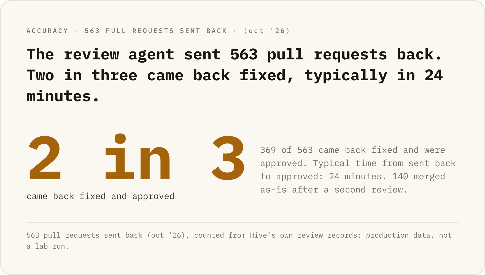
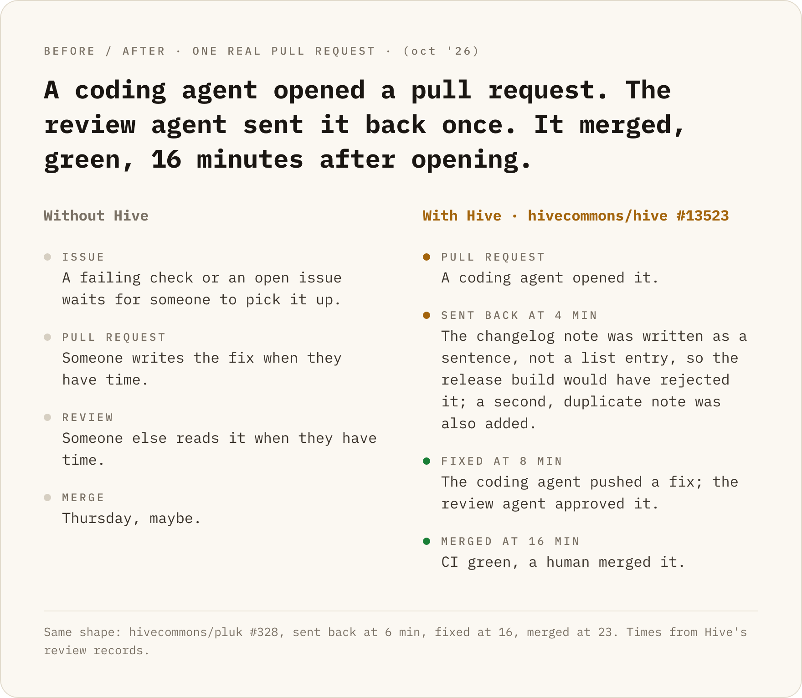
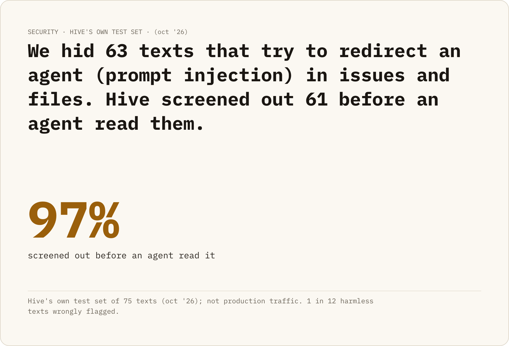
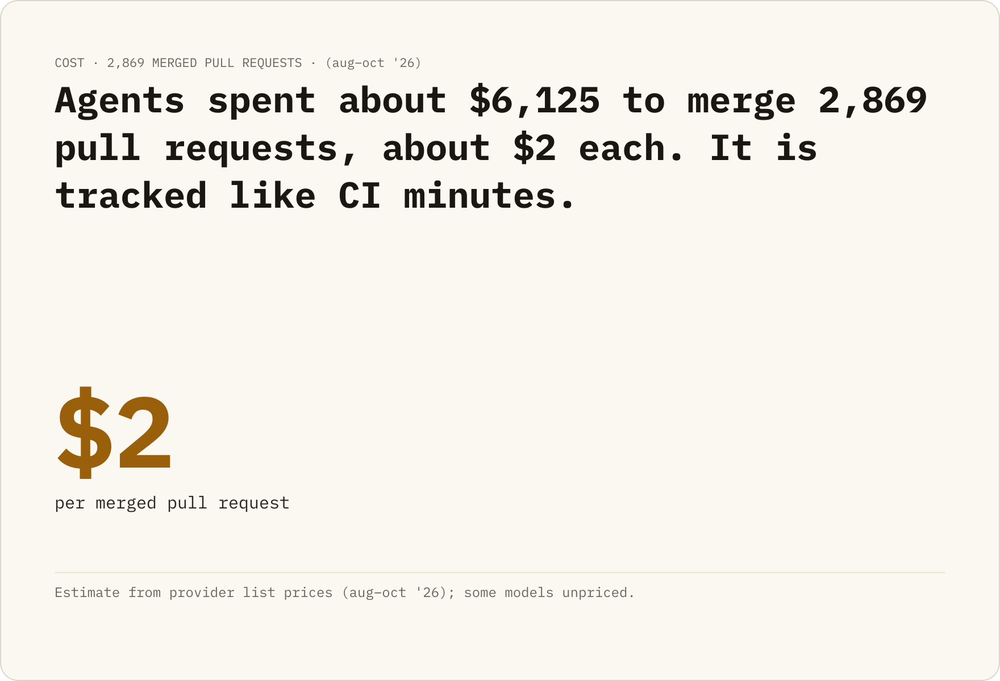
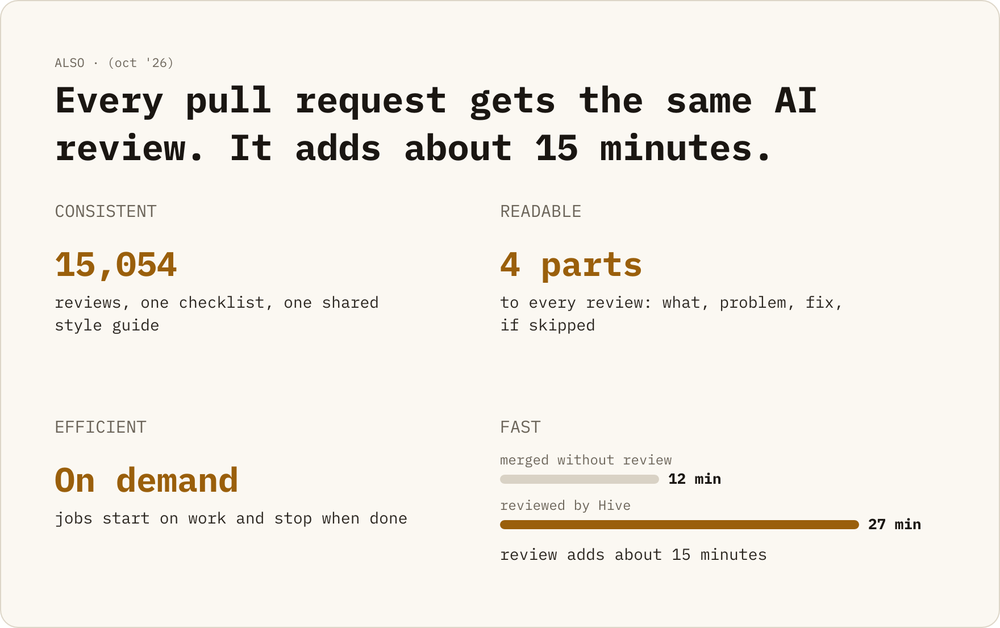
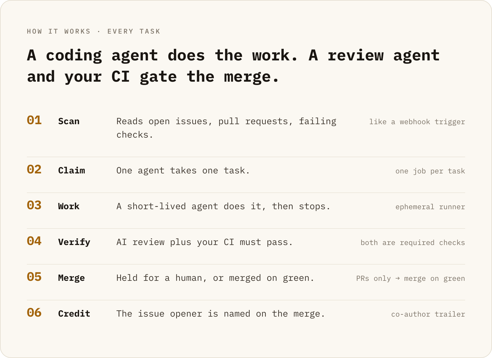

<p align="center">
  
</p>

# Hive

[](https://www.bestpractices.dev/projects/14261)
[](LICENSE)

You know the one. Reads every pull request. Never lets red merge. Sends it back with one line, and the line is right. Hive puts that person between your coding agents and main.

If you run CI you know the shape. The job is an AI coding agent. The gate is an AI review plus your own CI.

<!-- outcomes:start -->
<!-- generated by src/scripts/outcome-benchmark.sh --readme. Do not edit by hand. Report: src/docs/benchmarks/outcomes-2026-10.md -->
Everything below comes from 11,571 live pull requests in 10 repositories and 15,054 reviews (oct '26).

## Accuracy

The review agent sent 563 pull requests back. Two out of three came back fixed and approved, usually within 24 minutes.

<picture><source media="(prefers-color-scheme: dark)" srcset="src/docs/benchmarks/assets/outcomes-2026-10-card-accuracy-dark.png"></picture>
<picture><source media="(prefers-color-scheme: dark)" srcset="src/docs/benchmarks/assets/outcomes-2026-10-card-stories-dark.png"></picture>

## Security

We planted 63 texts that try to redirect an agent in issues and files. Hive caught 61 before an agent read a word. One harmless text in 12 got flagged by mistake. Agents run as a GitHub App, not on your token.

<picture><source media="(prefers-color-scheme: dark)" srcset="src/docs/benchmarks/assets/outcomes-2026-10-card-prompt-injection-dark.png"></picture>

## Cost

Agents spent about $6,125 to merge 2,869 pull requests. Call it $2 a merge, our estimate (aug–oct '26).

<picture><source media="(prefers-color-scheme: dark)" srcset="src/docs/benchmarks/assets/outcomes-2026-10-card-cost-dark.png"></picture>

## And the rest

Every pull request gets the same one-line review, in your style guide's voice. It adds about 15 minutes to a merge.

<picture><source media="(prefers-color-scheme: dark)" srcset="src/docs/benchmarks/assets/outcomes-2026-10-card-also-dark.png"></picture>

Humans still merge. Start with "open PRs only". When you trust it, [turn it up](src/docs/acmm-policy-matrix.md) and it merges on green, like a merge queue that reads the code.

Reverts are too new to report. [How we count →](src/docs/benchmarks/outcomes-2026-10.md)
<!-- outcomes:end -->

## How it works

<p align="center">
<picture><source media="(prefers-color-scheme: dark)" srcset="src/docs/benchmarks/assets/outcomes-2026-10-card-how-it-works-dark.png"></picture>
</p>

## Run it

```bash
git clone https://github.com/hivecommons/hive.git && cd hive
cp src/hive.yaml.example src/hive.yaml   # set project.org, project.repos and dashboard.port 3002
printf 'HIVE_GITHUB_TOKEN=ghp_...\nHIVE_DASHBOARD_TOKEN=%s\n' "$(openssl rand -hex 32)" > src/.env && chmod 600 src/.env
docker compose -f src/docker-compose.yaml up -d
```

The [quick start](src/docs/quickstart-docker-compose.md) explains each line. [Podman and Kubernetes](src/docs/what-is-hive.md#run-it) too.

## Learn more

[Overview](src/docs/what-is-hive.md) · [Architecture](src/docs/architecture.md) · [Security model](src/docs/security-model.md) · [Terminal UI](src/docs/hivectl.md#tui--live-terminal-dashboard) · [Integrations](src/docs/integrations.md) · [Contribute compute](src/docs/contributor-relay.md) · [Contributing](CONTRIBUTING.md) · [Code of Conduct](CODE_OF_CONDUCT.md) · [Adopters](ADOPTERS.md) · [Repositories](docs/repositories.md) · [Changelog](CHANGELOG.md) · [Vulnerabilities](SECURITY.md) · [Telemetry](src/docs/telemetry.md) · [Hosted service](https://hive.hivecommons.dev)

That maintainer now reads every repo. Only run images from `ghcr.io/hivecommons/hive`. Anything else is not ours.

---

Apache-2.0. Hive is a [CNCF](https://www.cncf.io/) sandbox project ([onboarding status](src/docs/cncf-sandbox-onboarding.md)) and follows the [CNCF Code of Conduct](CODE_OF_CONDUCT.md). Copyright The Linux Foundation and Hive contributors. Trademarks follow [Linux Foundation policy](https://www.linuxfoundation.org/legal/trademark-usage).
