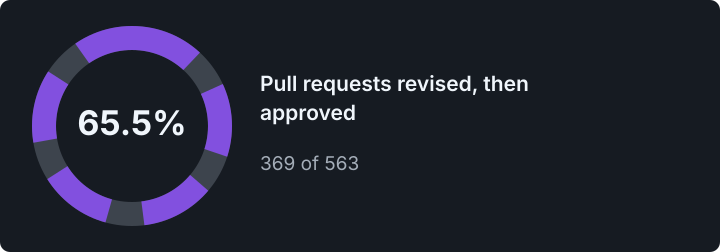
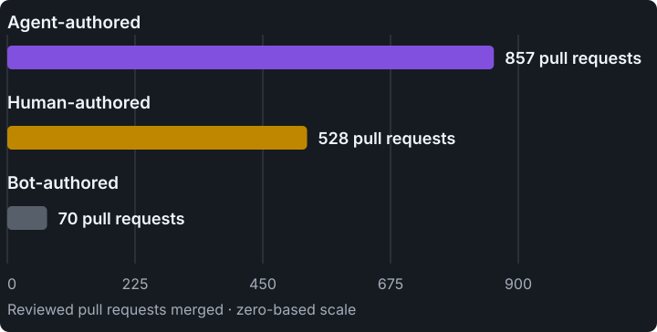
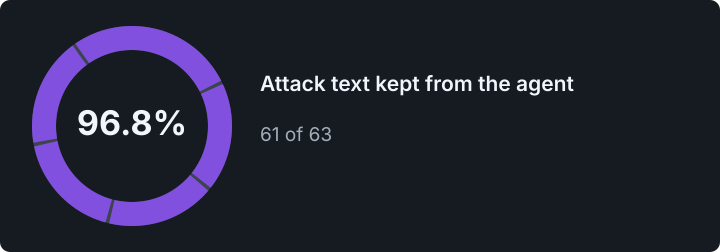
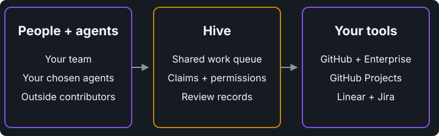

<p align="center">
  
</p>

<h1 align="center">Hive</h1>

<p align="center">
  <em>Useful work. Clear limits. A record you can follow.</em>
</p>

<p align="center">
  <a href="#install">Get started</a> ·
  <a href="src/docs/what-is-hive.md">Overview</a> ·
  <a href="#community">Community</a>
</p>

<p align="center">
  <a href="https://www.twitch.tv/hivecommons"></a>
</p>

---

Hive helps people and AI agents work together across their projects.

It connects the work, the rules and the review history. Bring your own agents. You decide what they can do.

Keep code in **GitHub or GitHub Enterprise**. Bring tasks from **GitHub Issues, GitHub Projects, Linear or Jira**.

[See integrations](src/docs/integrations.md).

## Trust

**See whether feedback leads to a change.**

Hive keeps reviews and updates together. You can see what was asked, what changed and who approved it.



Pull requests revised, then approved: **65.5% (369 / 563)**.

Of 563 pull requests sent back for changes, 369 had an updated version approved. The other 194 had no later approval recorded. Approval does not prove the code is right.

[Data](https://github.com/hivecommons/hive/blob/6c7cb37b9ef20830d23795ee248e552705c3acc1/src/docs/benchmarks/outcomes-2026-10.json) · [How it was counted](https://github.com/hivecommons/hive/blob/6c7cb37b9ef20830d23795ee248e552705c3acc1/src/docs/benchmarks/outcomes-2026-10.md#what-the-readme-shows-and-leaves-out)

[How reviews are tracked](src/docs/review-evidence.md).

## Productivity

**Move useful work forward.**

Hive works on issues, pull requests and failed checks. People and agents share the work.



**857** agent-authored, **528** human-authored and **70** bot-authored pull requests.

October 27, 2026: 1,455 merged pull requests with a Hive review, from one Hive. These counts do not measure time saved or productivity gained.

[Data](https://github.com/hivecommons/hive/blob/6c7cb37b9ef20830d23795ee248e552705c3acc1/src/docs/benchmarks/outcomes-2026-10.json) · [How it was counted](https://github.com/hivecommons/hive/blob/6c7cb37b9ef20830d23795ee248e552705c3acc1/src/docs/benchmarks/outcomes-2026-10.md#scale)

For example, a review caught a compile error in [pluk#328](https://github.com/hivecommons/pluk/pull/328#pullrequestreview-5607075007). An updated version was approved about ten minutes later.

## Efficiency

**Cut repeat work.**

Task claims help avoid duplicate work. Budgets and retry limits keep failed attempts from running on.

Contributors can use their own agents and model plans. Their model keys stay on their machines.

[Share work](src/docs/contributor-relay.md) · [Set limits](src/docs/security-model.md).

## Governance

**Decide who can do what before the work starts.**

Set who can view, change settings and merge. Keep human holds and your repo's branch rules.

Hive also checks outside text for hidden instructions before an agent reads it.



Attack text kept from the agent: **96.8% (61 / 63)**.

Hive's own test, October 23, 2026. Two of 63 attack inputs got through. This small test does not show how well Hive stops real attacks.

[Test and misses](https://github.com/hivecommons/hive/blob/6c7cb37b9ef20830d23795ee248e552705c3acc1/src/docs/ioscan-red-team.md#results) · [Data](https://github.com/hivecommons/hive/blob/6c7cb37b9ef20830d23795ee248e552705c3acc1/src/docs/benchmarks/red-team-2026-10.json)

The filter made mistakes too: it removed safe text in **1 of 12 harmless test cases**.

[Permissions](src/docs/acmm-policy-matrix.md) · [Test details](src/docs/ioscan-red-team.md).

## Auditability

**See what happened and why.**

Logs show actions and who took them. Review records link a change to its reviews and checks.

These records must be enabled. Some fields and signatures are optional. They are not a complete audit.

[Review records](src/docs/review-evidence.md) · [Activity logs](src/docs/audit-log.md).

## What Hive adds

An agent can write code. Hive connects agents to a shared queue, project rules and review records.



Work stays with the project, not just one chat. You can bring different agents and run several Hives under one hub.

[How it fits together](src/docs/architecture.md) · [Agent setup](src/docs/agent-configuration.md).

### About the numbers

The review charts use an October 27 snapshot from one Hive. They show activity, not time saved or proof of better code.

[Sources and limits](src/docs/benchmarks/outcomes-2026-10.md#methodology).

## Install

Start with the [getting-started guide](src/docs/getting-started.md).

```bash
git clone https://github.com/hivecommons/hive.git
cd hive
```

Choose how to run it:

| Run Hive | Start here |
| --- | --- |
| Docker Compose | [Compose quick start](src/docs/quickstart-docker-compose.md) |
| Podman | [Podman quick start](src/docs/quickstart-podman.md) |
| Kubernetes | [Deployment guide](src/docs/kubernetes-deployment.md) |
| Hosted | [Hosted guide](src/docs/hosted-hub.md) · [Open the service](https://hive.hivecommons.dev) |

Use official images from `ghcr.io/hivecommons/hive`.

## Community

[First contribution](docs/getting-started-contributing.md) · [Contributing](CONTRIBUTING.md) · [Contribute compute](src/docs/contributor-relay.md) · [Discord](https://hivecommons.dev/discord) · [Live stream (Twitch)](https://www.twitch.tv/hivecommons) · [Discussions](https://github.com/orgs/hivecommons/discussions).

[Code of Conduct](CODE_OF_CONDUCT.md) · [Project governance](GOVERNANCE.md) · [Report a vulnerability](SECURITY.md) · [Telemetry](src/docs/telemetry.md).

[Adopters](ADOPTERS.md) · [Repositories](docs/repositories.md) · [Changelog](CHANGELOG.md) · [OpenSSF Best Practices](https://www.bestpractices.dev/projects/14261).

---

[Apache-2.0](LICENSE). Hive is a [CNCF](https://www.cncf.io/) sandbox project ([onboarding status](src/docs/cncf-sandbox-onboarding.md)) and follows the [CNCF Code of Conduct](CODE_OF_CONDUCT.md).

Copyright The Linux Foundation and Hive contributors. [Trademark policy](https://www.linuxfoundation.org/legal/trademark-usage).
