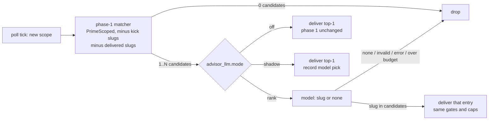

# RFC #17054: LLM-ranked knowledge advisor (phase 2)

Status: proposal, for discussion on #17054  
Refs: #17054, #17052 (phase 1, implemented by PR #17068), #17045 / PR #17060
(scoped entries), #17043, 2026-11-05 Hive Commons community meeting

## Summary

Phase 1 (#17052) is a pure matcher. The runtime parses each agent's pane for
scopes it has entered since the kick: a source directory, or a `gh` command
family. It asks the hive-side `crux.KnowledgeAdviser` for matching entries
(`Primer.PrimeScoped`, BM25 + Fisher-Rao), then types up to
`knowledge.advisor_max_per_kick` `📚 Knowledge:` lines into the live session.

This RFC proposes an optional **advisor pass** that runs between the matcher
and delivery. A small model gets the kick's task summary, the tail of the
agent's pane, and the matcher's candidates. It returns either nothing or **one
candidate slug** plus a one-sentence reason. The runtime then delivers the
chosen entry with phase 1's primitive, line format, caps and gates.

The recommendations, argued below:

| Question | Recommendation |
| --- | --- |
| Ranker vs. generator | **Rank only.** The model returns a slug, which must be one of the candidates. The agent never sees model-written text: the reason goes to the decision record, not to the pane. |
| Budget | Per-agent hourly call cap plus a fleet-wide daily cap. Both are hive-side counters, charged to the hive's `governor.litellm` key and attributed per agent. The pass does not draw on the agent's own backend spend. |
| Where it runs | In the hive process, behind phase 1's `KnowledgeAdviser` seam. The model call must not run on the poll goroutine. Sidecar support comes with phase 1's planned `/v1/knowledge/advise` callback. |
| Signal | Kick summary plus the last 80 pane lines (scrubbed). No proxy GitHub calls and no JSONL transcript in the first cut. |
| Measurement | A shadow mode, then a per-kick holdout, with outcomes compared from the retro lane's existing counters. No "did this help" line. |

## What exists today

All of the following are on `v5` unless noted:

- **Matcher.** `knowledge.Primer.PrimeScoped(ctx, scope, filePaths, keywords)`
  in `src/pkg/knowledge/primer.go` runs BM25 search over the wiki layers and
  the local `FileStore`. It then applies lifecycle and scope filters,
  Fisher-Rao reranking (blended with BM25 weight 0.4) and priority, and cuts
  to `MaxFacts`. The kick calls it from `Scheduler.primeKnowledge`
  (`src/pkg/scheduler/kick_priming.go`).
- **Phase 1 seam (PR #17068, open).** `crux.KnowledgeAdviser` has two methods:
  - `Policy(agent)`
  - `Advise(agent, KnowledgeScope) []KnowledgeAdvice`

  The contract is that `Advise` "runs on the agent's poll goroutine and must
  be bounded". The hive-side implementation (`cmd/hive/knowledge_adviser.go`)
  gives `PrimeScoped` a 5 s timeout and returns at most 2 entries per scope.
  Deliveries are recorded in prompt history with the trigger
  `knowledge-advisor`. The seam is in-process only: in sidecar mode the
  runtime has no adviser.
- **In-process model calls.** Hive has no shared completion helper. Each
  feature carries its own small OpenAI-compatible client with a
  `Complete(ctx, messages, maxTokens)` method:
  - the retro analysis, `src/pkg/retro/analysis.go` (`retro.analysis_model`);
  - the trajectory reviewer, `src/crux/trajectory` (`governor.trajectory`,
    resolved by `GovernorConfig.ResolveReviewer`);
  - the ioscan classifier, `src/pkg/ioscan`. It wraps its CLI client in a
    per-UTC-day call cap (`NewDailyQuotaClassifier`, `cli_daily_quota`).

  All of these default to the `governor.litellm` endpoint and key. The retro
  analysis makes no model call while `retro.analysis_model` is empty. Model
  output is parsed with `jsonextract.Object`.
- **"Advisor" in the codebase today is not a model tier.** The `advisor` tier
  in `hub.tier_limits` / `ContributorLaneGrantableTiers` is a contributor
  trust tier. The `advisor` GitHub token tier (`AgentMode.TokenTier`) mints
  read-only tokens. OMP's `--advisor` model is display-only metadata on
  contributor PRs. The issue's "the `advisor` lane tier" therefore has nothing
  to route to. The advisor pass needs its own model setting, like
  `retro.analysis_model`.
- **Per-agent budget precedent.** `src/crux/proxy/agent_github_budget.go`
  counts each agent's GitHub API calls through the proxy in a rolling one-hour
  window (`agents.github_api_hourly_cap`, default 300).
- **Pane scrubbing.** `crux/logscrub.RedactPaneTokens` and `ScrubString`
  already redact GitHub tokens, `sk-…` keys and the per-agent `sk-hive-<agent>`
  LiteLLM keys from pane text before it leaves the runtime.
- **Retro lane.** The model call is in `pkg/retro` (`Lane.Run` →
  `Analyzer.Analyze`). It works on a compact `RetroRecord` of counters (fix
  attempts, kicks, drift pauses) plus PR and issue refs. `pkg/knowledge/retro_lesson.go`
  only quality-gates, dedupes and stores the resulting lesson. Neither reads a
  PR body or a diff, so "the retro pass looks for the slug in the PR" would be
  new code, not an existing hook.

## Design

### Pipeline



1. **Candidates.** The phase-1 matcher runs unchanged. It asks for up to
   `candidates` (default 5) entries instead of 2. Entries the kick block
   rendered or that were already delivered this kick are removed first. With
   zero candidates, no model call is made.
2. **Call.** One chat completion with `temperature: 0` and a small output cap
   (about 120 tokens). The response must be one JSON object:
   `{"slug": "<candidate slug>" | null, "reason": "<≤200 chars>"}`.
3. **Validation.** The runtime parses the object with `jsonextract.Object`.
   A `slug` that is not exactly one of the candidates, or a malformed
   response, is treated as `null`. The pass never invents an entry. There is
   no corrective retry: a wrong answer costs at most one silent scope, while a
   retry doubles the spend.
4. **Delivery.** The runtime types the chosen entry using phase 1's line
   (`📚 Knowledge: <title> — <summary> (full: <ref>)`). Phase 1's
   `advisor_max_per_kick`, cooldown, mid-tool-call, attached-human and
   `kickDelivering` gates all apply. The model's `reason` is **not typed**. It
   is recorded with the decision (see Measurement).

### Ranker vs. generator: rank only

Generation, which is what OMP's advisor does, lets the model write the hint.
This RFC rejects generation for the first LLM cut, for three reasons:

- **Audit.** Every line an agent receives stays a stored, reviewable
  knowledge entry with a slug and a source. "Why did the agent do X?" can be
  answered from the entry, not from a model sample that no longer exists.
- **Prompt injection.** The pane holds untrusted text: issue bodies, PR
  comments and tool output from strangers. The rank-only output space is the
  set {candidates} ∪ {nothing}. A hostile pane can at most make the advisor
  pick a weaker candidate or stay silent. It cannot make the runtime type
  attacker-chosen text into another agent's session. This is also why the
  `reason` is not typed: it is model-generated free text derived from that
  same pane.
- **Phase-1 bound preserved.** #17052's invariant is "the advisor can never
  show an agent something its kick could not". Rank-only keeps it.

Generation can be reconsidered once there is measured evidence that ranked
entries are acted on, and that their wording, not their selection, is the
bottleneck.

### Timing

Phase 1 fires on the first sighting of a scope. The advisor pass handles
timing in two ways:

- **`null` is a first-class answer.** The prompt tells the model to return
  `null` unless the pane shows the agent about to act in this scope, for
  example opening a file for edit or composing a `gh` command. A passing
  `grep` should get `null`.
- **One re-evaluation per scope.** A `null` decision leaves the scope
  eligible for exactly one more call. That call happens when the runtime next
  sees an **edit** in the scope (for `gh` scopes, the next command in the
  family). This requires phase 1's scope parser to tag each observation as
  read, edit or run. The pane lines it parses (`⏺ Read(…)`, `● Edit …`,
  `$ gh …`) already distinguish them. A scope is therefore evaluated at most
  twice per kick.

### Where it runs: hive process, off the poll goroutine

The pass runs **in the hive process**, as a decorator over phase 1's hive-side
`KnowledgeAdviser`. The hive process holds the knowledge store, the Primer and
the `governor.litellm` credentials. A Crux-side hook would need all three
shipped to the runtime, and would also put an inference key in the sidecar.

The phase-1 `Advise` contract has to change first. Phase 1 calls `Advise`
synchronously on the agent's 3 s poll goroutine. That is acceptable for a
bounded local search, but a model call takes seconds and would stall
everything else that tick serves, such as the CI-poll guard. Proposed change,
which also benefits phase 1's 5 s Primer timeout:

- The runtime calls `Advise` on a separate goroutine, with **at most one call
  in flight per agent**. New scopes seen while a call is running are queued,
  newest first, and capped at the remaining per-kick allowance.
- The result is held until a later poll tick passes the existing delivery
  gates. It is dropped if the kick has changed in the meantime. The check
  compares the kick identity captured when the call was made with the
  current one.
- `KnowledgeScope` gains an `Action` field (`read` / `edit` / `run`) and a
  `PaneTail string`. The runtime fills `PaneTail` only when the policy says
  the adviser wants it. Phase 1's policy never asks, so phase 1 never ships
  pane text across the seam.

**Sidecar.** Phase 1 already names a `/v1/knowledge/advise` callback route as
the follow-up for sidecar hives. The advisor pass would use the same route,
because the hive side does the work. No Crux-side model call is proposed.

### Signal: pane tail plus kick summary only

The model's input:

- **Kick summary**, at most 600 chars: the primed issue/PR refs, titles and
  labels that `primeKnowledge` already extracts keywords from. The hive-side
  adviser keeps this per agent, set when the scheduler primes a kick.
- **Pane tail**: the last `pane_lines` (default 80) lines of the scrollback
  the poller already captured, passed through `logscrub.RedactPaneTokens`
  before it crosses the seam.
- **Candidates**: slug, title, and the same at most 300-char summary phase 1
  would type. No full entry bodies.

Excluded from the first cut:

- **Proxy GitHub calls.** The proxy sees API paths. For "which `gh` family is
  the agent in", that adds nothing beyond phase 1's `gh` scope, and wiring it
  in would couple the advisor to `crux/proxy`.
- **JSONL transcript (`kick_log_source: transcript`).** Readers exist only for
  `claude` and `copilot`. Transcripts carry full tool outputs (more tokens and
  more secret surface), and they would make the advisor's behaviour depend on
  the backend. If shadow-mode data shows the pane tail is too thin, this is
  the first signal to add, behind the same scrubber.

### Budget

The pass uses the hive's model, not the agent's, so it is hive spend:

- **Per agent:** `max_calls_per_agent_hour`, default 6. This is a rolling
  one-hour window counted the same way `agent_github_budget.go` counts GitHub
  calls.
- **Fleet:** `max_calls_per_day`, default 300. This is a per-UTC-day counter,
  following ioscan's `NewDailyQuotaClassifier`.
- **Attribution:** each request sets the OpenAI `user` field to
  `hive-knowledge-advisor:<agent>`, so LiteLLM spend logs show per-agent cost
  without hive running its own spend ledger. The decision record carries
  prompt and completion token counts from the response's `usage`.
- **Over budget, timeout (`timeout_s`, default 15) or endpoint error:** the
  scope is treated as `null` and a decision record with the outcome is
  written. The pass falls back to silence, not to phase 1's top-1. The pass
  exists to cut noise, and silently reverting to the noisier behaviour under
  load would hide that it had stopped working. Operators who want the matcher
  back can set `mode: off`.

Charging the agent's own spend was rejected. Many agents run on subscription
CLIs with no per-call meter. Where an agent does have a LiteLLM virtual key,
spending it on advice would let the advisor exhaust the agent's own budget.

### Configuration

```yaml
knowledge:
  advisor: true                  # phase 1 switch (#17052); required
  advisor_llm:
    mode: off                    # off | shadow | rank
    model: ""                    # required for shadow/rank; empty = off
    endpoint: ""                 # default governor.litellm endpoint
    api_key_env: ""              # / api_key_file; default governor.litellm key
    candidates: 5
    pane_lines: 80
    timeout_s: 15
    max_calls_per_agent_hour: 6
    max_calls_per_day: 300
    holdout_percent: 0           # rank mode: % of kicks that decide but never deliver
```

`advisor_exclude_agents` and `advisor_max_per_kick` from phase 1 apply
unchanged. The endpoint, key and model resolve the same way as
`GovernorConfig.ResolveReviewer`.

### Measurement

Each model decision writes one `knowledge advisor: decision` log line and,
when something is delivered, one prompt-history entry with trigger
`knowledge-advisor`, exactly as phase 1 does. The log line carries:

- agent, kick identity and scope (kind, key, action);
- the candidate slugs;
- the pick (or `null`), the reason, and the outcome (`delivered`,
  `held-out`, `gated`, `invalid`, `timeout`, `over-budget`, `error`);
- latency and token counts.

Rollout:

1. **Shadow.** `mode: shadow` delivers phase 1's top-1 and logs what the model
   would have picked. A week on hive's own hive answers the cheap questions
   with no behaviour change: how often the model says `null`, how often it
   picks something other than the matcher's top-1, the cost per kick, and the
   latency.
2. **Rank with holdout.** `mode: rank`, `holdout_percent: 50`. The kick
   identity is hashed into the delivery arm or the holdout arm. Holdout kicks
   make the call and log the pick but type nothing. This gives a control group
   with the same selection, which "did the agent mention the slug" never
   gives.
3. **Outcome comparison.** The retro lane already reconstructs per-bead fix
   attempts, kicks and drift pauses (`RetroRecord`). A small addition gives
   each record the advisor arm of its kicks. Comparing the two arms on those
   counters answers "did delivered advice help" with existing data. It needs
   no new model call and no agent cooperation.

An explicit "did this help" line from the agent is rejected. It spends an
agent turn on every delivery, agents tend to answer yes, compliance varies by
backend, and it adds lines to transcripts that the retro and log consumers
would then have to filter out. Searching the PR for the slug is also rejected
as the primary signal. Agents act on a rule without citing it, so the search
undercounts, and it measures citation, not effect.

## Non-goals

- Changing the entry format or the kick-time primer (#17045, #17043).
- Pull-based mid-task lookups by agents (the `/mcp/knowledge` endpoint).
- Generated hints (see "Ranker vs. generator").
- Any delivery path other than phase 1's.

## Implementation slices

Each slice is independent once phase 1 (PR #17068) lands:

1. **Runtime.** Make `Advise` asynchronous: one call in flight per agent, a
   kick-identity check at delivery, and the `KnowledgeScope.Action` /
   `PaneTail` fields. No behaviour change with phase 1's adviser.
2. **Hive.** Add the `knowledge.advisor_llm` config and the ranking decorator
   with validation, budgets, the decision log line, and modes
   `off`/`shadow`/`rank` plus holdout.
3. **Retro.** Record each bead's advisor arm in `RetroRecord` for the outcome
   comparison.
4. **Sidecar.** The `/v1/knowledge/advise` callback, shared with phase 1's
   sidecar follow-up.

## Open for discussion

- Is a per-agent-hour default of 6 calls with a fleet default of 300 per day
  the right order of magnitude for hive's own fleet, or should shadow data
  set the defaults?
- Should the second evaluation of a scope also be allowed on a long gap, for
  example 10 minutes later, rather than only on the first edit?
- Once rank mode has data, should the reason be shown to agents as a
  separately marked line? It is model text, so this reopens the injection
  question above.
