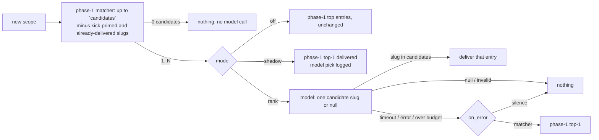

# How Hive injects knowledge and memory into agents

> Written to answer the 2026-11-05 community-meeting question "how does
> Hive's memory/knowledge injection work today?". It describes `v5` as of
> this page's merge; the [Known gaps](#known-gaps--in-progress) section links
> the work that will change the memory half.

Hive agents receive context from **three distinct layers**, and only one of
them is Hive's own:

| Layer | Who owns it | Where it lives | Hive's role |
|---|---|---|---|
| **Knowledge** — curated facts about the repos and the fleet | Hive (`pkg/knowledge`) | File vaults under `/data/knowledge/…`, optional HTTP wiki layers | Selects a few facts per kick and **pushes** them into the kick prompt; also serves them for **pull** via API/MCP/`hivectl` |
| **Conversation** — the current chat in the CLI pane | The CLI | In the CLI process | Resets it before every kick (`/clear`) |
| **CLI memory** — the CLI's own persistent, cross-session notes (Claude Code auto-memory, Codex memories, Gemini `GEMINI.md`, …) | The CLI | Dot-directories under the agent's `HOME` | **None.** Hive neither feeds, reads, filters nor clears it; it only decides which agents share the directory |

The confusion at the meeting was between layers 2 and 3: "every agent clears
its context before it runs" is true of the conversation and false of CLI
memory.

## 1. Knowledge: the kick primer (push)

```
 knowledge.vaults / git_sources / connectors / bead_synthesizer vault
   (FileStore per source; HTTP wiki layers for personal/project/org/community)
                              │
   registerKnowledgeStores (cmd/hive/boot_knowledge_primer.go)
                              ▼
 ┌───────────────── Scheduler.primeKnowledge (pkg/scheduler/kick_priming.go) ───┐
 │ 1. extractKeywordsFor ← titles + labels of the agent's first                 │
 │    maxIssuesToPrime (=5) queued issues, minus what the hive put              │
 │    there: routing labels (stage/, agent/, origin/, hive/, needs-,            │
 │    never-claim, Prow's, …), the complexity tier, a filer tag                 │
 │    naming a hive agent and the "Review backlog (<p>):" stem; when            │
 │    that leaves nothing, or matches no entry in step 3, the search            │
 │    uses the pre-filter query instead (legacyKeywords)                        │
 │ 2. scope ← knowledge.agent_scopes[<agent>] (or base agent for a replica)     │
 │ 3. Primer.PrimeScoped (pkg/knowledge/primer.go)                              │
 │      search every layer/store → merge by layer precedence →                  │
 │      FilterByLifecycle (approved only) → scope.Filter →                      │
 │      Fisher-Rao rerank → type priority → cap at max_facts (25) →             │
 │      expandWithGraph (never past the scope) → Context7 hints                 │
 │ 4. PrimedKnowledge.Render (primer_render.go): "# Relevant Knowledge",        │
 │    grouped by type, whole facts dropped past max_bytes (8192),               │
 │    "_… truncated: N facts / M bytes omitted (size cap)._" marker             │
 └──────────────────────────────────────────────────────────────────────────────┘
                              │
   templates.go: skills section + AGENTS.md section + knowledge section
   substituted into the agent's kick template; lane kicks (lane_messages.go)
   append the knowledge section for scanner / quality / architect / <agent>
                              ▼
   tmux: [/clear ⏎]  then the kick text  ⏎        (crux/agent/manager_kick.go)
```

**Where the facts come from.** Everything the primer searches is registered
in `registerKnowledgeStores` (`src/cmd/hive/boot_knowledge_primer.go`):
configured `knowledge.vaults` (personal layer), `knowledge.git_sources`
(layer from config), connector output, the **bead synthesizer vault**
(closed beads from every agent, classified into fact types — the main
organic source on a running hive), plus any HTTP wiki layers in
`knowledge.layers`. The repo's own docs are *not* a source unless you index
them through a git source, connector or code map
([knowledge-curator.md](knowledge-curator.md)) — with one seeded default:
a hive whose `knowledge.git_sources` key is absent gets one entry for its
primary repo's knowledge directory at boot
(`seedKnowledgeGitSource`, `src/cmd/hive/boot_knowledge_seed.go`). The
probe asks GitHub for the repo's default branch, then for
`knowledge.bead_synthesizer.publish.path` if set, else `docs/knowledge/`
then `src/docs/knowledge/`; the first that exists becomes
`<repo>-knowledge` at the `project` layer. Nothing is written to
`hive.yaml`; an operator list — including an explicit `git_sources: []`,
which is what a dashboard disconnect saves — is never touched, and a
missing dir, non-GitHub forge or absent client skips with a DEBUG line.

**How it is scoped.**

- *By the work, not the repo:* the query is keywords from the titles and
  labels of the agent's first five queued issues (`extractKeywords`,
  `isNoiseLabel`). There is no automatic per-repo or per-issue filter; a fact
  tagged with another repo can surface if the keywords match.
- *By agent:* `knowledge.agent_scopes.<agent>` is an allow-list of `layers`,
  `repos`, `types`, `tags` (`KnowledgeAgentScope` in
  `src/pkg/config/knowledge_config.go`). It is applied inside
  `Primer.PrimeScoped` *after* the lifecycle filter and can only narrow; graph
  expansion never pulls in an out-of-scope fact. A replica inherits its base
  agent's entry (`Config.KnowledgeAgentScope`). No entry means unrestricted.
- *By lifecycle:* kicks carry **approved facts only** by default. The kick
  primer is built with no `IncludeStates` (`newKnowledgePrimer` in
  `src/cmd/hive/main.go`), so `deprecated` and `superseded` never reach a kick
  and `agent_scopes.include_states` only widens API/TOC reads that already
  asked for those states ([knowledge-lifecycle.md](knowledge-lifecycle.md)).
  The one kick-path exception is an agent's **own drafts** (#17076): when the
  agent's `agent_scopes` entry lists `draft` (or `all`) in `include_states`,
  drafts whose `author:` (or `owner:`) frontmatter is that agent, its base
  agent or one of the hive's owner logins are primed too, each marked
  `(draft)` in the kick (`kickDraftAuthors` in `kick_priming.go`,
  `TOCScope.DraftAuthors`). Drafts by anyone else, and drafts with no author,
  are still excluded.

**Size caps** (all drop whole units, never clip, and leave a visible marker):

| Block | Cap | Config |
|---|---|---|
| `# Relevant Knowledge` | 25 facts, 8192 bytes (floor 512) | `knowledge.primer.max_facts`, `knowledge.primer.max_bytes` |
| Repo `AGENTS.md` | 8192 bytes (floor 2048), whole sections | `project.agents_md_max_bytes` (`agentsmd.DefaultMaxInjectionBytes`) |
| Declared skills | 8192 bytes, whole skills | `maxSkillsInjectionBytes` in `kick_priming.go` (fixed) |

**Switches.** `knowledge.enabled` gates the primer only — the bead synthesizer
still writes facts when it is off, they just reach no kick. The dashboard
knowledge toggle registers/unregisters the primer live
(`knowledgePrimerControl`). `knowledge.enabled: false` or an empty keyword set
means the kick simply has no knowledge section.

**Mid-task advisor.** After the kick, the opt-in advisor (`knowledge.advisor`)
types one `📚 Knowledge:` line when the pane shows the agent entering a new
scope. Each scope is tagged `read`, `edit` or `run` from its pane line and
asked about at most twice per kick: on first sight, and on its first edit or
next `gh` command. The adviser runs off the poll goroutine with one call in
flight per agent. A result is held until a tick passes the delivery gates and
dropped if the kick changed meanwhile. See
[knowledge-curator.md](knowledge-curator.md#mid-task-knowledge-advisor-knowledgeadvisor).

## 2. Knowledge: pull access

Agents (and external tools) can fetch what the primer did not push:
`GET /api/knowledge/toc` and `/api/knowledge/entry/{id}` (pass `agent=` to
apply that agent's scope), `GET /api/knowledge/effective?agent=` to see what
a given agent is allowed to see and why entries are excluded, the public
`POST /mcp/knowledge` MCP (`knowledge_toc`, `knowledge_get`), `hivectl
knowledge search|list`, and `bd kb search` inside the pod. See
[knowledge-toc.md](knowledge-toc.md) and
[public-knowledge-mcp.md](public-knowledge-mcp.md).

The mid-task advisor (`knowledge.advisor`) can rank its candidates with a
model; its `knowledge.advisor_llm` block carries hard budget ceilings (6 calls
per agent-hour, 300 per day) that only `budget_override: true` lifts. See
[Model-ranked advisor](#model-ranked-advisor-knowledgeadvisor_llm) below and
[knowledge-curator.md](knowledge-curator.md#model-ranked-advisor-knowledgeadvisor_llm).

### Model-ranked advisor (`knowledge.advisor_llm`)

When `knowledge.advisor_llm` resolves at startup (the advisor is on and an
endpoint and key come from the block or `governor.litellm`), a ranking pass
wraps the phase-1 matcher in the hive process
(hivecommons/hive#17155, RFC `docs/rfc-17054-llm-ranked-knowledge-advisor.md`).
It re-reads the block on every call, so `mode: off` returns to phase 1 without
a restart. The pass ranks; it never writes. The agent only ever receives a
stored knowledge entry, typed with phase 1's `📚 Knowledge:` line and gates.



- **Input.** The kick summary (primed issue refs, titles and labels, at most
  600 characters), the runtime's scrubbed pane tail (`pane_lines`, verbatim)
  and each candidate as `slug — title — summary` with the same ≤300-character
  summary phase 1 would type. Entry bodies never reach the model.
- **Endpoint path.** A bare host gets `/v1/chat/completions`, a base ending in
  `/v1` gets `/chat/completions`, and an endpoint already ending in
  `/chat/completions` is used as-is. For the Copilot API set
  `endpoint: https://api.githubcopilot.com/chat/completions` with
  `api_key_file: /data/copilot-user-token`. Do not use the bare
  `https://api.githubcopilot.com` host: it would get `/v1/chat/completions`
  appended, and the Copilot API has no `/v1` prefix, so the call 404s (and
  under `on_error: silence` the advisor is disabled silently).
- **Call.** One chat completion per decision: `temperature: 0`, about 120
  output tokens, `timeout_s`, and the `user` field set to
  `hive-knowledge-advisor:<agent>` so proxy spend logs attribute cost per
  agent. The answer must be `{"slug": <candidate>|null, "reason": "..."}`;
  a slug that is not exactly a candidate, or a malformed answer, is `invalid`
  and treated as `null`. There is no retry, and the `reason` is logged, never
  typed.
- **Modes.** `shadow` delivers phase 1's top entry and records what the model
  would have picked. `rank` delivers the model's pick; with
  `holdout_percent`, the kick identity is hashed into a delivery or holdout
  arm, and holdout kicks make the call and log the pick but type nothing.
  A valid `null` never falls back to the matcher; `on_error: matcher` only
  covers timeouts, endpoint errors and exhausted budgets.
- **Budgets.** A rolling one-hour window per agent
  (`max_calls_per_agent_hour`, default and ceiling 6) and a per-UTC-day fleet
  counter (`max_calls_per_day`, default and ceiling 300). An exhausted budget
  makes no request and is handled like an error.
- **Decision log.** Every model decision writes one line:

  ```
  knowledge advisor: decision agent=… kick=… mode=rank scope_kind=path scope_key=src/pkg/x scope_action=edit
    candidates=a,b,c pick=b reason="…" verdict=pick outcome=delivered delivered=b
    latency_ms=… prompt_tokens=… completion_tokens=…
  ```

  `verdict` is what the model produced (`pick`, `null`, `invalid`,
  `timeout`, `over-budget`, `error`); `outcome` is what happened to delivery
  (`delivered`, `held-out`, `gated` when the kick moved during the call,
  `fallback-matcher`, or the verdict when nothing was typed). Over-budget
  lines also carry `budget=agent-hour|fleet-day`. Delivered lines still land
  in the prompt history under trigger `knowledge-advisor`.
- **Decision store.** Each decision, held-out ones included, also appends one
  compact record (agent, kick id, the kick's primed issue/PR refs, mode, arm
  `shadow|deliver|holdout`, outcome, slug; never the reason or pane text) to
  `/data/knowledge-advisor-decisions.jsonl`, which the retro lane reads to
  assign each bead its advisor arm (see
  [retro-lane.md](retro-lane.md#knowledge-advisor-arm)).

**Rollout.** Start with `mode: shadow` for about a week: delivery is
unchanged, and the decision lines show how often the model says `null`, how
often it disagrees with the matcher's top entry, the cost per kick and the
latency. Then switch to `mode: rank` with `holdout_percent: 50` so half the
kicks form a control group with the same selection, and compare the two arms'
outcomes. Lower `holdout_percent` once the comparison is settled; `mode: off`
returns to phase 1 at any time.

## 3. AGENTS.md / CLAUDE.md: injected by Hive, not read natively

Each agent's CLI starts in `/data/agents/<name>` (`crux.DefaultWorkDir`),
not inside a repository checkout, so the CLIs' native instruction-file
discovery (`AGENTS.md` for Codex/Copilot, `CLAUDE.md` for Claude Code,
`GEMINI.md`) finds **nothing from the monitored repo** at launch. Repo
instructions reach agents only through the scheduler: `primeAgentsMd` parses
`<project.checkouts_dir>/<repo>/AGENTS.md` for the agent's *primary* repo and
prepends the rendered block to the knowledge section (`templates.go`). Without
`project.checkouts_dir` (or a matching `policies.local_dir`) the block is
empty — see [agents-md.md](agents-md.md). Skills declared on the agent are
prepended the same way ([skills.md](skills.md)); the hive-wide house style
precedes both ([house-style.md](house-style.md)).

Two instruction files *are* read natively: a user-level
`~/.claude/CLAUDE.md` / `~/.gemini/GEMINI.md` if one exists. Since
[#17031](https://github.com/hivecommons/hive/issues/17031) those files live in
each agent's own `~/.claude` / `~/.gemini` (next section), so such a file
applies to that agent only.

## 4. CLI memory and conversation: what Hive does and does not touch

**Conversation.** `clear_on_kick` defaults to `true` (`ClearOnKick`,
`src/pkg/config/config.go`). `deliverKickLocked` in
`src/crux/agent/manager_kick.go` types `/clear` ⏎ before the kick text for
every TUI backend (agy headless starts a new conversation instead). The one
exception is a PR follow-up delivered with `SendResumeKick`
(`pr_session_resume.go`), which deliberately continues the authoring
conversation. `/clear` empties the chat; it does not touch anything on disk.

**Home layout** (`interactive_home.go`, `manager_env.go`, `manager_homes.go`):

- Per-UID agents get `HOME=/data/home/agents/<name>` (`AgentHome`,
  `interactiveHomePath`) with per-agent `XDG_DATA_HOME`/`XDG_STATE_HOME` under
  `~/.local` (`setupAgentXDGDirs`). `/data/home` is the persistent volume.
- `interactiveHomeBridgeDirs` symlinks `.config`, `.codex` and `.cache` from
  every per-agent home to the **same** directories under `/data/home`, so one
  login authenticates the fleet. Those hold credentials/config and caches only.
- Real per-agent directories with narrow, credential-only bridges inside them
  (`perAgentCLIHomes`, [#17031](https://github.com/hivecommons/hive/issues/17031)):
  `~/.claude` (only `.credentials.json` and `settings.json` shared —
  `projects/` with transcripts and auto-memory, `todos/`, `history.jsonl` and a
  user-level `CLAUDE.md` are per-agent), `~/.gemini` (only sign-in files,
  `settings.json` and `antigravity-cli/` shared — `GEMINI.md` and `tmp/`
  per-agent), `~/.bob` (only `settings.json` / `settings/` shared), `~/.copilot`
  (only `config.json` shared, #9444). Also per-agent: `~/.local`,
  `.claude.json`, `.npm`, `.gitconfig` (#9478). Codex gets
  `CODEX_HOME=/data/home/.codex-<name>` with only `auth.json` symlinked to the
  shared login (`setupCodexHome`, `codexHomePath`). Legacy whole-directory
  symlinks are retired on the next launch; nothing under `/data/home` is
  deleted — a pre-isolation `projects/*/memory` store is logged once for review.
  The full table is in [agent-configuration.md](agent-configuration.md#per-agent-homes-what-is-shared-and-what-is-private).
- `HIVE_SHARED_AGENT_HOME=1` forces the legacy single shared home for all.
- Inference (API-routed) agents use throwaway homes under
  `/tmp/.claude-inference-home-<name>` that vanish with the pod.
- Contributor containers stage only `.credentials.json` and `settings.json`
  into the container (`CLAUDE_STAGE_ALLOWLIST` in the `justfile`, #7836);
  transcripts, history and memory stay on the host. This is the one place
  memory is isolated by construction.

**Memory policy** (`agents.cli_memory`, `cli_memory.go`,
[#17032](https://github.com/hivecommons/hive/issues/17032)). `auto_memory`
defaults to **false**: Claude Code is launched with
`CLAUDE_CODE_DISABLE_AUTO_MEMORY=1`, Codex gets `[features] memories = false`
in `$CODEX_HOME/config.toml`, Copilot CLI gets `"memory": false` in its
per-agent `~/.copilot/settings.json`; Gemini has no equivalent switch.
`clear_on_kick` (default false) removes this agent's
`~/.claude/projects/*/memory/`, `$CODEX_HOME/memories*/` and
`~/.gemini/GEMINI.md` before each non-resume kick, next to the `/clear`. All
keys can be overridden per agent. With everything off, what each CLI
remembers it remembers across kicks and pod restarts — but, since #17031, not
across agents. See [agent-configuration.md](agent-configuration.md#cli-auto-memory-agentscli_memory).

**Memory → knowledge drain** (`agents.cli_memory.drain_to_knowledge`,
`src/crux/agent/cli_memory_drain.go`, `src/pkg/knowledge/climemory`,
[#17033](https://github.com/hivecommons/hive/issues/17033)). Default false.
When on, `deliverKickLocked` runs the drain before the wipe on every
non-resume kick: the manager lists the agent's own stores (never a shared or
symlinked one) and the hive converts them — Claude `MEMORY.md` plus its topic
files, every `*.md` under Codex `memories*/`, the `## Gemini Added Memories`
section of `GEMINI.md` — one bullet or paragraph per entry, into the
`bead-synth-wiki` vault that the Primer already reads
(`registerKnowledgeStores`, `src/cmd/hive/boot_knowledge_primer.go`). Each
entry is written with `state: draft`, `source: cli-memory`, `agent: <name>`,
`cli: <claude|codex|gemini>`, `repo: <org/repo>` when the Claude project slug
ends in one of the agent's repos, and a `memhash` (SHA-256 of the normalised
text) that makes the drain idempotent: a fact already in the vault, in any
state and under any file name, counts as a duplicate. A duplicate is never
rewritten; it only gains the draining agent's `agent:<name>` tag, so an
inference several agents reached on their own is one entry with one tag per
agent, and a fact an operator deprecated or superseded stays that way however
often a CLI writes it again ([#17056](https://github.com/hivecommons/hive/issues/17056)).
A memory file whose facts do not all reach the vault (the vault is
unwritable, or the 200-facts-per-drain cap was hit) is copied to
`/data/knowledge/auto-memory-spool/<agent>/` first, so the `clear_on_kick`
wipe that follows loses nothing; the agent's next drain retries the spool
before its live store and deletes each spooled copy once all its facts are
stored. The drain never blocks the kick. Because the Primer is
approved-only by default (section 1), a drained fact is **not** injected into
anyone's kick until an operator approves it through the normal lifecycle —
that review step is the point: the CLI's one-off inference becomes a
candidate, not a rule. One log line per drain:
`cli-memory: drained N facts from <agent> into bead-synth-wiki (dupes K, spooled S)`.
The drain needs the in-process crux runtime; the sidecar runtime logs a
warning and only wipes.

### What persists across what

Columns: a cadence **kick**; an explicit **`/clear`**; a **pod restart**; a
**new agent** added to the same hive. ✓ = survives / is visible, ✗ = gone /
not visible.

| | Kick | `/clear` | Pod restart | New agent in same hive |
|---|---|---|---|---|
| **Knowledge** (`# Relevant Knowledge`, AGENTS.md, skills) | re-selected for *this* kick's issues | n/a — re-injected next kick | ✓ vaults on `/data` | ✓ same stores, filtered by its own `agent_scopes` |
| **Conversation** — all CLIs | ✗ (`/clear` first, unless `clear_on_kick: false` or a resume kick) | ✗ | ✗ (CLI relaunched) | ✗ |
| **Claude Code memory** (`~/.claude/projects/-data-agents-<name>/memory/`, `~/.claude/CLAUDE.md`, `history.jsonl`) | ✓ unless `cli_memory.clear_on_kick` (and off by default: `auto_memory: false`); with `drain_to_knowledge` each fact lands as a draft knowledge entry first | ✓ | ✓ (`/data/home/agents/<name>/.claude` is persistent) | ✗ per-agent dir (#17031); only `.credentials.json` / `settings.json` shared. Before #17031 the whole tree was one bridged copy any agent could read or rewrite |
| **Codex memory** (`$CODEX_HOME`) | ✓ unless `cli_memory.clear_on_kick` (off by default); drained first with `drain_to_knowledge` | ✓ | ✓ (`/data/home/.codex-<name>`) | ✗ per-agent dir; only `auth.json` shared |
| **Copilot CLI memory/sessions** (`~/.copilot`) | ✓ | ✓ | ✓ | ✗ per-agent dir (#9444); only `config.json` shared |
| **Gemini memory** (`~/.gemini/GEMINI.md`, state) | ✓ unless `cli_memory.clear_on_kick`; drained first with `drain_to_knowledge` | ✓ | ✓ | ✗ per-agent dir (#17031); only sign-in files, `settings.json`, `antigravity-cli/` shared |
| **Bob memory/settings** (`~/.bob`) | ✓ | ✓ | ✓ | ✗ per-agent dir (#17031); only `settings.json` / `settings/` shared |

The dashboard's cost accounting reads `data.claude_sessions_dir` (default
`/data/home/.claude/projects`) **and** every per-agent sibling
`/data/home/agents/*/.claude/projects` (`ClaudeSessionTrees`,
`src/pkg/tokens/agent_home_trees.go`), attributing each per-agent tree to its
owner and falling back to the `-data-agents-<name>` project slug for the
shared tree (`claude_scanner.go`); `bob_sessions_dir` and
`copilot_sessions_dir` work the same way.

## Known gaps / in progress

Do not treat the following as current behaviour; follow the links.

- [#17031](https://github.com/hivecommons/hive/issues/17031) — fixed by
  [PR #17039](https://github.com/hivecommons/hive/pull/17039) (per-agent
  `.claude`/`.gemini`/`.bob`, described above). Hives upgraded from before it
  still hold the old shared store under `/data/home/.claude/projects`; it is
  left in place and logged once. Drain it with
  `hivectl knowledge drain-memory --legacy` (see
  [Auto-memory drafts](knowledge-lifecycle.md#auto-memory-drafts)) or remove
  it by hand.
- [#17032](https://github.com/hivecommons/hive/issues/17032) — done:
  `agents.cli_memory.auto_memory` (default off) and
  `agents.cli_memory.clear_on_kick`, described above.
- [#17033](https://github.com/hivecommons/hive/issues/17033) — done for the
  kick-time drain (`agents.cli_memory.drain_to_knowledge`, described above),
  the review flow, the hard exclusion of drained drafts from every agent read
  and the one-shot legacy drain
  ([#17058](https://github.com/hivecommons/hive/issues/17058)). Still open: a
  Claude Code `SessionEnd` hook that drains without waiting for the next kick
  ([#17057](https://github.com/hivecommons/hive/issues/17057)).
- Repo `AGENTS.md` injection still requires `project.checkouts_dir`; nearest-
  file (`ParseNearest`) targeting is deferred ([agents-md.md](agents-md.md)).

Closed history worth knowing: #7836 (contributor `~/.claude` staging), #9444
(Copilot session-state isolation), #9478 (per-agent `.gitconfig`), #11201
(`knowledge.agent_scopes`), #12124/#12129 (primer and AGENTS.md size caps),
#10524 (knowledge TOC, lifecycle, suggest).

## Related

[design/knowledge-system.md](design/knowledge-system.md) ·
[knowledge-curator.md](knowledge-curator.md) ·
[knowledge-lifecycle.md](knowledge-lifecycle.md) ·
[knowledge-toc.md](knowledge-toc.md) · [agents-md.md](agents-md.md) ·
[skills.md](skills.md) · [agent-configuration.md](agent-configuration.md) ·
[contributor-relay.md](contributor-relay.md)
