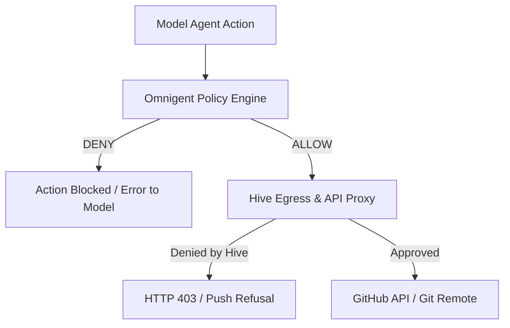

# Omnigent CLI Contract and Policy Composition

This note records the observed contract of the **Omnigent** CLI ([omnigent-ai/omnigent](https://github.com/omnigent-ai/omnigent), Apache-2.0) against Hive's backend acceptance bar (`src/docs/backend-support-tiers.md`), covering the six required contract facts, safety flag enforcement, credential detection, local confinement posture, and policy composition with Hive.

Tracking issue: [#14094](https://github.com/hivecommons/hive/issues/14094) (child issues: [#14119](https://github.com/hivecommons/hive/issues/14119), [#14121](https://github.com/hivecommons/hive/issues/14121), [#14122](https://github.com/hivecommons/hive/issues/14122)).

---

## 0. What Hive actually launches

Hive wires omnigent on the **interactive** contributor path only. `backend_perm_flag omnigent` (`config/backends.conf`) emits `run --server local`, so every launch path — the contributor tmux line (`bin/contributor-agent.sh`), the Justfile local-mode line and `bin/agent-launch.sh` argv — produces:

```bash
omnigent run --server local [--model <id>]
```

Both words are load-bearing and neither is a sandbox:

- **`run`** is the agent REPL. A bare `omnigent` on a TTY is rewritten by upstream `omnigent.cli:main` to `omnigent start` (spawns the background server/host and returns to the shell prompt — no agent), and a bare `omnigent --model X` is a root-level Click `UsageError` (exit 2). Without `run`, the tmux pane would show a shell prompt or help text and the relay would type the task into bash.
- **`--server local`** pins the session to a local Omnigent server. `omnigent login <url>` persists a `server:` default in `~/.omnigent/config.yaml`, and `omnigent run` falls back to it when `--server` is absent. A remote Omnigent server hands the user's GitHub token to its managed runners, which push branches and open PRs from outside the Hive container and egress proxy — exactly the path the precedence rule in §5 says must not exist. `local` is Omnigent's documented sentinel for `run` ("overriding any configured server default"; `--server ""` is the historical spelling). **Remote-server mode is unsupported by Hive**, and `contribute-check-backend omnigent` says so.

omnigent is **not** in the relay's `HEADLESS_BACKENDS` (`bin/contributor-relay.js`) and is declared non-headless in `bin/test_backend_smoke.sh` and the Kubernetes capability map (`api_contribute_test.go`). The one-shot `omnigent run -p` shape in Facts 1–3 below is recorded from upstream's CLI source and docs so the contract is complete; Hive has **not** wired or verified it end to end. Wiring it would need a small relay extension, because `flagsAfterCommand` cannot place `-p <prompt>` last after `--model`.

## 1. Six CLI Contract Facts

### Fact 1: Non-interactive invocation

> **Status: documented upstream, not wired or verified by Hive** (see §0). Hive launches the interactive REPL (`omnigent run --server local`), not this path.

Omnigent provides a non-interactive entry point via `omnigent run` with the `-p` / `--prompt` option. Without `-p`, `omnigent run` launches an interactive prompt_toolkit / Rich REPL and browser co-drive. With `-p "<prompt>"`, the CLI runs headlessly, sends one turn, writes the assistant text response to stdout, and exits.

```bash
omnigent run --harness codex -p "Implement the requested feature"
```

Per upstream source and docs:
- Runs in headless mode (REPL and browser auto-open are bypassed when `-p` is set unless explicitly configured).
- `--no-session` (ephemeral mode) runs in-process with a temporary SQLite database and artifact directory that are cleaned up on process exit.
- `omnigent run <agent.yaml> -p "..."` runs the declared agent spec headlessly.

### Fact 2: How a prompt is passed in

The prompt is passed via the `-p` or `--prompt` CLI option. The positional argument `[AGENT]` to `omnigent run` is reserved for the agent spec YAML file or agent directory path; passing the prompt as a positional argument causes an `Agent path not found` error.

```bash
# Correct: prompt via -p
omnigent run --harness claude -p "Explain this codebase"

# Passing prompt as positional argument fails:
omnigent run "Explain this codebase"
# Output on stderr:
# Error: Agent path not found: Explain this codebase
# Exit code: 1
```

### Fact 3: Exit codes on success, failure, and denial

- **Success (0):** When the agent turn completes normally, the assistant response is emitted on stdout and the CLI exits with status `0`.
- **Execution Failure / Server Error (1):** When a run fails (e.g. runner disconnection without completed turn, agent spec resolution error, or uncaught server exception), Omnigent outputs `Error: <reason>` to stderr and exits with status `1`.
- **Policy Denial (1 or handled):** When a tool-call policy emits `DENY`, the policy engine rejects the action and returns an error payload to the agent model turn. If the overall turn or session fails as a result, or an admission policy blocks session initialization, the command exits with code `1`.
- **CLI Option / Argument Parsing Error (2):** Omnigent uses Click. Passing invalid flags or illegal values produces a `UsageError` on stderr and exits with status `2`.

```bash
# Invalid option:
omnigent run --invalid-safety-flag
# Output on stderr:
# Error: no such option: --invalid-safety-flag
# Exit code: 2
```

### Fact 4: Transcript written to disk and where

- **Persistent sessions:** By default, Omnigent persists sessions, turns, and artifacts in an SQLite store under `${HOME}/.omnigent/` (`omnigent.db` and runner artifacts).
- **Session logs (`--log`):** In interactive mode, passing `--log` writes full JSON conversation dumps to `${HOME}/.omnigent/logs/`.
- **Event tapes (`--debug-events`):** When enabled, SSE event logs are streamed to `${HOME}/.omnigent/debug/`.
- **Ephemeral mode (`--no-session`):** Uses an isolated temporary directory (`tmpdir`) for SQLite storage and session state, which is unlinked on completion.

### Fact 5: Model and cost reporting

- **Model selection:** Specified via `--model <model-id>` or in the agent spec (`executor.model`).
- **Cost tracking & budgets:** Omnigent includes builtin cost guardrail policies (`omnigent.policies.builtins.cost.cost_budget` and `user_daily_cost_budget`). These track cumulative USD spend per session or per user day across both LLM request turns and tool calls, triggering `ASK` soft checkpoints or `DENY` hard caps on expensive model tiers.
- **Usage reporting:** Operators and scripts query cumulative metrics via the `omnigent usage` command.

### Fact 6: Tool-denial list and policy enforcement

Omnigent features a multi-tiered policy engine evaluating at three phases: session, agent spec, and server-wide. Policies evaluate at tool-call checkpoints and emit one of three verdicts:
- `ALLOW`: The tool call proceeds.
- `DENY`: The tool call is blocked; the agent receives an error payload.
- `ASK`: The tool pauses for user approval.

Builtin tool policies include:
- `ask_on_os_tools`: Requires approval before OS file read, write, edit, or shell execution.
- `block_skills`: Denies loading specific skill bundles.
- `max_tool_calls_per_session`: Denies tool invocations once a count limit is reached.
- `github_policy`: Restricts GitHub MCP operations and `git`/`gh` shell commands to an allowlist of repositories and branches.

---

## 2. Safety Flag Enforcement

Per Criterion 3 of `src/docs/backend-support-tiers.md`, CLI safety flags must be actively parsed and enforced: an invalid option must exit non-zero rather than being silently ignored.

Because Omnigent is implemented with Click, unrecognized options and invalid flag values fail immediately at argv parse time with exit code `2`:

```bash
$ omnigent run --dangerously-bypass-everything
Error: no such option: --dangerously-bypass-everything
[exit status: 2]
```

Unattended mode is triggered by `-p` / `--prompt` (with no interactive REPL). Unattended runs must not configure policies that emit `ASK`, as an unanswered prompt in a headless container would stall. Hive does not currently wire this mode (§0).

---

## 3. Credential Detection (`detect_cli`)

Omnigent provides a standard `--version` flag:
```bash
$ omnigent --version
omnigent, version 0.2.0
[exit status: 0]
```
`omnigent --version` is an eager Click callback that exits `0` even when no credentials exist on the host. Probing `--version` alone would falsely report `OK` for unauthenticated environments.

To provide honest credential detection, `detect_cli` in `bin/contributor-agent.sh` checks for valid authentication sources:
1. Ambient provider API keys: `ANTHROPIC_API_KEY`, `OPENAI_API_KEY`, `GEMINI_API_KEY`.
2. Databricks profile credentials: `DATABRICKS_TOKEN`, or non-empty `${HOME}/.databrickscfg`.
3. Omnigent session credentials: non-empty `${HOME}/.omnigent/auth_tokens.json` or `${HOME}/.omnigent/config.yaml`.

If the binary exists but none of these credential paths are present, `detect_cli` outputs `NOT_AUTHED`.

**Container staging is an allowlist, never the directory.** `just contribute-hive omnigent` stages only `~/.omnigent/auth_tokens.json` and `~/.omnigent/config.yaml` into the container's `~/.omnigent`, plus `~/.databrickscfg` as a single file when present, and forwards `ANTHROPIC_API_KEY`, `OPENAI_API_KEY`, `GEMINI_API_KEY`, `DATABRICKS_TOKEN` and `OMNIGENT_API_KEY` by name — exactly the sources `detect_cli` accepts, so the container's verdict matches the host preflight. The rest of the directory — `omnigent.db` (every prior session and turn), `logs/` and `debug/` (Fact 4) — is the contributor's full Omnigent history and stays on the host, for the same reason `~/.claude` is staged as an allowlist (#7836). A `server:` key in the staged `config.yaml` is inert: the launch line's `--server local` overrides it (§0).

---

## 4. Confinement Posture and Refusal Gate

- **Local confinement posture:** `postureRefusalGated` (`refusal-gated`).
- **Support tier:** T3 (experimental).
- **Reasoning:** On the contributor local launch path (`just contribute-hive omnigent local`), the bare `omnigent` CLI runs directly on the host. While Omnigent supports an `enforce_sandbox` policy (using bubblewrap on Linux or seatbelt on macOS) in agent specifications, and supports external remote sandboxes (e.g. Modal, Daytona), Hive does not wire an OS-level filesystem sandbox directly through launch flags. Local mode therefore **refuses to launch** by default and requires the explicit opt-in:
  ```bash
  export HIVE_OMNIGENT_DANGEROUSLY_RUN_UNCONFINED=1
  ```
  Container mode (`just contribute-hive omnigent`, the default) provides standard container boundary isolation and requires no escape hatch.

---

## 5. Policy Composition with Hive

Omnigent functions as an open-source meta-harness over Claude Code, Codex, Cursor, Pi, and custom agent runtimes. Because both Omnigent and Hive feature policy layers, composition must follow strict precedence rules:



### Precedence Rules

1. **Hive policy strictly wins on GitHub writes.**
   This holds only while the Omnigent server runs inside the Hive container, which is why every launch pins `--server local` (§0); a remote Omnigent server would route GitHub writes through its own runners and is unsupported.
   All repository interactions (pull request creation `POST /repos/{owner}/{repo}/pulls`, merge requests `PUT /repos/{owner}/{repo}/pulls/{n}/merge`, issue comments, releases, and Git pushes) are routed through Hive's egress proxy and GitHub App authentication broker.
   Even if an Omnigent policy (e.g. `github_policy`) or agent bundle permits a write, Hive's proxy checks (DCO trailers, ACMM tier gates, merge policy) remain authoritative. A proxy denial produces an HTTP 403 or push refusal that Omnigent cannot bypass.

2. **Omnigent's sandbox is additive, never a substitute for Hive proxy or container isolation.**
   Omnigent's optional sandbox (`enforce_sandbox`) or managed cloud sandboxes add host-level defense-in-depth. However, they do not replace Hive's API proxy or the contributor container boundary.

3. **Underlying harness credential flow.**
   Omnigent orchestrates underlying harnesses like Claude Code or Codex. In Hive, provider credentials reach the harness via ambient environment variables or staged configs. At no point are raw GitHub personal access tokens or administrative tokens exposed to Omnigent or its child harnesses.
