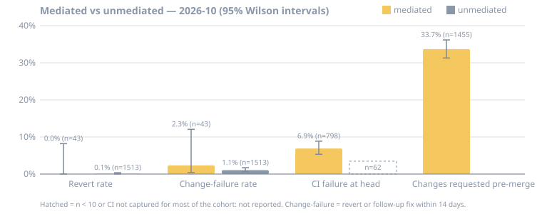
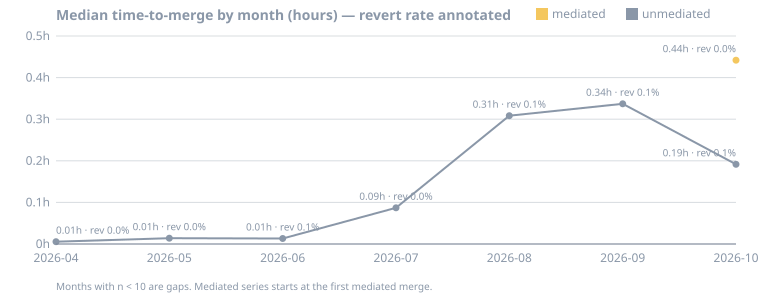

# Outcome benchmark — 2026-10

Generated 2026-10-27 from hive's own spoke (hive-oke) evidence snapshot taken 2026-10-27. Window: merged 2026-10-01 → 2026-11-01; maturation 14 days (observed as of 2026-10-27).

Pull requests that went through Hive's review swarm (**mediated**: at least one recorded verdict or posted review) versus pull requests merged without it (**unmediated**). Every rate carries its n and a 95% Wilson interval; anything with n < 10 is `not reported`.

## Headline

| Metric | Mediated | Unmediated |
|---|---|---|
| Merged PRs in window | 1455 | 2224 |
| Revert rate (matured) | 0.0% [0.0–8.2] (n=43) | 0.1% [0.0–0.4] (n=1513) |
| Change-failure rate (revert or follow-up fix, matured) | 2.3% [0.4–12.1] (n=43) | 1.1% [0.7–1.7] (n=1513) |
| Median time-to-merge | 0.44 h (n=1455) | 0.19 h (n=2224) |
| CI failure at merged head | 6.9% [5.3–8.9] (n=798) | 27.4% [17.9–39.6] (n=62) — captured on only 3% of merges, not comparable |
| Had a `changes_requested` verdict before merge | 33.7% [31.3–36.1] (n=1455) | — (no verdicts by definition) |
| Cost per merged PR | ≈$2.13 est. (n=2869 merged, 2026-08-08 → 2026-10-27) | — |

### Reading the numbers

- Revert rates are indistinguishable at this n: 0.0% [0.0–8.2] (n=43) mediated vs 0.1% [0.0–0.4] (n=1513) unmediated (overlapping intervals).
- Median time-to-merge is 0.44 h (n=1455) for mediated vs 0.19 h (n=2224) for unmediated: review adds about 15 minutes to the median PR.
- 33.7% [31.3–36.1] (n=1455) of mediated merged PRs were flagged `changes_requested` on an earlier head before merging — findings an unmediated PR would have carried to main unseen.
- CI at merged head is only captured for reviewed heads (mediated 6.9% [5.3–8.9] (n=798)); the unmediated cell is not comparable.
- Estimated agent spend is ≈$2.13 per hive-attributed merged PR (n=2869).

## Trend by month

Whole evidence history, not just the window; months with n < 10 are gaps.

| Month | Mediated merged | Mediated revert | Mediated TTM | Unmediated merged | Unmediated revert | Unmediated TTM |
|---|---|---|---|---|---|---|
| 2026-04 | 0 | not reported (n=0) | not reported (n=0) | 184 | 0.0% [0.0–2.0] (n=184) | 0.01 h (n=184) |
| 2026-05 | 0 | not reported (n=0) | not reported (n=0) | 432 | 0.0% [0.0–0.9] (n=432) | 0.01 h (n=432) |
| 2026-06 | 0 | not reported (n=0) | not reported (n=0) | 943 | 0.1% [0.0–0.6] (n=943) | 0.01 h (n=943) |
| 2026-07 | 0 | not reported (n=0) | not reported (n=0) | 611 | 0.0% [0.0–0.6] (n=611) | 0.09 h (n=611) |
| 2026-08 | 0 | not reported (n=0) | not reported (n=0) | 1881 | 0.1% [0.0–0.4] (n=1881) | 0.31 h (n=1881) |
| 2026-09 | 0 | not reported (n=0) | not reported (n=0) | 3088 | 0.1% [0.1–0.3] (n=3088) | 0.34 h (n=3088) |
| 2026-10 | 1455 | 0.0% [0.0–8.2] (n=43) | 0.44 h (n=1455) | 2224 | 0.1% [0.0–0.4] (n=1513) | 0.19 h (n=2224) |

## Real examples

- [hivecommons/hive#13523](https://github.com/hivecommons/hive/pull/13523): the [posted review](https://github.com/hivecommons/hive/pull/13523#pullrequestreview-5613922737) caught: The changelog note was written as a sentence, not a list entry, so the release build would have rejected it. A second, duplicate note was also added. The fixed head was approved 4 minutes later; the PR merged 16 minutes after opening (opened 12:07, caught 12:12, approved 12:16, merged 2026-10-22 12:23 UTC).
- [hivecommons/pluk#328](https://github.com/hivecommons/pluk/pull/328): the [posted review](https://github.com/hivecommons/pluk/pull/328#pullrequestreview-5607075007) caught: An apostrophe inside a quoted message ended the string early, so the project would not compile and no tests could run. The fixed head was approved 10 minutes later; the PR merged 23 minutes after opening (opened 22:30, caught 22:36, approved 22:46, merged 2026-10-21 22:54 UTC).

## Scale

- 13060 evidence bundles (10 unreadable) folding to 11571 pull requests across 10 repositories; 15054 verdicts recorded.
- Merged in window by repository: hivecommons/hive 2451, hivecommons/docs 223, hivecommons/dibs 179, hivecommons/rationguard 172, hivecommons/pluk 155, hivecommons/promptargs 147, hivecommons/hivecommons.github.io 145, hivecommons/hotshot 122, hivecommons/homebrew-hive 78, hivecommons/crux 7.
- Merged in window by author kind — mediated: agent 857, bot 70, human 528; unmediated: agent 1186, bot 103, human 935.
- First mediated merge in the evidence: 2026-10-09.
- Hub `GET /api/hub/evidence` was not consulted (it requires an admin session); numbers are this spoke's evidence only.

## What the README shows and leaves out

The README carries only plain-language cards; this section says which numbers made it and why the rest did not.

- **Sent back, then fixed** is shown: 369 of 563 PRs that received a changes_requested verdict in the window pushed a new head that was then approved (404 pushed a new head at all; 140 merged on the same head, 133 of those because another perspective approved it; 19 were unresolved at observation time).
- **Time to fix** is shown: 24 minutes is the median from the first changes_requested verdict to the first approve verdict on a later head, over 369 PRs.
- **Sent back before merge** (490 of 1455 reviewed merges) is in the tables but not the README: it counts reviewer objections, not whether the shipped code was right.
- **Checks fixed after a change request** is not shown: a check result is captured on both the sent-back head and the next head for 140 of 404 PRs (35%), under the 80% floor; of those, 48 went from failing to passing.
- **Issues that stayed closed** is not shown: issue reopen records exist only for the newest part of the history and no closure via a reviewed merge has been observed for 14 days yet.
- **Checks passing at merge** is not shown: a check result is recorded on 798 of 1455 reviewed merges (55%), under the 80% floor, so the pass rate would describe a biased subset.
- **Revert rate** is not shown: the reviewed base is 43 merges observed 14+ days after merge, below the README minimum of 200, and the two groups are not distinguishable on this data.
- **Cost per merged PR** is shown as an estimate: $2.13 = $6124.75 estimated spend / 2869 hive-attributed merges, 2026-08-08 → 2026-10-27.
- **Time to merge** is shown in the Also strip as 27 minutes (typical, i.e. median) for 1455 reviewed merges, against 12 minutes for 2224 merges without review; the extra minutes are stated as the cost of review.
- **Not a controlled comparison.** Pull requests merged without a Hive review come from other repositories and periods; differences between the two groups may not be caused by review.
- **Pull requests sent back.** Counts a `changes_requested` verdict on any head before merge. Whether the next head fixed the finding, or a human overrode it, is not verified here.
- **Prompt injection.** The catch rate is from Hive's own evaluation set, not production traffic, and is not subject to the README minimum base because it is a self-run test and labelled as such on the card.
- **Post-merge CI pass rate** is drawn only when at least 80% of reviewed merges carry a recorded check result; a roadmap item is to record check status for every merged head so it can be reported.

## Methodology

How measured: per-PR evidence bundles the spoke already writes, folded per PR; 95% Wilson intervals; n < 10 is never reported. The README shows only cards whose base is at least 200 (`--readme-min-base`), in plain words and without intervals; everything below that threshold, and every interval, is in this report.

- **Source.** Only the per-PR evidence bundles the spoke already writes under `/data/evidence` (schema v1), folded per PR with `pkg/evidence.FoldPRs`. No new telemetry.
- **Cohorts.** A PR is *mediated* if any head carries a Hive verdict or a posted Hive review; otherwise *unmediated*. Backfilled history is unmediated by construction, so the window must start no earlier than the first mediated merge or the comparison is confounded by time.
- **Revert / change-failure.** Denominator is merged PRs observed at least 14 days after merge. A revert is a later PR the evidence linker tagged `reverted_by`; change-failure adds `followed_up_by` fixes.
- **Time-to-merge.** Lower median of merge time minus open time, over merged PRs whose bundle recorded an open time.
- **CI failure at head.** Share of merged heads with a captured `failure` status among heads with a captured success/failure. The unmediated cohort rarely has a captured status (Hive only records CI for heads it reviews), so its cell reports coverage and is not comparable when coverage is low.
- **Changes requested.** Share of mediated merged PRs with at least one `changes_requested` verdict on any head before the merge — findings the author had a chance to address pre-merge. Whether the later head fixed the finding, or a human overrode it, is not verified here.
- **Sent back, then fixed.** Over PRs whose first `changes_requested` verdict falls in the window: the share that pushed a later head which then received an `approve` verdict. Heads are ordered by bundle creation time; a PR counted as *merged on the same head* merged with no later head, and the report says how many of those heads also carried an `approve` from another perspective, which is how the gate let them through. This measures whether the author acted on the reviewer and the fix passed re-review, not whether the shipped code was correct.
- **Time to fix.** Lower median of first `approve` on a later head minus the first `changes_requested`, over the PRs counted as fixed above.
- **Outcome measures after review** (reverts, follow-up fixes, reopened issues) need merges observed at least 14 days; the reviewed cohort is too young for a base of 200, so they stay in the tables and are not drawn in the README.
- **Cost.** `/api/cost` estimated spend divided by its hive-attributed merged-PR count over the same window; model prices are estimates and some models are unpriced, so treat it as an upper-bound order of magnitude.
- **Intervals.** 95% Wilson score; n < 10 is never reported.
- **Regenerate.** `src/scripts/outcome-benchmark.sh --month 2026-10` (see `docs/benchmarks/README.md`).
