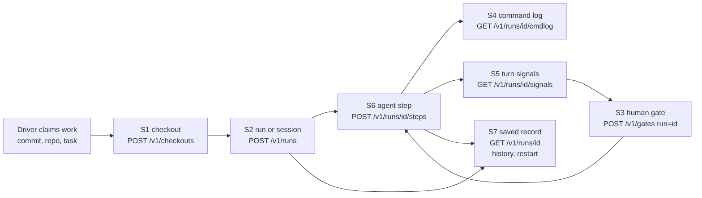

# Crux work services: integration guide

**Audience:** a developer wiring an orchestrator — hive, a Nous v2 session
backend, Spotlights, or a fourth consumer — onto the Crux work services of
RFC [hivecommons/crux#114](https://github.com/hivecommons/crux/issues/114).
It walks the seven slices in the order a driver composes them, with the
`curl` and `crux` CLI form of every call, the server configuration each
one needs, authentication in both flavours, the failure drills from the
RFC's acceptance sections, and a symptom → saved-record troubleshooting
map. The slice-by-slice semantics, status codes and storage layout are in
the [design record](design/crux-work-services.md); this guide does not
repeat them, it sequences them.

The rule every slice shares, and the reason the guide ends at S7: **crux
records what happened; the driver decides what it means.** A `done`
signal is a notification, a saved record is proof, and after any
disconnect the driver asks for the record before it acts again.

## The composition at a glance



| Step | Slice | Verb | What the driver gets |
|---|---|---|---|
| 1 | S1 | `POST /v1/checkouts` | a worktree pinned at a full SHA, owned by the caller, capped, deletable |
| 2 | S2 | `POST /v1/runs` | a sandboxed command's real exit code and output — or, with `profile: agent`, an open **session** that steps run inside |
| 3 | S6 | `POST /v1/runs/{id}/steps` | one agent step whose JSON answer was checked against the driver's schema |
| 4 | S4 | `GET /v1/runs/{id}/cmdlog` | the commands the runtime actually dispatched for that run |
| 4 | S5 | `GET /v1/runs/{id}/signals` | where the turn is and how it ended, append-only |
| 5 | S3 | `POST /v1/gates` + `GET /v1/gates/{id}/wait` | a recorded human decision before the driver continues |
| 6 | S7 | `GET /v1/runs/{id}`, `/history`, `GET /v1/runs`, `POST /v1/runs/{id}/restart` | the truth after a disconnect, and an explicit, audited re-run |

S0 (caller principals) is not a step; it is what every row above means by
"the caller".

## Before the first call

### Start a server that has every slice on

```sh
export CRUX_TOKEN="$(openssl rand -hex 32)"           # control token (S0 operator)
export CRUX_CHECKOUT_ALLOWLIST=https://github.com/hivecommons/   # S1 on
export CRUX_RUNS_CONFIG=./runs.json                   # S2/S6 on
export CRUX_LANES_CONFIG=./lanes.json                 # optional: lane principals
crux serve --workdir ./crux-work --listen 127.0.0.1:7777 --operator-name kelly
```

`runs.json` is the contained-run backend (`crux/runs/config.go`); the
keys a driver's operator will touch:

```json
{
  "backend": "podman",
  "image": "ghcr.io/hivecommons/hive-sandbox:latest",
  "repo_allowlist": ["https://github.com/hivecommons/"],
  "workspace_roots": ["/srv/scratch"],
  "default_timeout_ms": 600000,
  "max_timeout_ms": 3600000,
  "default_max_output_bytes": 65536,
  "max_output_bytes_cap": 1048576,
  "network_restricted": false
}
```

| Key | Slice | Meaning |
|---|---|---|
| `backend` | S2 | `podman` (default) or `job` (Kubernetes Job; `job`, `job_network`, `job_network_policy` then apply) |
| `image` | S2/S6 | the container image every run and step runs in; **required** |
| `repo_allowlist` | S2 | URL prefixes the ad-hoc `worktree` form may clone; empty refuses it (use S1 instead) |
| `workspace_roots` | S2 | host directories a plain `workspace_path` may lie under; empty refuses it |
| `default_timeout_ms`, `max_timeout_ms` | S2/S6 | bounds on `timeout_ms` |
| `default_max_output_bytes`, `max_output_bytes_cap` | S2 | bounds on `max_output_bytes`; the full output is kept as an artifact regardless |
| `network_restricted` | S2 | operator's assertion that a podman network named `restricted` exists |

Server flags and env the slices read:

| Flag / env | Slice | Meaning |
|---|---|---|
| `--token`, `CRUX_TOKEN` | S0 | the control token; required on `--listen`; its principal is the **operator** |
| `--operator-name`, `CRUX_OPERATOR_NAME` | S0 | the name saved as `owner`/`opened_by_principal` for control-token calls (default `operator`) |
| `--lanes-config`, `CRUX_LANES_CONFIG` | S0 | lane principals: `{"principals":[{"project":"atlas","token_env":"ATLAS_LANE_TOKEN"}]}`; each project's token is a bearer token too |
| `--checkout-allow`, `CRUX_CHECKOUT_ALLOWLIST` | S1 | repo URL prefixes `POST /v1/checkouts` may clone; **unset means no checkout service (501)** |
| `--checkout-dir`, `--checkout-max-bytes`, `CRUX_CHECKOUT_TOKEN` | S1 | where checkouts live, the byte ceiling, the private-repo HTTPS token (env only) |
| `--runs-config`, `CRUX_RUNS_CONFIG` | S2/S6 | the file above; **unset means `POST /v1/runs` is 501**, saved records still serve |
| `--workdir` | S3–S7 | gates, run state, command logs, signals and steps all live under it |

### Authentication, two flavours

Every request carries `Authorization: Bearer …`. Which token decides who
the caller *is*, and that is the whole S0 model:

| Token | Principal | Use it for |
|---|---|---|
| the control token (`CRUX_TOKEN`) | the **operator** (`--operator-name`) | S1–S7 as the single driver: it owns what it creates, sees every record, and is the only principal that may answer a gate without an override |
| a lane principal's token (`lanes-config`) | the **project** (`atlas`) | one driver per project: each sees and may act on only its own checkouts, runs, steps and gates; a gate it opened it cannot answer |

Pick one and stay with it per driver: a run created as `atlas` is
invisible to `beacon` (403 `forbidden`, the message names the owner), and
an operator restart of a project's run keeps the run owned by the project
— it does not widen what the run may do.

```sh
export CRUX_SERVER=http://127.0.0.1:7777      # the CLI reads these
export CRUX_TOKEN=…                           # control token or a lane token
H=(-H "Authorization: Bearer $CRUX_TOKEN" -H "Content-Type: application/json")
```

Unix-socket servers without a token treat every caller as the operator;
that is what the transport already establishes.

## Step 1 — S1: pin the checkout

```sh
curl -s "${H[@]}" -X POST $CRUX_SERVER/v1/checkouts -d '{
  "repo": "https://github.com/hivecommons/hive",
  "commit": "84b42eabe0a1d2c3b4e5f60718293a4b5c6d7e8f",
  "ttl": "72h"
}'
# → 201 {"id":"co_…","path":"/…/checkouts/co_…","commit":"84b42…","owner":"kelly",…}

crux checkout add -repo https://github.com/hivecommons/hive -commit 84b42eabe… -ttl 72h -json
crux checkout list
crux checkout rm co_…
```

What to rely on: `commit` must be the full 40-hex SHA (a branch or tag is
400 — the pin cannot move under you); an off-allowlist repo is 403 before
anything is cloned; the response `path` is on the server and is what S2
runs in; `DELETE` is 409 while a run uses the checkout. Save the `id` with
the work item — it is the thing you hand to S2.

## Step 2 — S2: run the command, or open the session

A one-shot command:

```sh
curl -s "${H[@]}" -X POST $CRUX_SERVER/v1/runs -d '{
  "checkout": "co_…",
  "command": ["make", "test"],
  "env_allowlist": ["CI"],
  "network": "none",
  "timeout_ms": 600000,
  "idempotency_key": "card-42/baseline/1"
}'
# → 200 {"id":"run_…","status":"completed","exit_code":0,"stdout":"…","owner":"kelly",…}

crux runs start --checkout co_… --env CI --timeout 10m --idempotency-key card-42/baseline/1 -- make test
```

Always send `idempotency_key`: it is what makes a retried `POST` return
the run you already started instead of a second one. The response carries
the `id` the moment the run is **accepted**, before anything executes;
with `"detach": true` the call returns `202` with that accepted record and
the driver polls or waits (step 6).

A step **session** for S6 is the same route with no command:

```sh
curl -s "${H[@]}" -X POST $CRUX_SERVER/v1/runs -d '{
  "checkout": "co_…", "profile": "agent", "idempotency_key": "card-42/session"
}'
# → 202 {"id":"run_…","status":"accepted","profile":"agent",…}  then "waiting" once provisioned

crux runs start --checkout co_… --profile agent --idempotency-key card-42/session
```

The session provisions its sandbox and sits at `waiting`; it closes with
`POST /v1/runs/{id}/cancel` (`crux runs cancel`). Nothing runs in it until
step 3.

## Step 3 — S6: run one schema-checked agent step

```sh
curl -s "${H[@]}" -X POST $CRUX_SERVER/v1/runs/run_…/steps -d '{
  "backend": "claude",
  "model": "claude-sonnet-4-5",
  "prompt": "Measure the baseline: run make test three times and report pass counts as JSON.",
  "output_schema": {"type":"object","required":["runs","passed"],
                    "properties":{"runs":{"type":"integer"},"passed":{"type":"integer"}}},
  "tools": ["Bash"],
  "turn_limit": 20,
  "timeout_ms": 900000,
  "retry_on_mismatch": 2
}'
# → 200 {"run":"run_…","n":1,"status":"succeeded","answer":{"runs":3,"passed":3},"attempts":1,
#        "usage":{"input_tokens":…,"output_tokens":…},"transcript_path":"steps/1/transcript.jsonl"}

crux step run run_… --backend claude --prompt-file prompts/baseline.md --schema schemas/baseline.json \
  --tool Bash --turn-limit 20 --retry 2
crux step list run_…
crux step show run_… 1
```

Statuses a step ends in: `succeeded`; `schema_mismatch` (the answer
never matched after `retry_on_mismatch` re-asks — `violations` says
where); `timeout`, `backend_error`, `tool_denied`, `turn_limit_exceeded`,
`cancelled`; `unsupported` (the backend cannot enforce a limit you asked
for; recorded, never faked); `unfinished` (step 6). `answer` is only ever
present on `succeeded`, and it has already been validated against
`output_schema` — the driver does not re-check shape, it checks meaning.
One step at a time per session: a second `POST` while one runs is 409
`step_busy`.

The `process` backend (`"backend":"process","command":["./my-agent"]`)
is the way to put a non-LLM tool, or a test double, behind the same
contract.

## Step 4 — S4 + S5: verify what happened, follow where the turn is

The command log is the runtime's record of what the step actually
dispatched. The driver uses it to check an agent's claims, never the
agent's narration:

```sh
curl -s "${H[@]}" "$CRUX_SERVER/v1/runs/run_…/cmdlog?since_seq=0&limit=100"
# → {"run":"run_…","commands":[{"seq":1,"status":"completed","command":["make","test"],"exit_code":0,"capture":…,…}],"next_seq":2}

crux cmdlog list run_…
crux cmdlog show run_… 1          # one record with its captured output
```

"Did `make test` run at least three times?" is `cmdlog list --json | jq`
over `command` and `status`, not a question for the agent.

Turn signals are the live progress stream and the saved outcome of each
turn. The runner writes `started` and `done`; the driver (as owner) may
post the middle kinds for its own bookkeeping; a gate opened with `run`
(step 5) appears here as `needs-input` → `input`:

```sh
curl -s "${H[@]}" "$CRUX_SERVER/v1/runs/run_…/signals?since_seq=0"
# → {"run":"run_…","signals":[{"seq":1,"kind":"started","source":"runner",…},{"seq":2,"kind":"step","data":{"n":1,"status":"succeeded"}},…],"next_seq":3}

curl -s "${H[@]}" -X POST $CRUX_SERVER/v1/runs/run_…/signals -d '{"kind":"thinking","message":"planning the control arm"}'

crux signal list run_…
crux signal emit run_… --kind thinking --message "planning the control arm"
```

For push instead of poll, `GET /v1/events` is the server's SSE stream;
`run.signal` events carry the same records, `gate.*` events the gates.
Treat an event as a hint to read the saved record, not as the record.

## Step 5 — S3: ask a human before continuing

```sh
curl -s "${H[@]}" -X POST $CRUX_SERVER/v1/gates -d '{
  "subject": "Promote finding card-42 to the report?",
  "choices": ["approve", "reject", "rerun"],
  "timeout": "24h",
  "context": {"runs": 3, "passed": 3, "control_passed": 1},
  "idempotency_key": "card-42/promote",
  "run": "run_…"
}'
# → 201 {"id":"gate_…","status":"waiting","opened_by_principal":"atlas",…}

curl -s "${H[@]}" "$CRUX_SERVER/v1/gates/gate_…/wait?timeout=5m"
# → 200 the gate: answered or expired if that happened within the window (max 5m), still "waiting" otherwise — loop

# the operator answers, from anywhere with the control token:
curl -s "${H[@]}" -X POST $CRUX_SERVER/v1/gates/gate_…/answer -d '{"answer":"approve","note":"control arm looks right"}'

crux gate open --subject "Promote finding card-42?" --choice approve --choice reject --timeout 24h \
  --idempotency-key card-42/promote --run run_… --json
crux gate wait gate_… --timeout 30m
crux gate answer gate_… --choice approve --note "control arm looks right"
```

The opener cannot answer its own gate (403 `gate_self_answer`); the
operator may override with `"as_operator": true`, and that override is
audited. `answered` and `expired` are different statuses — an expiry is
never a denial. `context` is yours; keep secrets out of it, it is saved
and shown to the person deciding.

## Step 6 — S7: the saved record is the truth

Every S2 run and S6 step has an id from the moment it was accepted and a
record that outlives the connection, the request and the `crux serve`
process. After a timeout, a dropped connection or a restart, the driver's
first move is to read it:

```sh
curl -s "${H[@]}" $CRUX_SERVER/v1/runs/run_…                   # the run
curl -s "${H[@]}" $CRUX_SERVER/v1/runs/run_…/steps/1           # the step (RFC's GET /v1/steps/{id}, numbered per run)
curl -s "${H[@]}" $CRUX_SERVER/v1/runs/run_…/history
# → {"run":"run_…","transitions":[{"at":…,"status":"accepted"},{"at":…,"status":"running"},
#    {"at":…,"status":"unfinished","reason":"crux serve restarted while the run was in flight; the exit is not knowable"}]}
curl -s "${H[@]}" "$CRUX_SERVER/v1/runs?status=unfinished&limit=50"   # everything that needs a decision

crux runs status run_…
crux step show run_… 1
crux runs history run_…
crux runs list --status unfinished
```

Run statuses are a closed set: `accepted | running | waiting | completed |
failed | cancelled | unfinished`; steps add `succeeded` and
`unsupported`. `unfinished` means exactly one thing: the process that
would have known the exit is gone. Crux never upgrades it to success and
never silently re-runs it — the driver decides, and the record shows why.

When the decision is "run it again", say so explicitly:

```sh
curl -s "${H[@]}" -X POST $CRUX_SERVER/v1/runs/run_…/restart -d '{
  "reason": "serve restarted mid-run; baseline must be measured whole",
  "idempotency_key": "card-42/baseline/2"
}'
# → 200 the new run (202 with "detach": true), "restarted_from":"run_…"; the old record gains "restarted_by"
# → 409 conflict while the old run is accepted/running/waiting: the runner may be alive

crux runs restart --reason "serve restarted mid-run" --idempotency-key card-42/baseline/2 run_…
```

A restart re-validates the *saved* request as the *original* owner
against the *current* server configuration, so a removed checkout or a
shrunk allowlist refuses it the same way a fresh create would. It is
audited (`run.restart`: who, from which run, to which, why). It is a new
run with its own id, never a mutation of the finished one — `history` of
the old run still ends where it ended.

## Failure drills

Run these against a scratch project before trusting the integration. Each
is one of the RFC's "done when" conditions; the expected observation is
what the saved records show.

| Drill | Do | Expect |
|---|---|---|
| Lost connection after `POST /v1/runs` | send the create, kill the client before the response | `GET /v1/runs?status=…` or the same `POST` with the same `idempotency_key` returns the run that was started; nothing ran twice |
| Duplicate create | send the same body with the same key twice | one run, one id, `created` only the first time; `cmdlog` shows one dispatch |
| Server restart mid-run | start a long run or a step, restart `crux serve` | run `unfinished` with the restart reason; its `running` step `unfinished` with the same reason; `signals` ends in `done` with that status; `GET /v1/runs?status=unfinished` lists it |
| Restart while live | `POST …/restart` on a run that is `running` | 409 `conflict`; cancel it first (or let it end), then restart succeeds and the two records link |
| Pin that moves | `POST /v1/checkouts` with a branch name | 400 `bad_request`; nothing cloned |
| Off-list repository | checkout or `worktree` run against a repo not on the allowlist | 403 `forbidden`, message names the allowed prefixes |
| Agent lies about its work | step prompt says "run the suite three times"; agent answers `runs: 3` | `cmdlog list` is the count that matters; compare, do not trust the answer |
| Answer outside the schema | step with a strict `output_schema`, prompt that invites extra fields | re-asks up to `retry_on_mismatch`; then `schema_mismatch` with `violations`, no `answer` |
| Self-answered gate | open a gate as `atlas`, answer as `atlas` | 403 `gate_self_answer`; with `as_operator: true` 200 and an audit record |
| Gate expiry vs denial | open with `timeout: "1m"`, wait | `expired`, `expired_at` set, no `answer`; distinguishable from `answered: reject` |
| Cross-project read | create as `atlas`, read as `beacon` | 403 naming the owner, for runs, steps, checkouts and gates alike; `GET /v1/runs` as `beacon` omits it |

## Symptom → saved record

| You see | Read | It tells you |
|---|---|---|
| the create call hung or errored | `GET /v1/runs?limit=…` or replay the `POST` with its `idempotency_key` | whether the run exists and what state it is in |
| `status: unfinished` | `GET /v1/runs/{id}/history` | when it went in flight and the reason it was settled (serve restart) |
| a step `schema_mismatch` with no `answer` | `GET /v1/runs/{id}/steps/{n}` → `violations`, `attempts`, `transcript_path` | what failed to match per attempt; the transcript is under the run's work dir |
| a step `unsupported` | the step's `reason` | which limit the backend could not enforce; pick another backend or drop the limit |
| the agent says it ran X | `GET /v1/runs/{id}/cmdlog` | what was actually dispatched, with exit codes and captured output |
| "nothing is happening" | `GET /v1/runs/{id}/signals` | the last signal: `needs-input` on a gate (its id is in `data`), `thinking`, or no `started` yet (still provisioning) |
| a gate the driver is waiting on | `GET /v1/gates/{id}` | `waiting`, `answered` (by whom, with what, overridden or not) or `expired` |
| 409 on restart | `GET /v1/runs/{id}` | its status is live; `cancel` or wait |
| 409 on `DELETE /v1/checkouts/{id}` | `GET /v1/runs?status=running` / `waiting` | which run still uses it |
| 501 on `POST /v1/runs` or `/v1/checkouts` | server flags | `--runs-config` / `--checkout-allow` is unset on that server; saved records still serve |
| 403 on your own record | the token you sent | you are a different principal than the one that created it |

## What hive uses today vs. post-cutover

Hive is one driver among the ones the RFC names, and today a partial one.
The code of every slice lives in hive `src/crux` and reaches
[hivecommons/crux](https://github.com/hivecommons/crux) through the
[publish sync](crux-publish.md) until the **2026-11-16 cutover**, after
which the crux repository is the source of truth and hive pins a tagged
release.

| Concern | Hive today (`v5`) | After the cutover |
|---|---|---|
| Where the code lives | `src/crux`, same module as hive; the crux repo is a generated copy | `hivecommons/crux` at a tag; hive depends on it like any consumer |
| Running agents | in-process `crux.Runtime` behind `cmd/hive` (`agent_runtime.go`); no `crux serve` between hive and its agents | unchanged for hive's own agents — the work services are for *work*, not for hosting hive's agents |
| Stage worktrees (S1) | hive's own worktree management and `nousdeps` trust rules, which S1 was ported from | drivers that need a pinned checkout call `POST /v1/checkouts`; hive may keep its own path or adopt S1 for stage worktrees |
| Untrusted commands (S2) | hive's agent sandbox (`config.SandboxJobConfig`, podman/Job) runs the agent itself | the same backends behind `runs.Service`; a driver asks for a contained run instead of owning a sandbox |
| Human decisions (S3) | hive's maintainer commands and park/un-park on GitHub issues | an S3 gate is the runtime-side record; a product adapter can mirror it to a forge — crux never does |
| Verifying agent claims (S4) | not verified; the agent's narration is what the stage sees | `cmdlog` is the check; the Nous v2 backend is the first driver built on it |
| Turn outcomes (S5) | `GET /v1/agents/{name}/kick-outcome` for kicked agents; `run.signal` events | the same signals for every contained run |
| Agent steps (S6) | none; hive stages are whole agent turns | the Nous v2 backend's unit of work; hive stages could become steps in a session |
| After a restart (S7) | hive reconciles its own leases; crux runs were not hive's | `unfinished` records, `history`, explicit `restart`; hive's lanes (`cmd/hive/lanes.go`) already use the crux API client and are the natural place to read them |
| Lanes / work cards | hive is a lane participant via `crux/api` lanes client | unchanged; the work-card contracts are a companion spec, parked |

The first driver built end to end on these surfaces is the Nous v2
session backend — out of crux, built against a **tagged** Nous v2 release
and a **tagged** crux release (v0.3.0 is the floor). If this guide cannot
get that driver, or a fourth consumer, wired in days, the surfaces need
fixing, not the guide.

## See also

- [Design record: crux work services](design/crux-work-services.md) — routes, codes, semantics and storage per slice, as implemented
- [`crux serve`](crux-serve.md) — the server, its routes, events and the Go client
- [`crux` CLI](crux-cli.md) — the local runtime verbs the work-service verbs sit beside
- [Crux durable lanes](crux-lanes.md) — the transport the work-card contracts will ride on
- [Publishing Crux](crux-publish.md) — how `src/crux` becomes `hivecommons/crux`
