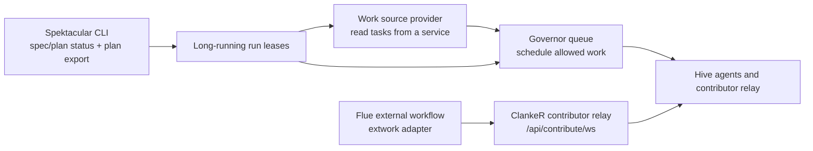

# Integration guide

Use this guide to choose a connection to Hive v5. Configuring an existing integration is different from implementing a new one.

| Your task | Start here | Current boundary |
| --- | --- | --- |
| Read tasks from a planning service | [Work source providers](integrations/work-source-providers.md), then its configuration examples | GitHub Issues, GitHub Projects, Linear, and Jira are primary providers. Implementing another primary provider requires Go changes in Hive. |
| Lend your machine's AI coding tool | [Contributor relay: basic setup](contributor-relay.md#basic-setup) | The relay receives work from Hive and reports its result. |
| Have an external workflow engine run work | [ClankeR and Flue-style execution](integrations/clanker-flue.md) | Hive still decides what may run and verifies reported evidence; Flue dispatch is report-only. |
| Turn a specification into staged work | [Spektacular integration](integrations/spektacular.md) | The planning tool must implement the documented Spektacular CLI contract; there is no general planning-engine registry. |

In the diagram, the **work source** supplies tasks, the **governor** schedules agents, and a **run lease** records who owns a stage and when it expires. An *additive* source appends tasks alongside the selected primary source rather than replacing it.

## Extension surfaces in v5

| Surface | What you can do today | Start here |
| --- | --- | --- |
| Work sources | Add or configure an adapter that turns source-native items into `worksource.Issue` values. The linked primary adapters are GitHub Issues, GitHub Projects, Linear, Jira, Gitea, and GitLab; `external` connects a provider-operated HTTPS shim with no Hive PR; run stages and Wavefront are additive sources. | [Work source providers](integrations/work-source-providers.md) |
| ClankeR + Flue-style external execution | Use the contributor relay as the transport and the `pkg/extwork` contract as the engine-neutral admission/observation seam. Flue is the reference HTTP adapter. | [ClankeR and Flue-style external execution](integrations/clanker-flue.md) |
| Spektacular | Let Hive poll a Spektacular-compatible CLI for `spec`/`plan` status and import final plan tasks into Hive's run flow, or select another registered planning engine with `runs.engine`. | [Spektacular and Project Inception](integrations/spektacular.md) |
| vibe-kanban | Mirror one repository's admitted hive queue onto a local [vibe-kanban](https://github.com/BloopAI/vibe-kanban) board through its MCP server, optionally record board pick-ups as shadow executions, or opt in to the `pkg/extwork/vibekanban` host adapter for report-only workspace dispatch. One way only: Hive keeps admission and acceptance. Default off. | [vibe-kanban mirror and dispatch](vibe-kanban.md) |

Related surfaces that are not redefined here: [agent configuration](agent-configuration.md), [CLI/backend setup](../../docs/backend-setup.md), [MCP write policy](security-model.md), [hub API](api-reference.md), [contributor relay](contributor-relay.md), [work sources](work-sources.md), [long-running runs](runs.md), and [Spektacular runner](spektacular.md).

## Terminology

Use source-neutral words in generic integration docs: **work source**, **project**, **item**, and **change request**. Keep product names only when talking about a specific adapter, such as GitHub Projects or Jira. The glossary and guard-test intent live in [Work-source terminology](work-source-terminology.md).

For implementers, *source-native* means retaining a service's own item identifier; an *admission/observation seam* is the code boundary for allowing work and checking its progress. A *canary* is a small verification workflow, not another installation requirement.

## Gaps tracked from this guide

- Work source enumeration can now be external: `work_source.type: external` reads a provider-operated HTTPS shim over `hive.worksource/v1` ([External provider](integrations/work-source-providers.md#external-provider)). Write-back across that boundary is still unavailable: [#10174](https://github.com/hivecommons/hive/issues/10174).
- Project Inception now has a named planning-engine registry: `runs.engine`
  selects a registered engine (default `spektacular`) behind the engine-neutral
  `pkg/planengine` boundary, so a planning engine no longer has to emulate the
  Spektacular CLI byte for byte. What remains open in
  [#10175](https://github.com/hivecommons/hive/issues/10175) is an
  out-of-process engine: the boundary is compile-time, so a new engine is a
  registered Go package ([Writing a planning
  engine](spektacular.md#writing-a-planning-engine)).
Documentation maintenance: edit canonical Hive guides in this repository's `src/docs/` on `v5`. The `hivecommons/docs` Next.js/Nextra site mirrors that tree; its README describes syncing. This source relationship is not an integration prerequisite.
