# Hive Labels and Control Signals

This is the operator view of Hive labels: if you add or remove a label, this is what the v5 code does. It also calls out non-label controls that look like labels from the dashboard.

## How labels reach agents

Most hard gates run before an agent sees work. GitHub issue enumeration reads labels in this order: standing meta issues are excluded first, then hold labels move the item to the Hold list, then exempt labels and the issue-level hard-suppress labels (`needs-human`, `needs-direction`, `needs-decision`, `needs-spec`; `hardSuppressIssueLabels` in `src/pkg/github/labels.go`) filter it out, so no agent kick names, and no kick claims, a parked issue, then `project.issue_filter.require_labels` admits or rejects the issue, and only then is it actionable (`src/pkg/github/client.go:955-1045`). Pull requests use the same hold-first enumeration for the PR Hold list (`src/pkg/github/client.go:1110-1165`). That means kick prompts, dashboard actionable counts, planning-from-label, and contributor offers normally inherit the same gate.

Some sweeps bypass that enumeration and list items themselves, but every one of them gates on the same hold predicate as enumeration (`Client.IsHeldLabels` / `Client.isHeld`, `src/pkg/github/client.go:1964-1972`, `src/pkg/github/client.go:2674-2676`), so the generic hold substrings and the exact dashboard `hive-pause/<hive-id>` label hold everywhere:

- Auto-merge sweeps reach it through the `Transport.IsHeldLabels` seam; the queued (`lgtm`) sweep skips a held PR before fetching it, and the self-authored sweep skips held PRs plus `needs-human` before merging (`src/pkg/github/automerge/automerge_sweep.go:23-38`, `src/pkg/github/automerge/automerge_sweep.go:959-964`, `src/pkg/github/automerge/automerge_sweep.go:966-1004`, `src/pkg/github/automerge/automerge_sweep.go:1029-1046`).
- The task-list sweep skips a held issue before its exempt / issue `needs-human` gate, so a held issue is never commented on, relabelled, or closed by it (`src/pkg/github/task_list_sweep.go:848-854`).
- The SHA-hold sweep lists primary-repo `kind/bug` issues itself, adds literal `hold` plus a marker notice when no SHA is present (for reporters in `issue_filter.reporter_trust` trusted associations it adds the soft `issues.sha_hold_trusted_label`, default `needs-sha`, instead, #12002), and removes `hold` only when the current hold is its own: the newest `hold` label event is a `labeled` by the App bot and an App-authored SHA-hold notice was posted at or after it (`EnforceSHAHold` / `shaHoldIsOwn` in `src/pkg/github/client.go`).
- PR-request watching applies server-side PR holds after a PR is opened; the agent's `--label hold` flag is deliberately discarded by the wrapper (`src/pkg/github/pr_request_watcher.go:452-524`, `bin/hive-open-pr.sh:142-150`).

The "respect hold labels" text in policy templates names the enforced set (`hold`, `on-hold`, `hold/review`, `hive-pause/<hive-id>`, any label containing `hold`, plus `do-not-merge` as exempt) but is a prompt-level backstop. The hard gate is the enumerator or sweep named in the table.

## Label axes

Hive-authored labels answer different questions. Read them as independent axes, not as one taxonomy: an issue can carry one label from each axis at the same time, and swapping a label on one axis never changes what the others mean.

| Axis | Shape | Question it answers | Signal? | Notes |
| --- | --- | --- | --- | --- |
| **Stage** | `stage/<step>` | Where is this item in the pipeline? | Control (read by claims/auto-merge) | See [Stage labels](#stage-labels-stagennn--the-pipeline-state-machine) below. |
| **Agent** | `agent/<lane>` | Which agent works it and, for agent-filed issues, which lane filed it? | Routing + ownership + lane provenance | The suffix is always the lane name from `HIVE_AGENT`. The classifier routes on it, PR ownership compares against it, and `authorkind` treats it as this hive's author stamp. Agent-filed issues carry exactly one lane/provenance label: `agent/<lane>`. |
| **Origin** | `origin/<source>` | Which non-lane hive component created this item? | Provenance only, never a gate | Reserved for hive filers that have no `agent/<lane>` equivalent: `origin/selfreport`, `origin/governor`, `origin/dashboard`, `origin/forge`, and `origin/convergence`. Agent lanes do not use `origin/<lane>`; the startup reconciler (`Client.MigrateOriginLabels`, `src/pkg/github/origin_labels.go`) removes redundant lane-origin and bare-lane labels while ensuring `agent/<lane>`. `origin/reviewer`, `origin/review`, and `from-review` are retired reviewer-lane spellings and map to `agent/reviewer`. |
| **Role** | `role/<tier>` | How far does the hive trust the author's login? | Control (auto-merge) | Was `author/<tier>` before #12581; the reconciler rewrites the old spelling. See [`role/*`](#role--would-the-hive-auto-merge-this). |
| **Author** | `author/<kind>` | Who wrote it — a person, a contributor's hive, or this repo's hive? | Informational (gates the 072 nudge/adoption) | `author/human`, `author/clanker`, `author/hive`; names configurable under `governor.labels.author`. See [`author/*`](#author--who-wrote-this-pr). |
| **Modifiers** | `blocked`, `hold`, `needs-*`, `hive-pause/<hive-id>` | What is stopping it right now? | Hold / suppress | See the reference table; these are the hard gates. |

### Origin sources

The `<source>` is the component that created the issue, never the person or hive that operates it. Agent lanes are not origin sources: an agent filing an issue gets `agent/<lane>` instead, and a bare `<lane>` label requested by that same agent is stripped as duplicate provenance. A caller-supplied non-lane `origin/*` label is kept and canonicalised; retired lane-origin spellings are mapped to `agent/<lane>`.

| `origin/<source>` | Created by | Code path |
| --- | --- | --- |
| `origin/selfreport` | Fleet runtime selfreports (`[selfreport] …`), filed directly or relayed by the hub. Sits next to the deprecated `hive/selfreport` for now. | `src/pkg/github/fleet_report.go`, `src/pkg/fleetreport/runtime.go`, `src/pkg/hub/selfreport_relay.go` |
| `origin/governor` | Governor automation: the advisory meta issue, the recommendations issue, upstream-watch filings. Task-list sweeps, stage regress and unpark notices do not file issues today; if they ever do, they use this source. | `src/pkg/github/advisory.go`, `src/pkg/github/recommendations.go`, `src/pkg/upstreamwatch/render.go` |
| `origin/dashboard` | Operator actions in the SPA that file an issue (ACMM eval filing). | `src/pkg/dashboard/api_acmm_eval.go` |
| `origin/forge` | The forge issue seam, when its consumer passes no origin label of its own. | `src/pkg/forge/github_forge.go` |
| `origin/convergence` | The convergence publisher and its GitHub channel. | `src/pkg/convergence/publish/publisher.go`, `src/pkg/convergence/publish/channel.go` |
| *(none)* | A human filing directly. **`origin/human` is deliberately never applied**: the absence of an origin label is what "a person filed this" looks like, and `author/*` already says who wrote a PR. | — |

Work-source sinks other than GitHub (Jira, Linear) carry no GitHub labels and are outside the axis.

Some hive-authored labels look like provenance but are read as signals, so they stay outside `origin/*` on purpose: `hive/selfreport` is the dedupe key the self-report joiner searches (`label:hive/selfreport` in `src/pkg/github/fleet_report.go`) and the hub relay re-applies it — it is **deprecated** in favour of `origin/selfreport`, which every new selfreport also carries, and will be removed once the joiner searches the origin label instead; `hive/advisory` makes an issue a standing meta issue that enumeration excludes (`src/pkg/github/standing_issues.go`); `hive/<hive-id>` is **retired** (#12539): nothing writes it any more, the origin marker in the body says which hive wrote an item, and the boot sweep strips leftovers (see the reference row). `hive/sentinel`, `hive/fleet` and `fleet` are only consulted by the good-first-issue exclusion list (`src/pkg/gfi/gfi.go`) and are no longer written by this code base.

## Categories

- **Informational / display-only** changes how Hive explains an item, not whether agents can act.
- **Workflow / status** marks a process state such as reviewer outcome or rebase need.
- **Gate / permit** admits, blocks, or releases a specific workflow.
- **Hold / suppress** removes work from agent/contributor/merge lanes until cleared.
- **Contributor eligibility / routing** affects `/contribute` offers or agent lane choice.
- **Human approval / acknowledgement** records that a human accepted a direction or design.

## Reference table

| Label or signal | Applies to | Consumer | Effect | Gate or signal | Who applies | When checked | Cleared / overridden | Config knobs |
| --- | --- | --- | --- | --- | --- | --- | --- | --- |
| `hold`, `on-hold`, `hold/review` | Issues, PRs | GitHub enumeration, auto-merge sweeps, task-list sweep | Any label containing a configured hold substring is held; held issues/PRs leave agent kicks, PR merge lanes, and the task-list sweep. Held red PRs still route back to their owning agent for CI repair, with instructions not to remove the hold. | Hard hold | Human, Hive level gate, #5117 gate, holdguard, SHA-hold | Enumeration and sweeps | Remove the matching label; Hive releases only literal `hold` it applied itself (level gate, #5117, SHA-hold) | Built-in `HoldLabels`; dashboard exact hold via `Client.SetHoldLabels` (`src/pkg/github/client.go:750-755`, `src/pkg/github/client.go:1894-1972`, `src/pkg/scheduler/policy_overlays.go:210-220`) |
| `hive-pause/<hive-id>` | Issues, PRs | GitHub enumeration, dashboard hold toggle, auto-merge sweeps, task-list sweep | Exact, hive-scoped dashboard hold. It is not provenance and intentionally avoids the substring `hold`. | Hard hold | Dashboard operator | Enumeration and sweeps | Dashboard Release removes labels causing the hold, including this one | Canonicalized from hive id (`src/pkg/github/client.go:1898-1932`, `src/pkg/github/client.go:1936-1945`, `src/docs/dashboard.md:80-96`) |
| GitHub "blocked by" dependency | Issues | GitHub enumeration, kick-list assembly | An open issue whose GitHub dependency list names an open blocker is enumerated with `DependsOn` edges and kept out of the ACTIONABLE ISSUES an agent picks from; the kick names it once in a `Blocked by open dependencies` footer with its blockers. A blocker that is closed resolves the edge; a mutual pair (A↔B) is dropped with a warning so neither hides the other. The blocker list failing to load fails open (issue offered). | Soft hold | Human (GitHub UI) or agent via `hive-open-issue --blocked-by` when splitting ordered children | Enumeration | Close the blocker, or remove the dependency on GitHub | None (`src/pkg/github/issue_dependencies.go`, `src/pkg/scheduler/kickmessage.go` `partitionBlockedIssues`/`formatBlockedIssuesNote`) |
| `hive/<hive-id>` (**retired**, #12539) | Issues, PRs | None | Formerly marked which hive filed or touched an item. Replaced by the `<!-- hive:origin hive=<hive-id> at=… -->` marker `bin/gh-wrapper.sh` appends after the identity footer (`**Instance:** \`<hive-id>\``) on every body it injects; `github.OriginHive` reads the marker and falls back to a leftover label. Fleet reports name the hive in `<!-- hive:selfreport … hive=… -->`, the seen-marker comment and the `Affected hives` block; claim markers carry `hive=`. Never a hold (#9371). | None | Nobody (was: `gh-wrapper.sh`, self-report joiner, hub relay) | — | `Client.RetireHiveIDLabels` runs at every boot until clean: strips the label from open items, deletes the definition once nothing open carries it, writes `/data/hive-id-label-retire-<hive-id>.json` and a `.done` marker | Hive id (`src/pkg/github/origin_marker.go`, `src/pkg/github/hive_id_label_retire.go`) |
| `hold` from ACMM level gate | PRs | PR-request watcher, self-authored auto-merge release | Agent PRs at L3-L5 get literal `hold`; `outreach` PRs whose target repo is not one the hive manages (cross-repo outreach) are held at every level, while same-repo outreach PRs follow the level. The watcher, not the policy prompt, applies it from the PR's target repo (`config.AgentOwnsRepo`). | Hard merge gate | Hive App | PR creation, later self-authored auto-merge release | Auto-release only when current policy no longer requires the level hold, latest hold event was by the App, and the release path runs; otherwise a human removes it | Hive-wide ACMM and agent (`src/pkg/github/pr_request_watcher.go:452-524`, `src/pkg/github/pr_level_hold.go:16-124`) |
| `hold` from #5117 self-authorization | PRs | PR-request watcher and self-authorization release | A PR whose only rationale is unacknowledged hive-filed issues gets literal `hold`. Acknowledging the issue later does not remove an existing PR hold by itself. At ACMM L6 Fully Autonomous, the unset default is off; lower levels default on. | Hard merge gate | Hive App | PR creation; evaluated only when no level hold applies | Acknowledge the issue and remove the PR `hold`; disabled policy release can remove Hive's own hold. At L6, that release path also clears existing Hive-applied #5117 holds when no explicit config keeps the policy on. | `github.self_authorization_hold`, per-repo `project.repo_policies[].self_authorization_hold`, `HIVE_SELF_AUTHORIZATION_HOLD` (`src/pkg/github/pr_self_authorization.go:14-226`, `src/pkg/github/pr_request_watcher.go:452-524`) |
| `triage/accepted` (or `project.issue_filter.reporter_trust.untrusted_require_labels`); `needs-triage` while waiting | Human-filed issues from untrusted reporters | GitHub enumeration | With `reporter_trust.enabled: true`, an issue whose reporter's GitHub `author_association` is outside the trusted set (default `OWNER`, `MEMBER`, `COLLABORATOR`) and whose login is not in `trusted_logins` is not actionable until it carries one of these labels. On the first excluded scan, core `github.Client.fetchIssues` posts one marked explanation comment and applies `needs-triage` (or `awaiting_label`); later scans do not repeat the comment. This is a poller-side write, not an agent prompt, and is capped at 10 new notices per poll. When the triage label appears, the same poll loop removes `needs-triage` only if the marker records that Hive added it, then the issue enters the backlog. Trusted reporters' issues pass untouched. Runs after holds/exempts and before `require_labels`, so the ordinary allow-list still applies afterwards. Hive- and bot-filed issues are not judged here (#5117 owns them). Counted as "needs triage" on the repo card, not as a generic filter refusal. | Hard admission gate (off by default) | Human; Hive App for the visibility comment/label | Enumeration | Add the label, trust the login or association under **Settings → Labels → Reporter trust**, or disable the gate | `project.issue_filter.reporter_trust.{enabled,trusted_associations,trusted_logins,untrusted_require_labels,awaiting_label,comment}` (`src/pkg/config/reporter_trust.go`, `src/pkg/github/client.go` `fetchIssues`) |
| `hold` from #9665 reporter trust | PRs | PR-request watcher, level-hold release | A PR whose rationale (closing or referencing links, or the request's declared issues) traces to an issue filed by an untrusted reporter gets literal `hold` at **every** ACMM level, including L6, plus `needs-human` (so it surfaces as waiting on a person, #10773) and a marked notice naming the untrusted reporter and stating the PR itself was authored by the hive. Any one untrusted citation holds. Evaluated even at hold-gated levels, because the notice is what stops promotion to L6 from releasing the label. | Hard merge gate | Hive App | PR creation; re-checked by the level-hold release path | A human removes `hold`. Hive never auto-releases it: the release sweep sees the notice (or re-evaluates and re-posts it) and leaves the label. Holdguard re-holds on a new head SHA. | `github.reporter_trust_hold` (nil follows `reporter_trust.enabled`), per-repo `project.repo_policies[].reporter_trust_hold`, `HIVE_REPORTER_TRUST_HOLD` (`src/pkg/github/pr_reporter_trust.go`, `src/pkg/github/pr_level_hold.go`) |
| `project.repo_policies[].auto_merge: false` | PRs | `hive-merge` relay, App self-authored auto-merge sweep, proxy | Below L6 this resolves off for every repo; at L6, PRs can still be opened, reviewed and held when the per-repo switch is off, but Hive refuses every merge path for that repo. Existing `hold` / `hive-pause/<hive-id>` labels stay put because the disabled repo is skipped before hold release or merge. | Hard merge gate | Operator/dashboard | Merge relay request, self-merge sweep tick, proxy direct merge attempt | Dashboard repo-card switch or config edit sets `auto_merge: true`/removes the override at L6; enabling is rejected below L6 | `project.repo_policies[].auto_merge` (`src/pkg/config/repo_policy.go`, `src/pkg/agent/manager_modes.go`, `src/pkg/github/automerge/automerge_sweep.go`, `src/pkg/proxy/rules.go`) |
| `hold` from holdguard | PRs | Holdguard ledger | If the head SHA changes while held, lifting the hold causes Hive to comment and re-apply literal `hold`; the next human removal is the fresh approval. | Hard merge gate | Hive | Governor holdguard pass | Human removes the re-applied hold | Built-in `holdguard.ReHoldLabel` (`src/pkg/holdguard/holdguard.go:1-43`) |
| `hold` from SHA-hold | Issues | SHA-hold sweep | Human-filed primary-repo `kind/bug` without a 7-40 hex SHA gets `hold` and a notice carrying `<!-- hive:sha-hold -->`; once a SHA appears in body/comments, Hive removes `hold` only if the current hold is its own (newest `hold` event labeled by the App bot, paired with an App-authored notice at or after it). A human's hold, a re-hold, or another subsystem's hold stays. Reporters whose author association is trusted (`issue_filter.reporter_trust.trusted_associations`, default OWNER/MEMBER/COLLABORATOR) get the soft `needs-sha` row below instead, and a SHA-hold `hold` already on such an issue is swapped for it (#12002). The hard-suppress reconcile also lifts this `hold` once a PR referencing the issue merges after it was applied. | Hard issue hold | Hive | Eval tick SHA sweep; hard-suppress reconcile | Add SHA evidence or merge the fix; sweep removes its own `hold`, a human removes any other | Primary repo and SHA-hold config (`src/pkg/github/client.go` `EnforceSHAHold`, `src/pkg/github/hard_suppress_reconcile.go`) |
| `needs-sha` from SHA-hold | Issues | SHA-hold sweep | Trusted-reporter `kind/bug` without a SHA gets this soft label plus the same `<!-- hive:sha-hold -->` notice instead of `hold`; the issue stays actionable. The sweep removes it once a SHA appears. | Soft (informational) | Hive | Eval tick SHA sweep | Add SHA evidence, or remove the label | `issues.sha_hold_trusted_label` (default `needs-sha`; `hold` restores the hard hold for everyone) |
| `do-not-merge` and `do-not-merge*` | Issues, PRs | Exempt filter, merge sweeps, task-list sweep | Permanently exempt; exact match is case-insensitive but prefix matching follows Go `strings.HasPrefix` on the original label. | Hard suppress | Human | Enumeration/sweeps | Human removes | Built-in `PermanentExemptLabels` (`src/pkg/github/client.go:750-755`, `src/pkg/github/client.go:2030-2048`) |
| `governor.labels.exempt` entries | Issues, PRs | Exempt filter | Same exempt behavior as `do-not-merge`; wins over required-label admission. Defaults include `nightly-tests`, `LFX`, `meta-tracker`, `auto-qa-tuning-report`, `adopters`, `changes-requested`, `waiting-on-author`. | Hard suppress | Operator/dashboard | Enumeration/sweeps | Remove label or config entry | `governor.labels.exempt` (`src/pkg/config/config.go:3388-3396`, `src/pkg/config/config.go:5800-5808`) |
| `needs-human` | Issues | Enumeration, task-list sweep, claim escalation gate and un-park sweep | Issue is filtered, not held: no agent kick or contributor offer; task-list sweep adds it only when a merged PR carries the explicit `Refs #N (needs-human: <reason>)` marker (never on a held issue; remainder prose yields `hive/handoff` instead, [#12002](https://github.com/hivecommons/hive/issues/12002)), and the claim escalation gate adds it instead of a third no-progress claim by the same agent (`governor.claims.escalate_after_claims`, [#10527](https://github.com/hivecommons/hive/issues/10527)). The un-park sweep keeps a "What to reply" comment on every parked issue listing the commands. See [Maintainer commands](maintainer-commands.md). | Hard suppress | Hive or human | Enumeration/task-list sweep/kick building | Only a person removes it. `/hive approve` / `/hive decision <text>` and label-driven approval add `approved-direction` and clear `stage/085-needs-decision` (and the retired spellings) but **never** remove `needs-human`: it says a human-held identity, consent or operator step is required, which no decision supplies, so the issue stays derived at 085 and out of the agent queue after the un-park ([#12680](https://github.com/hivecommons/hive/issues/12680), [#12681](https://github.com/hivecommons/hive/issues/12681)). Agents may ADD it through the relay `label` command when an owner's direction reserves the work for people (then `/unclaim`); they may never remove it (`src/pkg/github/issue_unpark_command.go`, `src/pkg/github/issue_request_label.go`) | Fixed label (`src/pkg/github/client.go:1008-1024`, `src/pkg/github/task_list_sweep.go:611-641`, `src/pkg/github/task_list_sweep.go:874-880`, `src/cmd/hive/claimescalation.go`) |
| `hive/handoff` | Issues | Task-list sweep | Soft hand-off marker. When a merged PR's `Refs #N` remainder section says in prose that the rest needs a person or another lane ("needs a human", "fix lane", "quality lane", "production change", …) without the explicit `needs-human:` marker, the sweep adds this label and notes "handed off to the next lane" in its remainder comment instead of parking the issue. It is not a hold, suppress, or enumeration filter: the issue stays actionable, so the next lane can still claim it ([#12002](https://github.com/hivecommons/hive/issues/12002)). Not added when the same sweep is applying `needs-human`. | Informational | Hive (task-list sweep) | Task-list sweep | Human or the claiming lane removes it; Hive never removes it | Fixed label (`src/pkg/github/task_list_sweep.go:85`, `src/pkg/github/task_list_sweep.go:576-596`, `src/pkg/github/task_list_sweep.go:635-665`) |
| `needs-human` | PRs | Escalation ledger, reviewer lane, self-authored auto-merge sweep, queued auto-merge sweep | Applied when red-CI fix budget is exhausted or a workflow needs a person; stops automated fix dispatch, sends the PR to the human/reviewer lane, and blocks auto-merge sweeps while present. It is not a PR enumeration filter. | Hard fix-dispatch and merge gate | Hive | Escalation pass/kick building/auto-merge sweeps | Human removes after root cause or reviewer un-escalates; budget resets after grace; auto-merge reconsiders on the next tick because no persisted hold state is kept | Fixed label (`src/pkg/escalation/escalation.go:400-470`, `src/pkg/escalation/escalation.go:1185-1205`) |
| `hive/advisory` | Issues | Standing meta classifier | Hive advisory report is never actionable and never appears on the Hold list. | Hard exclusion | Hive | Before holds/exempts | Remove label, but exact advisory title still excludes | Fixed label/name (`src/pkg/github/standing_issues.go:1-57`, `src/pkg/github/client.go:983-1001`) |
| `triage/advisory` | Issues | Standing meta classifier | Advisory-only dedupe checklist (`Decision required: no`, #11864) is never actionable and never appears on the Hold list; action-required checklists are parked with `needs-decision` instead. The close-on-merge backfill closes it once every `#N` it references is closed or merged, or after 7 days, and swaps it for `needs-decision` plus the "What to reply" notice if line two turns to `Decision required: yes` (#11871). | Hard exclusion | Dedupe agent | Before holds/exempts | Remove label | Fixed label/name (`src/pkg/github/standing_issues.go`) |
| `approved-direction` | Agent-filed issues | #5117 gate, ranking, kick tag | A PR opened after the label is present avoids #5117 hold; the issue ranks ahead of unacknowledged hive-filed backlog. | Gate input + soft ranking | Human | PR creation and issue ranking | Remove label; human assignee/comment can still acknowledge for #5117 | Fixed `HumanAckLabel` (`src/pkg/github/pr_self_authorization.go:14-226`, `src/pkg/github/client.go:2740-2832`) |
| Human assignee | Issues | #5117 gate and ranking | Human assignee acknowledges hive-filed direction and moves issue into rank tier 2. | Non-label approval | Human | PR creation/ranking | Unassign | N/A (`src/pkg/github/pr_self_authorization.go:180-226`, `src/pkg/github/client.go:2784-2832`) |
| Relay-linked parent | Hive-filed issues the relay split out of a parent | #5117 gate, ranking, kick tag | A child the issue-request relay itself linked as a GitHub sub-issue inherits acknowledgement from an **open, unheld** parent that is human-filed or carries `approved-direction`/a human assignee; one level only, and only for links the relay made (recorded in `/data/split-parents.json`), never for sub-issue links added later in the UI. The kick line shows `[hive-filed+parent-ack #N]`. | Non-label approval | Hive (from the parent's human signal) | Enumeration and PR creation | `hold` the child, or close/hold the parent | Fixed ledger (`src/pkg/github/split_parents.go`) |
| Human comment | Issues | #5117 gate | Any human comment in the first 100 issue comments acknowledges for #5117, but does not change ranking tier by itself. | Non-label approval | Human | PR creation | N/A | `selfAuthCommentPageSize` (`src/pkg/github/pr_self_authorization.go:14-18`, `src/pkg/github/pr_self_authorization.go:180-226`) |
| `needs-reporter-confirmation` | Issues | Issue-close gate, dashboard | Marks an issue whose opted-in fix appears to have landed but still needs the reporter or a maintainer to reply `/fixed`. The `CloseIssue` reporter-confirmation gate applies it only when `hive: needs-confirmation` or `issues.reporter_confirmation` requested the gate; if the reporter has write/maintain/admin access Hive also adds `needs-human` so the dashboard's human queue catches it. | Hard suppress / human signal | Hive App | Enumeration/dashboard | `/fixed`, deliberate close, or `/reopen` removes this label. Hive does not remove `needs-human` here because it may have been set by another workflow. | Fixed label (`src/pkg/github/issue_close.go`, `src/scripts/issue-confirm-fixed.sh`) |
| `hive: needs-confirmation` label/body text | Issues | Issue-close gate | Opts one human-filed bug-family issue into reporter verification before closing. PR bodies keep `Closes`/`Fixes`; the close path leaves the issue open pending confirmation until `/fixed`, `hive: reporter-confirmed`, an override, or marker removal. | Gate input | Human/filer/operator | `CloseIssue` | Remove label/text or confirm fixed | Fixed phrase (`src/pkg/github/pr_request_claims.go`, `src/pkg/github/issue_close.go`) |
| `hive: reporter-confirmed` label/body text | Issues | Issue-close gate | Legacy marker showing the reporter/maintainer verified the fix. Close-on-merge is now the default, so this is usually redundant; it still bypasses an active `hive: needs-confirmation` or `issues.reporter_confirmation` gate. | Permit | Human/reporter | `CloseIssue`, `/fixed` workflow | Remove label/text | Fixed phrase (`src/pkg/github/pr_request_claims.go`, `src/pkg/github/issue_close.go`) |
| `hive: close-on-merge` label/body text | Issues | Issue-close gate | Legacy filing-time marker for bugs whose merged fix is the verification. Close-on-merge is now the default, so this is usually redundant; it still bypasses an active reporter-confirmation config gate. `hive-open-issue --close-on-merge` still adds it for compatibility. | Permit | Human/filer | `CloseIssue` | Remove label/text | Fixed phrase (`src/pkg/github/pr_request_claims.go`, `src/pkg/github/issue_close.go`) |
| `design-approved` | Issues | Planning design gate | Approves a requested architect design; counts after a design exists. | Planning gate | Human | Planning label sweep | Remove/re-apply design labels as needed | `planning.design_approved_label` (`src/pkg/planning/design.go:68-125`, `src/pkg/planning/design.go:320-345`) |
| Lane-name label or `agent/<role>` segment | Issues | Classifier/scheduler | Routes issue to a lane after title prefix and before keyword routing. Scanner sees every issue; other agents see their lane. | Soft routing | Hive/human | Classification before kicks | Change/remove label | `agents.*.lane_keywords` (`src/pkg/classify/classifier.go:249-276`, `src/pkg/scheduler/templates.go:298-303`) |
| `agent/<role>` | Issues, PRs | Provenance, ownership, dashboard bands | Marks the filing/owning agent. The wrapper always derives the suffix from the lane name (`HIVE_AGENT`), never the display name, so PR ownership and label routing see the same token the scheduler compares against. On PRs it is written only when the PR's author is the hive's own App identity: editing, commenting on or merging a contributor's PR (a `review.fix_human_prs` review-fix kick, a description touch-up) does not transfer ownership and adds no label. The stage reconciler strips a stray `agent/*` or `hive/<hive-id>` from any open PR the App did not author (#12545). Adoption (stage/074) opens a new App PR, which carries both legitimately; the adopted contributor PR keeps its own authorship. | Informational + routing | Hive | Issue/PR creation and display | Remove if wrong; the reconciler removes it from non-hive PRs | Agent identity settings (`bin/gh-wrapper.sh` `_hive_owns_pr`, `src/pkg/github/automerge/automerge_stage_labels.go` `stripStrayOwnershipLabels`, `src/pkg/scheduler/pr_annotations.go:146-158`) |
| Priority labels (`triage/accepted`, `ai-fix-requested`, `approved-direction`, `kind/bug`, `bug`, `priority/critical-urgent`, `priority/important-soon`, `help wanted`, `good first issue`) | Human-filed issues | Ranking | Human-filed issues with these labels go to tier 0 in kick lists. | Soft ordering | Human/Hive | Ranking | Remove label | `HIVE_ACTIONABLE_PRIORITY_LABELS` (`src/pkg/github/client.go:2740-2832`) |
| `auto-qa`, `auto-qa-finding`, `kind/security`, `kind/regression` | Issues | Classifier | `auto-qa`/`auto-qa-finding` make Simple; `kind/security`/`kind/regression` make Complex. | Soft classification | Hive/human | Classification | Remove label | Classifier tables (`src/pkg/classify/classifier.go:279-303`) |
| `run/spec`, `run/fix` | Issues | Runs triage | Forces spec or direct-fix triage when runs triage is enabled. | Gate when enabled | Human/Hive | Triage | Remove label | `runs.triage.enabled` (`src/pkg/classify/triage.go:1-55`) |
| `runs.triage.spec_labels` / `fix_labels` (v6/edge Spek) | Issues | Spek/runs triage | Configured exact labels route to spec or fix; mark this v6/edge when documenting Spek behavior. | Gate when enabled | Operator/human | Triage | Remove label/config | `runs.triage.spec_labels`, `runs.triage.fix_labels` (`src/pkg/classify/triage.go:35-55`) |
| `tracker`, `meta-tracker`, `tracking`, `epic` (last segment) | Issues | Tracker detector, PR claim rewrite, contributor queue | Marks coordination-only/tracker issues; agents see tracker tags, contributors do not get them. | Soft for agents; hard for contributors | Human/Hive | Enumeration/contributor admission | Remove label or close tracker | Tracker detector (`src/pkg/github/client.go:2090-2156`) |
| `hive-plan`, `hive-design` | Issues | Planning label sweep | `hive-plan` mints/decomposes an epic; `hive-design` asks architect for design first. Only works when planning-from-label is enabled and ACMM >= 5. | Gate when enabled | Human | Planning sweep | Remove label or process plan/design | `planning.plan_from_label`, `planning.plan_labels`, `planning.design_labels` (`src/pkg/config/config.go:400-460`, `src/pkg/planning/issue.go:483-510`) |
| `lgtm` | PRs | Queued auto-merge sweep | Queue label for human/owner merge action; the sweep also requires its normal authorization and skips held/exempt PRs. Adding by hand is not enough if the App approval/authorization is absent. | Permit | Dashboard/merger | Auto-merge sweep | Remove label; head changes can de-queue | `governor.labels.automerge`, default `lgtm` (`src/pkg/config/config.go:3388-3396`, `src/pkg/config/config.go:4952-4957`, `src/pkg/github/automerge/automerge_sweep.go:966-1036`) |
| `reviewer-passed` | PRs | Reviewer lane/escalation reconciliation | Marks one reviewer pass/de-escalation; with no `needs-human`, un-escalates. | Workflow | Reviewer lane/Hive | Reviewer/escalation pass | Remove only if intentionally re-reviewing | Fixed label (`src/pkg/escalation/escalation.go:1185-1205`) |
| `reviewer-recommend-close` | PRs | Reviewer lane | Reviewer recommends closing rather than continuing automated repair. | Workflow | Reviewer lane | Reviewer pass | Human decides/clears | Fixed label (`src/pkg/scheduler/reviewer_lane.go:296-305`) |
| `review.human_decision_label` | PRs | Human-decision mirror | Mirrors review `requires_human` verdict to an existing repo label. The label itself gates nothing and Hive does not create/remove it; in self-authored review-gate enforce mode, a trusted human's normal GitHub Approve review on the exact head clears `requires_human`/missing swarm approval, but not `changes_requested`/`reject`. | Informational | Hive if label exists | Review verdict | Human removes | `review.human_decision_label` (`src/pkg/github/human_decision_label.go:1-36`, `src/pkg/config/config.go:7186-7203`) |
| `needs-rebase` | PRs | Scanner/kick annotation | Fills mergeability annotation in kick data. | Informational | Scanner/Hive | PR status processing | Remove after rebase | Fixed label (`src/pkg/scheduler/pr_annotations.go:117-144`) |
| `🐝 covered by PR` (formerly `hive/covered-by-pr`; **retired in favour of `stage/040-covered-by-pr`**, see [Stage labels](#stage-labels-stagennn--the-pipeline-state-machine); the stage reconciler removes it from open items) | Issues | PR-claim label sync and dashboard | Open PR is verified as related; issue remains actionable. For a closing or branch-name claim Hive also links the PR to the issue via GitHub's `addCloseIssueReferences`, so GitHub's own issue list shows the PR icon ([#11888](https://github.com/hivecommons/hive/issues/11888), [#12091](https://github.com/hivecommons/hive/issues/12091)). A reference claim (`Refs #N`, `Part of #N` — including a branch named after the issue when the body says `Refs #N`) is never linked, because a closing link makes GitHub close the issue when the partial PR merges; if the hive App itself linked such a pair earlier, the next sweep retracts the link with `removeCloseIssueReferences`, while links made by a person are left in place and logged ([#12144](https://github.com/hivecommons/hive/issues/12144)). The dashboard's own `🔗` pill does not depend on the GitHub link. Labels are synced only for actionable issues, so stale labels can remain on held/exempt/filtered issues. | Display-only | Hive | Claim sync after enumeration | Hive removes when actionable issue no longer has open PR evidence | Fixed label (`src/pkg/github/prclaims.go:1380-1435`) |
| `hive/likely-done` | Issues | PR-claim label sync and dashboard | Merged PR is verified as related while issue remains open; issue remains actionable until GitHub/operator closes or confirms. Requires a closing keyword or branch-name claim: a merged `Refs #N` / `Part of #N` applies `hive/partially-addressed` instead ([#12383](https://github.com/hivecommons/hive/issues/12383)). | Display-only | Hive | Claim sync after enumeration | Hive removes when actionable evidence no longer says likely done | Fixed label (`src/pkg/github/prclaims.go`) |
| `hive/partially-addressed` | Issues | Close-on-merge sweep, PR-claim label sync and task-list sweep | A merged PR covered only part of the issue ([#11931](https://github.com/hivecommons/hive/issues/11931)): applied instead of `hive/likely-done` when the PR has no closing keyword (`Fixes`/`Closes`/`Resolves #N`) for the issue, its body carries a remainder/out-of-scope paragraph, or none of the backtick-quoted paths cited in the issue body is among its changed files. No `/fixed` prompt is posted, `hive/likely-done` is suppressed, and the issue stays in the actionable pool; the `<!-- hive:task-list-sweep -->` comment lists the cited paths no merged PR changed as `Not yet touched: ...`. | Display; suppresses likely-done | Hive | Close-on-merge sweep for issues behind a confirmation gate | Hive removes it when a later merged PR fully covers the issue and `hive/likely-done` is applied; humans may remove it | Fixed label (`src/pkg/github/close_on_merge.go`, `src/pkg/github/task_list_sweep.go`) |
| `hive/verified-open` | Issues | Verify-once kick path, PR-claim label sync and close-on-merge | A `hive/likely-done` / already-done claim from a merged PR was checked and the issue is NOT finished ([#11931](https://github.com/hivecommons/hive/issues/11931)): the agent that verified it labels the issue (`src/pkg/scheduler/kickmessage.go` "verify once" instruction) so later kicks say "already verified — implement the rest" and the claim sync never re-applies `hive/likely-done` from the same stale claim (`src/pkg/github/prclaims.go`). Merged-PR evidence, orthogonal to the stage: the issue keeps moving `010 → 020 → 030 → 040` as new work starts. | Suppresses likely-done; kick wording | Agent (verify-once kick) / Hive | Verify-once kick, claim sync | Human removes when the issue is really done, or close-on-merge closes the issue | Fixed label (`src/pkg/github/prclaims.go` `VerifiedOpenLabel`, `src/cmd/hive/verifyonce.go`) |
| `hive/already-done` | Issues | Contributor queue, already-done verdict close path, and dashboard | Contributor already-done verdict/confirmation; default contributor skip label and done band. When the verdict cites a PR that the API verifies as merged on the default branch, Hive labels the issue and runs the normal completed close path; human-filed bugs close too unless `hive: needs-confirmation` or `issues.reporter_confirmation` opted into the reporter gate. | Contributor hard skip; dashboard display; conditional close | Hive/contributor flow | Contributor admission, verified verdict settlement, issue close gate | Human removes/reopens or confirms reporter-gated bugs | `hub.contribute_already_done_label`, fixed label (`src/pkg/config/config.go:4701-4924`, `src/pkg/dashboard/contribute_verdict_settle.go`, `src/pkg/github/issue_close.go`) |
| `blocked` | Issues | Contributor queue and dashboard issue bands | Always included in contributor skip patterns and default waiting band. Does not by itself stop spoke-agent enumeration unless also exempt/held/filtered. | Contributor hard skip; display | Human, or Hive App on a contributor blocked verdict | Contributor admission/dashboard render | Remove label. Hive's hard-suppress reconcile (#12002) lifts a `blocked` whose newest label event is a `labeled` by the App bot once a PR referencing the issue merges after it, posting one note carrying `<!-- hive:hard-suppress-lifted -->`; a human-applied (or re-applied) `blocked` is never lifted. | `hub.contribute_skip_labels`, dashboard bands (`src/pkg/config/config.go:4585-4685`, `src/docs/dashboard.md:105-140`) |
| `needs-direction` (retired) | Issues | Issue stage reconciler (migration only) | Retired ([#12683](https://github.com/hivecommons/hive/issues/12683)): nothing writes it. `stage/085-needs-decision` is the single "parked for a maintainer ruling" signal. An open issue still carrying it is read as parked (same hard suppress, same un-park), the issue stage reconciler adds `stage/085-needs-decision` and then removes the retired label, and the label definition is deleted from the repo once no open item carries it. The scanner's "needs-direction (scanner): …" comment may remain as the explanation text accompanying the 085 transition — no label. | Hard suppress until migrated | — (legacy) | Issue stage reconciler | Migrated to `stage/085-needs-decision` (`src/pkg/github/legacy_decision_labels.go`) | Fixed legacy spelling (`src/pkg/config/issue_filter.go`) |
| `needs-decision` (retired) | Issues, PRs | Issue stage reconciler (migration only); PR lanes read it as a hold modifier until gone | Retired ([#12683](https://github.com/hivecommons/hive/issues/12683)): nothing writes it. The relay's `hive-open-issue --needs-decision` and the configured `project.issue_filter.hard_suppress_labels.needs_decision` / `hub.contribute_needs_decision_label` now default to `stage/085-needs-decision`; a configured legacy spelling is upgraded. Migration as for `needs-direction`. | Hard suppress until migrated | — (legacy) | Issue stage reconciler | Migrated to `stage/085-needs-decision` (`src/pkg/github/legacy_decision_labels.go`) | `hub.contribute_needs_decision_label` (`src/pkg/config/config.go`) |
| `needs-triage`, `discussion`, `question`, `tracking`, `epic` | Issues | Contributor queue | Default contributor skip labels/patterns. | Contributor hard skip | Human/Hive | Contributor admission | Remove label or config | `hub.contribute_skip_labels`, `HIVE_CONTRIBUTE_SKIP_LABELS` (`src/pkg/config/config.go:4585-4685`) |
| Contributor allow/deny label filters | Issues | Contributor queue | Hive-wide label filters can run in deny mode (skip if any label matches) or allow mode (offer only if at least one label matches); per-repo filters layer on top and can only narrow offers. Patterns use Hive wildcard/substring matching, not GitHub hold matching. | Contributor hard gate | Operator | Contributor admission | Edit filter mode/list or per-repo filter | `hub.contribute_labels_mode`, `contribute_deny_labels`, `contribute_allow_labels`, `contribute_repo_filters` (`src/pkg/config/config.go:4388-4420`, `src/pkg/config/config.go:6940-6994`, `src/pkg/config/config.go:7008-7055`) |
| `1-triage`, `2-discussing`, stage labels | Issues | Dashboard repo-card bands/legend | Stage vocabulary is display-only unless another consumer names the same label. `2-discussing` ships in the default waiting band; `1-triage` is just a visible repo taxonomy label unless configured elsewhere. | Display-only | Human/repo automation | Dashboard render | Remove label or change band config | `dashboard.issue_bands` (`src/docs/dashboard.md:105-140`) |
| `claimed` (**retired → `stage/020-claimed`**), `preempted:<login>`, `hive/claimed-by-<agent>` | Issues | Claims/dashboard | A claim is a comment; the `claimed` label is a mirror Hive keeps in sync. Go claim gates use comments/assignees/ledger, not these labels. | Display-only | Hive/claim flows | Dashboard render | Cleared by claim flow or human | `governor.claims.*` (`src/docs/dashboard.md:105-140`) |
| `hive/in-progress` (**retired → `stage/020-claimed` / `stage/030-pr-in-progress`**; the claim marker comment below remains the detection signal) | Issues | Agent claim relay, ledger mirror, enumeration sweep and dashboard in-progress band | States that a hive agent (normally the scanner) has started work on a PR for this issue ([#11841](https://github.com/hivecommons/hive/issues/11841)). Applied by `hive-open-issue claim` next to `hive/claimed-by-<agent>` in one label call, together with a bot comment carrying `<!-- hive:claim who=<agent> kind=agent hive=<spoke> at=<RFC3339> until=<at+agent TTL> -->` (the ledger's 🔒 comment carries the same `at=` when `governor.claims` is on). While the marker is live (`until` in the future) every hive scanning the repo withholds the issue from kicks, so two spokes never start the same issue; the `at=` instant is the start timestamp for per-repo SLA spans (`kicked → started → pr_opened`). | Kick withhold while marker live; display | Hive | Claim relay, ledger `OnClaimed`, enumeration sweep | Hive removes when the agent's PR opens (`hive-open-pr --issues`), when the ledger releases the agent claim, or at enumeration once PR evidence exists (`hive/covered-by-pr`, `hive/likely-done`, linked PRs) or the marker lapsed (default 2h `agent_ttl_s`); `governor.claims.label: false` disables it | Fixed label (`src/pkg/github/issue_inprogress.go`, `src/cmd/hive/claimswire.go`) |
| `origin/<source>` (non-lane only) / `agent/<lane>` (agent lanes) | Issues | Every hive issue-create path, GitHub proxy, origin-label reconciler | Marks which hive component created an issue (see [Origin sources](#origin-sources)). Agent filings use exactly one lane/provenance label, `agent/<lane>`; the redundant `origin/<lane>` and bare `<lane>` aliases are stripped. Non-lane hive filers use `origin/selfreport`, `origin/governor`, `origin/dashboard`, `origin/forge`, or `origin/convergence`. Humans get none. No code path uses `origin/*` as a gate. At startup, open items carrying retired reviewer spellings (`from-review`, `origin/review`, `origin/reviewer`) are swapped to `agent/reviewer`, redundant lane-origin labels are removed, and older `hive/selfreport` issues are backfilled with `origin/selfreport`. | Informational | Hive | Issue creation/display; one-time migration at startup (`/data/origin-label-migration-v4.done`) | Remove label | `review.backlog.labels` (default `[agent/reviewer]`; `from-review`, `origin/review`, and `origin/reviewer` accepted and mapped) (`src/pkg/config/origin_labels.go`, `src/pkg/github/origin_labels.go`, `src/pkg/github/review_backlog.go`) |
| `hive: churn-triaged` | Issues | Contributor churn guard | Marks churn triage acknowledgement for contributor flow. | Workflow signal | Human/Hive | Contributor/churn checks | Remove label to re-triage | Fixed phrase in contributor flow docs/config (`src/pkg/dashboard/contribute_admission.go:302-338`) |
| `good first issue`, `help wanted`, `bug`, `enhancement` | Issues | Contributor opportunistic ordering | Small ordering boost/visibility in contributor panels; `good first issue`, `help wanted`, and `bug` also appear in default actionable priority labels for human-filed issues. | Soft ordering | Human/Hive | Contributor queue/ranking | Remove label | Contributor/ranking config (`src/pkg/github/client.go:2740-2832`) |
| `good first issue` + `help wanted` (hive-curated, `<!-- hive:gfi -->` comment) | Issues | Contributor advertising | On by default (`good_first_issue.enabled: false` opts out), hive applies both labels to a few qualifying open, unclaimed issues and leaves one welcome comment linking its relay. Not a hold — the issue stays in the hive's queue; a hive agent starting it removes the label and marks the comment superseded. Never in the hard-suppress set. See [good-first-issue.md](good-first-issue.md). | Soft (advertising) | Hive | Sweep (`src/pkg/gfi`) | Hive agent start, or remove label | `good_first_issue.*` |
| `<!-- hive:first-timer-welcome -->` comment | PRs | Contributor onboarding | On by default (`governor.first_timer_welcome.enabled: false` opts out), hive leaves one welcome comment on the first PR a human first-time contributor opens in a repo, inviting them to run their own hive (profile, leaderboard, trust tiers). Never on bot, `author/clanker`/`author/hive` or draft PRs; once per author per repo. See [good-first-issue.md](good-first-issue.md#welcoming-first-time-contributors). | None (advertising) | Hive | Sweep (`src/pkg/firsttimer`) | n/a | `governor.first_timer_welcome.*` |

## Stage labels (`stage/NNN-*`): the pipeline state machine

Operator request ([#12429](https://github.com/hivecommons/hive/issues/12429)):
"the labeling of issues and prs has to give hints as to what stage the work is
in … the labels must be clear and reflect the state machine … this needs to be
dead simple." The hive therefore owns ONE ordered, mutually exclusive
`stage/NNN-slug` family shared by issues and PRs, an orthogonal `role/*`
family that answers "would the hive auto-merge this?", an orthogonal
`author/*` family that answers "who wrote this?", and one red health
marker (`stage/stalled`) that says nobody is working the item. Exactly one
`stage/*` stage label per open item; closed, merged or superseded items carry
none (terminal = no stage). (`stage/regressed` was retired in
[#12534](https://github.com/hivecommons/hive/issues/12534): the review loop
050 → 060 → 072 → 070 → 050 is the intended cycle, so a backward move is
recorded as a one-line stage comment and in the dashboard's transition
history, not as a label.)

The engine lives in `src/pkg/stagelabels` (the table, the reconciler plan, the
persisted stage timing) and `src/pkg/github/automerge/automerge_stage_labels.go`
(the mapping from each automerge lane's per-PR reason to a stage, applied once
per sweep cycle under the `hive:stage_labels` REST caller). Labels come from
the PR list payload the sweep already fetched and are written only when the
planned set differs from the current one, so an unchanged item costs nothing.

**One writer.** Every stage write — the PR lanes, the issue reconciler
(`src/pkg/github/issue_stage_labels.go`) and the claim-ledger hooks that
mirror a new claim onto the issue — goes through `stagelabels.Enforce` /
`EnforceStage` ([#12512](https://github.com/hivecommons/hive/issues/12512)).
When a write is due, Enforce re-reads the item first and plans from that
fresh label set, so a stage another writer placed since the cycle's snapshot
(a contributor claim landing seconds after the reconciler staged the issue
`010`) is replaced rather than joined, and any item found carrying two
`stage/NNN-*` labels is healed on the spot (`healed` in the reconcile log
lines). The claim hooks always re-read: they know the stage a claim implies
but not what the lanes think of the author tier or health, which they keep.
The hub's label writes are also journaled against the item's `updated_at`
from that read: the mutation journal otherwise treats "remove `stage/020`
from #N" as applied forever, so a label another writer put back could never
come off again — the reconciler kept logging the remove while GitHub kept
the label (hivecommons/hive#12443).

**Issue stages and PR stages are disjoint.** The stage table marks each
stage `Issue` or `PR` (never both): `010`–`040` are issue stages, `050`–`100`
are PR stages. Enforce clamps every write to the item's kind
(`Stage.For(stagelabels.IssueItem | PRItem)`): a PR stage asked of an issue
becomes `040-covered-by-pr`, an issue stage asked of a PR clears the stage,
and the reconcile log line carries `clamped=true` with the stage that was
asked for. An issue's pipeline therefore ends at `040` while its PR is open;
the covering PR's own stage is recorded in the issue's stage *reason* (`open
PR #N covers it (PR at 060-reviewed)`, in `/data/stage-labels.json` and the
dashboard), never as a second label. Before this rule the reconciler mirrored
the PR's stage onto the issue, which is how hivecommons/hive#12451 came to
wear `stage/010-actionable` + `stage/040-covered-by-pr` +
`stage/050-review-pending` at once and #12483 (covered by a PR that merely
referenced it) a lone `stage/050-review-pending`
([#12451](https://github.com/hivecommons/hive/issues/12451)).

### Numbering rules

- **Sparse, zero-padded, 3 digits.** GitHub sorts labels lexically, so the
  padding is what keeps `stage/100-…` after `stage/090-…`.
- **100 is always the merge queue.** New stages are inserted *between*
  existing numbers (e.g. `035`), never above 100.
- **Renaming or inserting a stage = edit ONE table**, `stagelabels.Table`.
  Stages are keyed in code by Go identifiers (`ReviewPending`, `MergeQueue`,
  …); the label string (number + slug), description, dwell and colour are all
  derived from that row. The reconciler treats any `stage/*` label not in the
  current table as stale and removes it, so a renumber ripples to every open
  item on the next cycle; the old labels can then be deleted from the repo.
- **Colours**: every `stage/NNN-*` label is the same hive amber `#f5a623`
  (the colour the retired `🐝 covered by PR` used) so the eye tracks the family
  across lists; `stage/stalled` `#d73a4a` is red; `role/*` is neutral grey
  `#6e7781` except `role/trusted` `#0e8a16`; `author/human` is the same grey,
  `author/clanker` purple `#8250df`, `author/hive` blue `#1d76db`; `dco`
  shares `role/trusted`'s green and `no-dco` shares `stage/stalled`'s red
  (same constants, so the pair reads as one family). The retired
  `stage/regressed` is stripped from any item the sweep sees and is no longer
  provisioned.
  The ensure-label step creates missing labels and PATCHes the colour of an
  existing one only when it differs from the table, once per repo per
  process — a PATCH keeps the label on every PR wearing it, so an existing
  pill is recoloured, never removed and re-added.

### The table

| Label | Applies to | Meaning | Expected dwell (then `stage/stalled`) |
|---|---|---|---|
| `stage/010-actionable` | issue | triaged; eligible for the hive to pick up | 24h |
| `stage/020-claimed` | issue | claimed by the scanner or a relay contributor (replaces `claimed`, `hive/in-progress`) | 2h |
| `stage/030-pr-in-progress` | issue | an agent kick / contributor session is actively working; no PR yet | 90m |
| `stage/040-covered-by-pr` | issue | an open PR covers it (replaces `🐝 covered by PR`); the issue stays here while the PR is open — the PR's own stage is named in the issue's stage reason, never written as its label ([#12451](https://github.com/hivecommons/hive/issues/12451)) | n/a (the PR carries health) |
| `stage/050-review-pending` | PR | review swarm requested/dispatched; awaiting a verdict for the current head (or CI still pending with no verdict) | 1h |
| `stage/060-reviewed` | PR | swarm verdict approve but a gate is still pending (CI running, soak not started) | 30m |
| `stage/070-fixing` | PR | hive-authored (App/taken-over) PR: CI red, changes requested or needs-rebase; a hive agent is reworking it | 2h |
| `stage/071-needs-author` | PR | human-authored PR (`author/human`): CI red / changes requested / conflicting; the hive posted its diagnosis, the author must act. No nudge, no adoption — the person pushes or comments | 24h |
| `stage/072-returned-to-contributor` | PR | clanker PR (`author/clanker`, relay or external hive): CI red / changes requested / conflicting; the hive posted its diagnosis, the ball is in the contributor hive's court. (Briefly spelled `stage/072-needs-author` by [#12713](https://github.com/hivecommons/hive/pull/12713); the engine renames that label back in place) | 24h |
| `stage/074-adopted-by-hive` | PR | the author (a clanker) was unavailable — relay offline, never registered, or silent past the grace (see below); the hive took the PR over: in place on the PR's own branch when it may push there (the scanner's red-PR fix kick rebases and fixes it), otherwise via `hive/adopt-<n>` and a superseding App PR that keeps the author's commits (the original closes automatically when the superseder merges). Adoption is an **ownership** state, not a CI state: the PR reads 074 for as long as the hive owns it — through its fixes going pending, green, reviewed or red again (074 outranks 050/060/070/071/072) — and leaves 074 only at the merge gate (080/085/090/100) or when the adoption is released. For in-place adoption, a changed head must be linked to the App bot by GitHub commit metadata (the stage store only remembers heads that already passed that check); otherwise the hive treats it as a contributor push and hands the PR back (072 if red, else the normal path). Forgeable git author/committer names and emails never keep 074. | 3h |
| `stage/080-awaiting-merge-admission` | PR | nothing left for the author: CI green (no red check on the head, required or not), verdict approve, no modifiers — and the automerge lane has not admitted it yet (prefilter not evaluated for this head, labels not synced, lane tripped). A stall here means a lane problem, so the hive also posts one `<!-- hive:stage-stalled -->` comment with the lane's last skip reason | 30m |
| `stage/085-needs-decision` | PR, issue | on an issue: **the** park-for-a-maintainer-ruling signal ([#12683](https://github.com/hivecommons/hive/issues/12683); it replaced `needs-direction` and `needs-decision`) — an input the enumeration hard-suppresses on, written by the relay (`hive-open-issue --needs-decision`, or `label … stage/085-needs-decision`, the one stage label an agent may add), by the dedupe/selfreport relays, and derived by the reconciler for the other hard-suppress labels (`needs-human`, `needs-spec`); it is outside the agent work queue until a maintainer replies `/hive approve` / `/hive decision <text>`, which removes it (but leaves `needs-human`, which keeps deriving 085); once `approved-direction` is on the issue the relay refuses an agent's re-park on 085 while the recorded decision is unchanged — the agent adds `needs-human` and `/unclaim`s instead; a lapsed claim on a parked issue never shows 030. On a PR: a person owes a **decision**, not a merge: a `requires_human` swarm verdict (reason `reviewer-verdict:requires_human`), `sentinel-alert`, `hold` / `do-not-merge*` / `needs-decision` modifier, no reviewer configured, or a human-only lane rule unrelated to trust (workflow-path edits, tests removed, human-merge path, reporter-trust hold). One `<!-- hive:stage-needs-decision -->` comment on entry names what is owed | none |
| `stage/090-ready-for-human-merge` | PR | the hive would merge this itself but trust/role blocks it: reviewer verdict approve at the **current** head, required checks green (tide excluded), DCO yes, no sentinel alert, no conflicts, soak elapsed, no hold — and the only remaining lane reason is the author's tier/role. A maintainer's `/lgtm` `/approve` is the only missing step. One `<!-- hive:stage-ready-for-human-merge -->` comment on entry carries the evidence. Always read with the `role/*` and `author/*` labels. (Was `stage/090-needs-human` before [#12528](https://github.com/hivecommons/hive/issues/12528); the engine renames the GitHub label in place) | none |
| `stage/100-merge-queue` | PR | lane admitted: soaking, merge-eligible or waiting for tide / the merge window — and every check on the head is green (tide excluded). A red optional check is 070/071/072 like any red CI | 3h |

Dwell thresholds are overridable per slug under `governor.labels.stage.dwell`
(`review-pending: 1h`, `0` = never). The whole family is switched by
`governor.labels.stage.enabled` (default `true`); both are on the Settings →
Labels tab.

```mermaid
stateDiagram-v2
    direction LR
    [*] --> s010: issue triaged
    s010: 010 actionable
    s020: 020 claimed
    s030: 030 pr-in-progress
    s040: 040 covered-by-pr
    s050: 050 review-pending
    s060: 060 reviewed
    s070: 070 fixing
    s071: 071 needs-author
    s072: 072 returned-to-contributor
    s074: 074 adopted-by-hive
    s080: 080 awaiting-merge-admission
    s085: 085 needs-decision
    s090: 090 ready-for-human-merge
    s100: 100 merge-queue
    s010 --> s020: scanner / relay claim
    s020 --> s030: kick running
    s030 --> s040: PR opened
    s040 --> s050: the PR takes over (issue stays 040)
    s050 --> s060: swarm approve
    s060 --> s080: CI green, author side done
    s080 --> s100: lane admits (soak / merge-eligible)
    s050 --> s070: hive PR red / changes requested
    s050 --> s072: contributor PR red / changes requested
    s050 --> s085: swarm requires_human (reason reviewer-verdict:requires_human)
    s060 --> s070: new head red
    s100 --> s070: new head red (backward hop, commented)
    s100 --> s072: contributor head red (backward hop, commented)
    s070 --> s050: fixed head pushed
    s072 --> s050: author pushes a new head
    s072 --> s074: clanker unavailable (offline / unregistered / grace), adopted in place or superseded
    s074 --> s080: in-place fix green and approved (adoption outranks 050/060; the merge gate takes it)
    s074 --> s100: lane admits the hive's head (soak / merge-eligible)
    s074 --> [*]: superseder merged (original closed)
    s074 --> s072: superseder closed unmerged, or contributor pushed over an in-place adoption (handed back; 050 if that head is green)
    s050 --> s085: hold / sentinel / human-only lane rule
    s060 --> s090: untrusted tier, head otherwise mergeable, soak elapsed
    s085 --> s090: hold lifted / alert cleared, head mergeable
    s090 --> s085: hold or sentinel alert added
    s090 --> s050: new head pushed (verdict pending)
    s090 --> s072: head red / DCO missing / conflicts
    s085 --> s072: head red / DCO missing / conflicts
    s090 --> [*]: maintainer lgtm+approve → merged
    s100 --> [*]: merged (labels removed)
```



### How an issue's stage is decided

The enumeration cycle already sorts every open issue into a work bucket
(actionable, live claim, in-progress start mark, covered by an open PR,
filtered …) before the scanner kicks anything. `src/pkg/github/issue_stage_labels.go`
(`SyncIssueStageLabels`, REST caller `hive:issue_stage_labels`) runs once per
cycle after the claim guards and the in-progress sweep, so the buckets are
final, and maps each row ([#12436](https://github.com/hivecommons/hive/issues/12436)):

| Enumeration bucket | Stage |
|---|---|
| carries `hive/likely-done` (a PR merged, awaiting confirmation) | no stage — every hive-owned label removed, timing forgotten |
| actionable (no claim, no PR) | `010-actionable` |
| live claim (`<!-- hive:claim … -->` marker / ledger) by a human or relay contributor | `020-claimed` |
| live claim by one of the hive's own agents, or an in-progress start mark (`kind=agent` marker from `hive-open-issue claim`) | `030-pr-in-progress` |
| covered by an open PR, PR not yet staged by the automerge sweep | `040-covered-by-pr` |
| covered by an open PR the sweep has staged (≥ 050) | still `040-covered-by-pr`; the reason reads `open PR #N covers it (PR at <stage>)`. `050`+ are PR-only stages and never land on an issue ([#12451](https://github.com/hivecommons/hive/issues/12451)) |
| exempt / filtered / reporter triage / advisory / dependency dashboard | no stage |

Labels come from the issue list payload the cycle already fetched — no
per-issue GETs — and are written only when the planned set differs from the
current one. While an open PR covers the issue (040), `stage/stalled` belongs
to the PR and is not written on the issue; for the issue's *own* stages
(010–030) the dwell is still measured from stage entry, because the list
payload carries no comment count or activity timestamp the hive did not
bump itself (`updated_at` moves on every hive write, #12491) — the PR
engine's no-activity clock and `stalled.require_quiet` below do not apply
to issues. When the issue falls back between its own stages (a claim or
kick lapsed with no PR: 030 → 010) it gets one explanatory comment and a
history hop in the store. The claim
relay (`hive-open-issue claim`) writes `stage/020-claimed` /
`stage/030-pr-in-progress` directly alongside `hive/claimed-by-<who>` so the
label is right as soon as the claim lands; `hive-open-pr --issues` swaps 030
for 040 when the PR opens. An agent comment that *escalates* (opens with
`needs-decision`/`needs-direction`/…, "parking this", "Triage (x): not a …
defect") or a label request carrying only escalation labels is not a start
signal: it records no agent claim and never stages the issue 030. Every stage
write outside the reconciler (claim relay, claim release, in-progress sweep,
PR-claim sync) goes through a fresh read so the mutation journal keys it to
the item's `updated_at` — a label a human removed is re-applied, not replayed
as "already applied"; close-on-merge strips every hive-owned label from
an issue it closes. Timing shares the PR engine's state file
(`/data/stage-labels.json`, issues and PRs share a number space per repo);
an issue's record never holds a PR stage, so a PR falling `100 → 060` does
not read as the issue regressing.

### How a PR's stage is decided

The automerge sweep already computes one reason per PR per lane each cycle
(self-authored, trusted-author, contributor lane — see
[hive-merge.md](hive-merge.md)). `automerge_stage_labels.go` maps that reason,
the review-swarm verdict for the head, and the author tier the lane actually
used to admit the PR:

| Lane reason (examples) | Stage |
|---|---|
| merged / `closed` / `gone` | terminal: every hive-owned label removed, timing forgotten |
| `draft` | no stage (stale stage removed) |
| `contributor-lane:no-verdict`, CI pending with no verdict | `050-review-pending` |
| CI pending, verdict approve | `060-reviewed` |
| CI green, verdict approve, no modifier, yet the lane stopped on a reason no stage claims or tripped on a transient error (`review-state-check`, …) | `080-awaiting-merge-admission` (weak opinion: any lane's definite stage wins) |
| CI red (`check-failing:*`, `required-check-failing:*`, `status-*`), `conflicting`, `not-mergeable`, `changes-requested`, verdict changes_requested/reject, `needs-rebase` present | `070-fixing` (self-authored lane or `author/hive`) / `071-needs-author` (`author/human`) / `072-returned-to-contributor` (`author/clanker`) — see [Stage 07x by author kind](#stage-07x-by-author-kind) |
| `contributor-lane:soaking(...)`, `head-changed-since-eval`, `merge-failed`, `required-checks-expected`, `behind`, `updated-branch`, `behind-update-budget-exhausted` (a behind self-authored PR the sweep did not update only because this tick's branch-update budget was spent; retried next tick, waits on the hive, [#12607](https://github.com/hivecommons/hive/issues/12607)), `release-hold*` — and no red check on the head | `100-merge-queue` |
| CI red (required or optional check) while the PR is deferred to an open `[shared-ci]` incident (`<!-- hive-shared-ci-<n> -->`, the governor's `deferred_incident`) for the same head | `050-review-pending` / `060-reviewed`, reason `shared-ci-incident:<n>`: the base or a shared check is what is red, so the PR is never sent to 070/071/072, never nudged and never stalled; once the incident closes a still-red head is handed back as usual. Conflicts and requested changes stay author-facing ([#12606](https://github.com/hivecommons/hive/issues/12606)) |
| any **non-required** check on the current head is red, whatever the lane's reason (the lane gates on required checks only, so it still soaks and merges; a reader of the rollup sees ✗). Parking modifiers (`hold`, `needs-human`, admission reasons) still win | `070-fixing` / `071-needs-author` / `072-returned-to-contributor` (by author kind), reason `optional-check-failing:<check>` (the nudge lists every red check); never 080 or 100. A red *required* check is the lane's own `required-check-failing:*` → 070/071/072 ([#12538](https://github.com/hivecommons/hive/issues/12538), seen on [#12457](https://github.com/hivecommons/hive/pull/12457)) |
| `label:hold`, `held`, `label:needs-human`, `exempt-label`, `excluded-label:*`, `sentinel`, `human-merge-path*`, `intent-*`, `contributor-lane:workflow-path` / `tests-removed` / `no-reviewer` / `reporter-trust-hold` | human hand-off, **decision** cause → routed by the head's evidence (below); lands at `085-needs-decision` when the head is otherwise clean |
| `contributor-lane:no-claim` / `claim-*` / `author-association` / `no-linked-issue`, `untrusted-author-role`, `author-permission-missing` | human hand-off, **trust** cause → routed by the head's evidence (below); lands at `090-ready-for-human-merge` when the head is otherwise clean |
| hand-offs (`not-app-authored`, `trusted-bot-lane`, `contributor-lane:app-authored`), transient fetch errors | no opinion — the owning lane decides; nothing is written |

When several lanes see the same PR the self-authored lane outranks the
trusted-author lane, which outranks the contributor lane; the trusted-author
lane's bare `untrusted-author-role` is a weak opinion the contributor lane
refines. A weak opinion (any admission reason — "this lane cannot vouch for
the author") is only written once every lane enabled for the repository has
reported on the PR in the same reconcile pass. Two drivers run the lanes
against one process-wide tracker (the engine's own ticker and the main loop's
queued sweep), so one pass can drain a maintainer PR's trusted-author
observation and the next hold only the contributor lane's `no-claim`; an
incomplete pass is treated as no opinion rather than written as 090 and
flipped back a minute later.

A maintainer's own PR is therefore not a 090 case at all: with
`auto_merge.trusted_authors` on (the hive's default spoke config —
`require_role: merger`, `require_github_permission: true`), the
trusted-author lane admits an `authorized_users` owner/merger with
write/maintain/admin permission and merges the PR itself once CI is green,
no `CHANGES_REQUESTED` review is outstanding and no `hold`/`do-not-merge`/
`needs-human` label is present. Only the lane's own reasons (CI pending or
red, `conflicting`, `label:needs-rebase`) hold it at 050/072; a human
`/lgtm`+`/approve` is never required.

#### Human hand-offs: 072 / 050 / 085 / 060 / 090

A lane stops at admission or at a hold before it looks at CI, so "a human
must act" alone says nothing about whether the merge button is safe. For
every such hand-off the engine gathers what the lane skipped — the reviewer
verdict for the **current** head, a digest of the head's checks (tide and
the other merge-metadata contexts excluded) and its DCO context, the
`sentinel-alert` / `hold` / `do-not-merge*` / `needs-decision` labels, the
conflict reason and the contributor lane's soak — and
`stagelabels.RouteHuman` decides, in this order
([#12528](https://github.com/hivecommons/hive/issues/12528)):

| Evidence | Stage |
|---|---|
| verdict changes_requested at the head, any red gating check, DCO sign-off missing, merge conflict (`conflicting` / `needs-rebase`) | `071-needs-author` (`author/human`) / `072-returned-to-contributor` (`author/clanker`); `070-fixing` when self-authored or `author/hive`. The 072 nudge lists every reason. Moving 085/090 → 071/072 is not a regression |
| no verdict for this head yet, or nothing has reported on the head (just pushed) | `050-review-pending` — never 090 without a current-head approve |
| sentinel alert, hold-class label, no reviewer configured, or a non-trust human-only lane rule | `085-needs-decision` + one entry comment naming the decision ("Needs a decision, not a merge: a sentinel alert is open on this PR.") |
| checks still running / unreadable, or the lane's soak not yet elapsed | `060-reviewed` |
| everything above clean and only trust in the way | `090-ready-for-human-merge` + one entry comment: "Ready for a human merge: verdict approved @abc1234, 55/55 checks green, DCO yes, soak 1h0m0s elapsed. Blocked only by `role/newcomer` (below require_tiers)." |

The entry comments are posted once per stage visit (a flip 085 ↔ 090 is a
new visit) and never as a GitHub review: the hive does not approve on a
maintainer's behalf, so prow/tide see nothing until a person acts. The
check digest costs two REST calls per head and is cached 10 minutes; it is
read only for human-routed PRs.

### `role/*` — would the hive auto-merge this?

One per PR, derived from what the lane used for admission (registry tier,
claim-marker `tier=`, trusted-author list, App-authored), recomputed with the
stage but written only on change:

| Label | Source |
|---|---|
| `role/trusted` | App-authored or self-authored lane; trusted-author lane allowed the author; registry/claim tier in the contributor lane's `require_tiers` (default `trusted`, `merger`) → auto-merge eligible |
| `role/contributor` | registry/claim tier `contributor` → needs human lgtm/approve |
| `role/newcomer` | registry/claim tier `newcomer` |
| `role/untrusted` | no claim and no registry profile (external PR), `revoked`, or not a trusted author |

**Renamed from `author/<tier>`** ([#12581](https://github.com/hivecommons/hive/issues/12581)).
The old prefix conflated trust with authorship: `author/trusted` sat on PRs a
maintainer pushed by hand and on PRs a contributor's hive opened under that
contributor's login. Trust is now `role/*`; `author/*` says who wrote it (next
section). Migration is automatic: every reconcile that writes a PR removes a
retired `author/trusted|contributor|newcomer|untrusted` and adds the `role/*`
equivalent in the same write; `stagelabels.RoleOf` still reads the old
spelling until then so a claim hook never drops the tier. The role names are
not configurable.

### `dco` / `no-dco` — the hive-owned sign-off signal

One per PR, written by the stage pass from the PR's **commits** — not copied
from any CI context or bot label ([#12542](https://github.com/hivecommons/hive/issues/12542)).
On each new head the pass reads the PR's commits once (cached per head in
the stage store) and counts the non-merge commits without a `Signed-off-by:`
trailer:

| Label | Colour | Meaning |
|---|---|---|
| `dco` | green (`role/trusted`'s `#0e8a16`), description "All commits are DCO signed-off" | every non-merge commit on the head carries a `Signed-off-by:` trailer |
| `no-dco` | red (`stage/stalled`'s `#d73a4a`), description "A commit is missing Signed-off-by — run `git rebase --signoff`" | at least one does not |

The pair is mutually exclusive. A missing sign-off is the one author-side
gate the hive decides **without waiting for CI or a reviewer verdict**: the
PR goes to `stage/071-needs-author` (human) / `stage/072-returned-to-contributor`
(clanker) — `070-fixing` when self-authored — with reason `dco-missing` on the first evaluation of the head,
and, for an `author/clanker` PR, the 072 nudge / relay `fix-pr` task names
the exact fix — `git rebase --signoff HEAD~<n> && git push --force-with-lease`
where `<n>` is the PR's commit count (a human-authored PR simply waits at 071
wearing `no-dco`; see "Stage 07x by author kind"). Signing and force-pushing produces a new head, which
is re-read and returns the PR to the normal path. A PR with no non-merge
commits, or whose commits could not be read, is *unknown*: its existing DCO
pills are left alone and no stage decision is made from DCO.

The labels are written on every managed repo; the **072 routing is per
repo**. It applies only where the repo actually enforces DCO — detected when
a `dco` / `DCO` context is in the branch's required checks or reported on
the PR head (the DCO GitHub App, Prow's plugin) during the lane's CI walk,
no extra API call — or where `governor.labels.stage.dco.required` says so:

```yaml
governor:
  labels:
    stage:
      dco:
        required:          # "owner/repo", bare repo, or "*"; overrides detection
          hivecommons/hive: true
          acme/playground: false
```

On an ungated repo an unsigned head keeps the lane's stage, carries `no-dco`
as information only, and the nudge does not ask for a rebase.

Prow's `dco-signoff: yes` / `dco-signoff: no` (the Prow `dco` plugin's
hard-coded names) are **retired** on hive-managed repos: once the hive has
read a head's commits it removes them, so a PR shows exactly one DCO pill.
Readers (`stagelabels.DCOFromLabels`, used by the merge-eligible export)
still honour the legacy pair when neither hive label is present, so nothing
breaks while Prow's plugin is being switched off. GitHub cannot colour one
label name two ways, which is why the red case is `no-dco` rather than a red
`dco`.


### `author/*` — who wrote this PR?

One per PR, mutually exclusive, decided by `pkg/authorkind` from evidence the
hive already leaves on a PR. It is orthogonal to `role/*`: a trusted
contributor whose own hive opened the PR carries `role/trusted` +
`author/clanker`. Unlike the pipeline labels it **stays on merged and closed
PRs** — who wrote a PR is a fact about it, not pipeline state, and the hub's
revert-rate-by-author-kind drill-down (#12428) reads it.

| Label | Meaning | Example |
|---|---|---|
| `author/human` | a person pushed the PR themselves | a maintainer's hand-written PR |
| `author/clanker` | a **contributor's own hive** (relay) authored the PR under that contributor's GitHub login — "clanker" is the project's word for a contributor's hive | mendezr's or Karibhou's relay-opened PRs: human login, `— hive:` trailer |
| `author/hive` | **this repository's own hive** — the App or one of its agent lanes — authored the PR | `app/hivecommons-hive` PRs, anything stamped `agent/<lane>` |

Detection rules, first match wins (`authorkind.Explain` returns the rule
name, logged at debug as `stage labels: author kind`):

1. author login is the hive's App login (`[bot]` suffix tolerated) → `author/hive`
2. an `agent/<lane>` ownership stamp is on the PR → `author/hive` (stamps the
   same pass strips as strays from a non-App PR, #12545, are ignored first)
3. `<!-- hive:origin hive=<id> -->` in the body: `<id>` is this hive's
   `hive_id` → `author/hive`; another hive → `author/clanker`
4. the visible `— hive:` attribution trailer (what the hub's
   `ReconcilePRAttribution` stamps on every relay-reported PR) → `author/clanker`
5. the `🐝 **Hive Agent**` identity footer from `gh-wrapper.sh` → `author/clanker`
6. the login has a contributor profile on this hive (runs a relay that
   targets it) → `author/clanker` (weakest signal; only reached with no marker)
7. a non-App `[bot]` login (dependabot, …) → no `author/*` label
8. otherwise → `author/human`

Names are configurable so a repo can spell them its own way; each must keep
the `author/` prefix (so the reconciler still owns it) and the three must
differ:

```yaml
governor:
  labels:
    author:
      human: author/human      # default
      clanker: author/clanker  # default
      hive: author/hive        # default
```

### Stage 07x by author kind

A red PR — CI red, changes requested, DCO missing or conflicting — lands in
one of three stages that mean the same thing ("the author must act") and are
reached and left through the same lane transitions. The author kind
(`author/*`, derived by the engine as `stageObservation.AuthorKind`) picks
the label, and with it the tracker word and whether the hive has anyone to
*interrupt*:

| Kind | Stage | Tracker word | Contributor nudge (`<!-- hive:contributor-nudge -->` + relay interrupt) | Offline adoption (074) |
|---|---|---|---|---|
| `author/human` | `stage/071-needs-author` | Needs author | no — plain wait on the person; they push or comment | no |
| `author/clanker` | `stage/072-returned-to-contributor` | Returned to contributor | yes — the contributor's hive is poked to fix its own PR | yes — after the grace, the hive adopts |
| `author/hive` (and any self-authored PR) | `stage/070-fixing` | Fixing | n/a — the hive's own lanes rework the head | n/a |

Only a clanker PR has a hive on the other end, so only 072 gets the nudge
comment, the relay interrupt and adoption; a human PR at 071 just sits there
until someone pushes a new head (and then stalls per the dwell table like any
other stage). A hive-authored PR never reaches 071/072: it is 070. Should an
`author/hive` PR still carry 071 or 072 (kind learned late), the next sweep
re-derives it to 070; a human-authored PR found at 072 (pre-071 labels) is
moved to 071 the same way. 071 and 072 are "author-blocked" everywhere the
rules below name 072 — dwell/stall, needs-rebase → 07x, regression checks and
the tracker's **CI / Review** column, which prints the stage word next to the
author-kind icon.

### `stage/stalled` — "nobody is working this"

On a PR, `stage/stalled` means **no activity by anyone but the hive for the
stage's dwell**: no head push, no comment, no review or reviewer verdict, no
CI status change and no label change for the time in the table
(`governor.labels.stage.dwell.<slug>` overrides it; `0` = never). On an
issue in its own stages (010–030) it still means "sat in the stage past the
dwell" (see above): the issue list payload has no activity signal the hive
does not bump itself.

- **Never while the item is waiting on the hive.** Required checks still
  running, or `050-review-pending` with no reviewer verdict for the current
  head, are waits on the hive's own lanes, not on a person — so they cannot
  stall whatever the elapsed time (specimen:
  [#12417](https://github.com/hivecommons/hive/pull/12417), 6h at 050 with CI
  green and no verdict, wrongly marked stalled). At 050 the label is possible
  only once the verdict exists and nobody acted on it for the dwell.
- **Cleared at once on any activity.** The next cycle that sees a new head,
  a new comment, a new review submission (an Approve / Request changes with
  only a body counts: the comment counters miss it) or a changed
  verdict/CI/label set removes it. The automerge engine's own comments
  (stage notes, nudges, regression lines, rebase requests, stale-approval
  and hold-release notes) and the hive app's own reviews do not count,
  whether posted before or after the cycle's reconcile; a comment from
  another hive process (the reviewer swarm's review comment, a merge note)
  is indistinguishable from a person's in the comment counter and does —
  so a stall can only come later than the rule says, never earlier.
- **No `updated_at`.** "Last activity" is derived from the head SHA, the
  PR's comment counters, the review submissions the lanes list (not every
  lane path lists them; a review seen by none is caught by the next cycle
  that does) and the verdict/CI/label digest the lanes already
  fetched — never `updated_at`, which GitHub bumps for the hive's own writes
  ([#12491](https://github.com/hivecommons/hive/issues/12491)). A change is
  dated by the cycle that first observes it (at most one sweep interval
  late; the list payload carries no commit or comment timestamps). State
  lives in `/data/stage-labels.json`; no extra API calls.
- `governor.labels.stage.stalled.require_quiet: false` restores the older
  rule (dwell measured from entering the stage); waiting on the hive still
  never stalls. The review queue's `stage.stalled` / `stage.past_dwell` and
  the `hive_held` count follow the same dwell overrides and `require_quiet`
  setting as the label.
- Only a stall in `080-awaiting-merge-admission` is explained in a comment
  (`<!-- hive:stage-stalled -->`, `stage 080-…: no activity for 30m0s: <lane
  reason>`), because that stall is the hive's fault, not the author's.
- **When the hive is the holder** — an item past its dwell *while* waiting
  on the hive — the PR gets no label. The engine logs one warning per item
  (`stage labels: PR waits on the hive past the stage dwell — reviewer lane
  needs attention`), counts it in `/api/review/queue` as `hive_held`, and the
  review-queue entry carries `stage.waiting_on_hive` + `stage.past_dwell`
  (rendered as a red "waiting on hive Xh" pill). That is the signal to look
  at reviewer capacity/cadence, not at the author.
- **Backward moves** (e.g. `100 → 070` because a new head went red) are not
  labels. The hive posts one short idempotent comment carrying
  `<!-- hive:stage-regressed -->` — `stage 100-merge-queue → 070-fixing:
  check-failing:unit` — and records the hop in the item's history
  (`stage.history[]` on the review-queue entry, newest last, capped at 12).
  Leaving a repair stage (`070`/`071`/`072`/`074`) for `050`/`060` is the repair
  route itself and is not commented.
- **Filter `label:stage/stalled` across repos = every PR a person has
  walked away from, plus every issue that sat in 010–030 past its dwell.**

### Off the happy path: 072 → nudge → 074 → takeover

When a clanker-authored contributor PR goes red the hive does not just relabel it (a human-authored one goes to `stage/071-needs-author` and waits) (full flow in
[hive-merge.md](hive-merge.md#stage-labels)):

1. `stage/072-returned-to-contributor` and ONE `<!-- hive:contributor-nudge
   head=<sha> n=<1|2> mode=<comment|queued|spawn|preempt> -->` comment
   @-mentioning the author with the failing checks / review asks and "reply
   here or push a new head". Re-posted only for a new head; re-nudged once
   more after `governor.labels.stage.contributor_nudge.renudge_interval`
   (default = the stage's 24h dwell, i.e. at `stage/stalled`), then no more
   — **cap: 2 nudges per head**. `mode=` records how the relay side was
   handled so the comment itself answers "did their agent get interrupted?".
   `governor.labels.stage.contributor_nudge.enabled: false` turns the
   comment and the relay task off; the stage label still moves.
2. Relay contributors (the author has a contributor profile and a live relay
   connection) also receive the diagnosis in their relay session as a
   `fix-pr` task with `priority: interrupt`. Presence = a relay heartbeat
   within `governor.labels.stage.presence_window` (default 15m); an offline
   or external author gets the GitHub comment only (`mode=comment`). The hub
   picks the delivery mode from what the relay advertised at DECLARE:
   - `mode=spawn` — the relay declared `parallel_sessions` and
     `max_parallel_fixes` (its `HIVE_MAX_PARALLEL_FIXES`, default 1, only
     when the backend has a headless entry point): a bounded parallel
     sub-session fixes the red PR while the primary session keeps its task.
   - `mode=preempt` — no parallel capability: the primary agent is told to
     park its current issue (WIP committed/stashed; the claim and lease stay
     alive), fix the PR on its existing branch with the same sign-off, print
     `HIVE_FIX_PR_DONE <task_id>` (or `HIVE_FIX_PR_FAILED <task_id> <reason>`),
     then resume. A headless primary cannot be interrupted, so the relay
     defers the fix and runs it before its next `ready`.
   - `mode=queued` — the contributor is over their fix budget (below); the
     task waits server-side and the PR carries stage 072 + the comment only.
   Protocol fields and client behaviour:
   [contributor-relay.md § fix-pr tasks](contributor-relay.md#fix-pr-tasks).
   The interrupt machinery in this step and the adoption in the next are for
   `author/clanker` PRs only — there is a hive on the other end to interrupt
   or stand in for. `author/human` and `author/hive` PRs follow the same
   stage transitions and simply wait at 071 for a push or a comment: no
   nudge, no adoption, no extra comment
   ([Stage 07x by author kind](#stage-07x-by-author-kind)).
3. If the author stays unavailable the hive adopts the PR
   (`governor.labels.stage.adoption.enabled`, default `true`). "Unavailable"
   is decided against the contributor's **live** presence on the hub at
   every sweep, not a snapshot taken when the nudge went out
   (hivecommons/hive#12527: the author's relay was polling for work during
   the nudge and dropped off 30 minutes later; a snapshot-based grace kept
   the PR at 072 indefinitely). The marker records which rule fired:
   - `reason=contributor-offline` — the author has a contributor profile
     here and no relay heartbeat within `governor.labels.stage.presence_window`:
     adopted `governor.labels.stage.adoption.after_offline` (default 15m)
     after the later of its last heartbeat and the first nudge;
   - `reason=contributor-unregistered` — no profile here (another hive, or a
     relay that never registered, posted the PR): adopted
     `governor.labels.stage.adoption.after_unregistered` (default 15m) after
     the first nudge;
   - `reason=grace-elapsed` — the relay is online but the nudge went
     unanswered for `governor.labels.stage.contributor_grace_online` (default
     2h); and, on a hub that reports no presence at all, the nudge-time
     graces (`contributor_grace_online` 2h / `contributor_grace_offline` 15m
     after a comment-only nudge).
   A PR carrying `hold`, `do-not-merge` or `do-not-merge/hold` is never
   adopted (a human parked it; one log line, the stage stays 072).
   How the hive takes over depends on whether it can push to the PR's own
   branch (`governor.labels.stage.adoption.in_place`, default `true`):
   - **in place** (`mode=in-place`) — the head is in the base repo, or the
     fork allows edits by maintainers (`maintainer_can_modify`, resolved with
     one `GET pulls/N` at adoption time): the hive posts ONE
     `<!-- hive:adopted by=<hive-id> reason=<r> mode=in-place head=<sha> -->`
     comment, moves the PR to `stage/074-adopted-by-hive` and files it in
     `ci-failing.json` as its own (`"adopted": true`, `reachable_action:
     push`, conflicted rows included — ordinarily only hive-authored
     conflict PRs are listed) so the scanner's FIX-BEFORE-NEW kick rebases
     and fixes CI **on the PR's branch**. No superseding PR, no `hive/adopt-<n>`
     branch. The hive's own pushes keep the adoption and the stage stays
     074 whatever CI or the review swarm say of them — pending, green,
     approved or red again — until the merge gate (080/085/090/100) takes
     the head (hivecommons/hive#12736). A later head keeps that ownership
     only when the commit's GitHub-linked author/committer is the App bot
     (the stage store remembers SHAs that already passed that check; it is
     not a separate evidence source)
     (`governor.labels.stage.adoption.strict_attribution`, default `true`).
     Hive launches push-capable App-authored agents with the App bot noreply
     email (`<bot user id>+<slug>[bot]@users.noreply.github.com`, resolved via
     `GET /users/<slug>[bot]` — the bot's user id, not the App id) as their
     git author/committer address, so normal fixer commits link
     to the App while the commit name/sign-off still show the lane. Commit
     author or committer **names/emails** that are not GitHub-linked are not
     trusted, because a contributor can forge them. On the first deploy (or
     old sessions) before any hive-push evidence has ever been recorded for
     the repo, the reconciler logs a warning and keeps ownership rather than
     reintroducing the yield loop; after evidence exists, a head without this
     hive-controlled evidence means the contributor is back: the hive yields — ONE
     `<!-- hive:adoption-yield head=<sha> -->` note, the adoption is forgotten
     and the PR is back on the ordinary 072 flow (a fresh nudge for the new
     head; it may be adopted again under the same rules).
   - **supersede** (`mode=supersede`) — the fork forbids maintainer edits,
     or `in_place: false`:
   - pushes `hive/adopt-<n>` in the base repo at the contributor's head SHA
     (the fork's commits, authorship and `Signed-off-by` preserved byte for
     byte — "sign-off survives the squash");
   - opens an App PR from it against the same base, titled like the original,
     whose body starts `Supersedes #N (adopted after CI went red and the
     contributor was unavailable; original commits by @author preserved)`,
     carries the original's `Closes/Fixes/Resolves` lines and instructs the
     fix agent to rebase on the base and fix CI **on that branch** without
     opening another PR;
   - posts ONE `<!-- hive:adopted by=<hive-id> reason=<r> mode=supersede
     superseded_by=M head=<sha> -->` comment on the original and moves it to
     `stage/074-adopted-by-hive` (its linked issue mirrors the stage). The
     hub drops the PR from the contributor's fix queue (either mode).
   The superseding PR is App-authored and red with the same failures, so the
   existing machinery takes over: it lands in `ci-failing.json` and the
   scanner's FIX-BEFORE-NEW kick (the route every red hive-authored PR takes,
   [hive-merge.md](hive-merge.md#stage-labels)) rebases and fixes it on
   `hive/adopt-<n>`; it then runs the normal `050 → 100` path, while the
   original stays 074 at the adopted head whatever its own CI says. No second
   takeover mechanism exists. One adoption attempt per contributor head,
   whatever the outcome. While in 074 the hive polls the superseder at most
   every 10 minutes: merged → one `<!-- hive:adopted-merged -->` note and the
   original is closed; closed unmerged (a maintainer declined) → the adoption
   is forgotten and the original returns to 072 (not a regression).
4. A new head from the author at any point before adoption re-arms the nudge
   (grace restarts) or, if green, returns the PR to the normal `050 → 100`
   path; no adoption. After a superseding adoption the author can still push
   a new head on the original and say so on the superseder; after an
   in-place adoption their push makes the hive yield (above).
   The contribute page's "PRs awaiting rework" list for a relay shows
   `adopting (contributor offline)` on a nudged PR whose relay connection is
   stale, and `adopted by hive` once the PR is in 074.
5. Backpressure — the per-contributor fix budget. Capacity = the relay's
   advertised `max_parallel_fixes` (fix sub-sessions beside the primary),
   clamped by `contribute.max_parallel_fixes` (default 2); an unadvertised
   relay has capacity 1 (preempt mode). At most that many `fix-pr` tasks are
   in flight per contributor; the rest wait in a per-contributor FIFO
   (oldest PR first, a human changes-requested before CI-red) carrying stage
   072 and the GitHub comment only. Preempt mode allows ONE preemption at a
   time and never preempts again until the parked task has resumed and run
   for `contribute.min_focus_window` (default 30m). Failures with the same
   cause (same failing check + error signature) are coalesced into one task
   listing every affected PR. A queued PR whose adoption grace expires goes
   to 074 instead of interrupting — the hive absorbs the overflow, not the
   human. Queue depth / in-flight is exposed as `fix_queue` on the
   contributor profile API and on the contribute page; the hub logs one line
   per enqueue/dequeue (`fixqueue: … event=…`).
6. Governing rule of the contributor fix scheduler, verbatim from the
   operator: **"contributors should clean up their mess before taking on new
   stuff."** Every ordering decision — task boundary, dequeue, a new-issue
   claim via the relay or the contribute page — checks the contributor's
   red-PR queue first: queued `fix-pr` tasks are handed out oldest first
   (even to a relay that advertises no fix-pr support, as an ordinary task)
   and a fresh issue is served only when that queue is empty. The contribute
   page shows "You have N PRs to fix first" and offers those PRs before new
   issues. Preemption of in-progress work still obeys the single-preempt +
   focus-window rule; this ordering applies at task-boundary time.
7. Capacity ≥ 2: fixes are dispatched immediately as parallel sub-sessions,
   up to the advertised count so the primary session keeps going and is
   never preempted; further failures queue, and each finished fix session
   (`task_complete`/`task_failed` for the fix's `task_id`) frees a slot that
   is refilled automatically with the next queued `fix-pr`.

All seven steps ship with the stage engine and the contribute hub
(hivecommons/hive#12436).

### Modifiers, not stages

These existing labels qualify a stage and may coexist with any stage label;
the reconciler never touches them: `hold` / `hold/*`, `needs-human`,
`blocked`, `needs-rebase`,
`hive/likely-done`, `hive/partially-addressed`, `hive/verified-open`,
`hive/claimed-by-<who>` (the grey "who" modifier a stage cannot carry),
`lgtm`, `role/*`, `author/*`, `dco` / `no-dco`, and the agent provenance
labels.

`hive/partially-addressed` and `hive/verified-open` are *merged-PR evidence*,
not stages, and stay coherent with the stage model: both describe what a PR
that already merged did (or did not) finish, while the stage says where the
issue is *now*. An issue wearing them is back in the pipeline — `010` once
nothing covers it, `020`/`030`/`040` as new work starts — and the two labels
tell the next kick and the close-on-merge sweep how to treat it: do not
re-verify, do not label `hive/likely-done` from the same stale claim,
implement the remainder (`src/pkg/scheduler/kickmessage.go`,
`src/pkg/github/prclaims.go`, `src/pkg/github/task_list_sweep.go`,
`src/cmd/hive/verifyonce.go`). They are not a second stage and are not
retired.

#### `hive/claimed-by-<who>`: one rule for the suffix

`<who>` names the party **accountable** for the claim, derived from the claim
marker by `claims.ClaimedByLabel` (`src/pkg/claims/claimedby.go`):

| Claim | Marker | Label |
|---|---|---|
| A person — dashboard, `/claim`, hivectl, or a Copilot CLI / Claude Code / Codex session acting on their behalf | `kind=human who=<login>` | `hive/claimed-by-<login>` (e.g. `hive/claimed-by-clubanderson`) |
| A relay contributor or external bot | `kind=contributor` / `kind=external`, `who=<login>` | `hive/claimed-by-<login>` |
| A hive agent with no human principal | `kind=agent who=<agent>` | `hive/claimed-by-<agent>` (e.g. `hive/claimed-by-scanner`) |

A backend or model name (`copilot`, `claude`, `codex`, `gemini`, `pi`) is
**never** a suffix: it names the tool, not who answers for the work. A
hive-agent claim whose name is a backend falls back to
`hive/claimed-by-agent`; a human/contributor claim with no usable login gets
no label. The suffix keeps the login's case and is reduced to
`[A-Za-z0-9_-]`; `session=` / `hive=` are not inputs. The writers all go
through the helper — the claim relay (`hive-open-issue claim`,
`src/pkg/github/issue_inprogress.go`) and the claim-ledger hooks
(`src/cmd/hive/claimswire.go`, `Client.ApplyClaimedByLabel`), which add the
claim's own label and strip only backend-named `hive/claimed-by-*` labels
when a claim lands (another party's principal label is kept), and remove
the holder's label — only the holder's — when the ledger releases or hands
the claim over. The ledger maintains at most one live claim per (repo, issue);
thus, co-party `hive/claimed-by-*` labels on the same issue arise only from
hand-applied labels or persistent debris left by an earlier holder, never
from the ledger modeling concurrent co-parties. The issue reconciler heals
the one malformed form a hand-applied label can introduce: a backend-named
suffix is swapped for the live holder's login (dropped when the issue carries
no live claim); a label naming a principal is never touched, so an issue may
carry one label per party (a person's and a contributor's) while both claims
are live.

### Migration from retired labels

`🐝 covered by PR` (and its pre-#11888 spelling `hive/covered-by-pr`), the bare
`claimed` label and `hive/in-progress` are **retired**: their meaning is
carried by `stage/040-covered-by-pr`, `stage/020-claimed` and
`stage/020-claimed` / `stage/030-pr-in-progress`. Claim *detection* never read
those labels — it uses the `<!-- hive:claim … -->` marker comment
(`claim_source=marker`), assignees and the ledger — so removing them changes
no gate. On the first cycle after upgrade the reconciler removes them from
every open item it writes a stage for, so open items lose
`claimed` / `hive/in-progress` / `🐝 covered by PR` and gain their stage label;
the repo-level labels can be deleted afterwards. The legacy writers are gone:
the claim relay and ledger mirror write `stage/020-claimed` /
`stage/030-pr-in-progress`, the PR-claim sync writes `stage/040-covered-by-pr`,
and the in-progress sweep still recognises `hive/in-progress` as a trigger for
one migration cycle so a lapsed mark from an older spoke is cleared rather
than orphaned. `hive/claimed-by-<who>` is kept as the grey "who" modifier.

Prow's `dco-signoff: yes` / `dco-signoff: no` are retired the same way
(#12542): the stage pass removes them from an open PR as soon as it has read
that head's commits and written `dco` / `no-dco`; readers accept the legacy
pair until then. The Prow `dco` plugin itself must be disabled for the org in
the Prow `plugins.yaml` (kubestellar/infra) or it will keep re-adding them.

## Matching rules

- **GitHub generic holds** are case-insensitive substring matches against `hold`, `on-hold`, `hold/review`, plus configured non-`hive-pause/` extra holds. A label such as `threshold` contains `hold` and therefore holds (`src/pkg/github/client.go:1894-1932`).
- **`hive-pause/<hive-id>`** is case-insensitive exact match, not substring, so it never collided with the retired `hive/<hive-id>` provenance label (`src/pkg/github/client.go:1898-1932`).
- **Exempt labels** use case-insensitive equality or prefix for permanent/configured labels, but the prefix check uses the original label string (`src/pkg/github/client.go:2030-2048`).
- **Contributor skip labels** are lowercased and matched with `path.Match` glob syntax; invalid globs fall back to exact case-insensitive matching (`src/pkg/config/config.go:4658-4708`).
- **Lane routing** lowercases labels and matches lane/routing tokens by segment, so `agent/scanner` can route to scanner; PR `agent/` ownership paths are stricter and should be treated as case-sensitive operationally. The wrapper writes `agent/<lane>` from `HIVE_AGENT`, so the label always carries a routable token (`src/pkg/classify/classifier.go:249-276`, `bin/gh-wrapper.sh:1068-1113`).
- **Planning and triage labels** are exact label names after normalization; defaults are prefixed (`hive-plan`, `hive-design`) so ordinary `plan` or capitalized `Epic` taxonomy does not trigger planning (`src/pkg/config/config.go:400-460`, `src/pkg/classify/triage.go:66-84`).
- **Linear holds** use GitHub-like case-insensitive substring matching with defaults plus `work_source.linear.hold_labels` (`src/pkg/worksource/linear.go:344-355`).
- **Jira holds** use exact, case-sensitive equality against configured `work_source.jira.hold_labels`; there is no built-in Jira default (`src/pkg/worksource/jira.go:50-68`, `src/pkg/worksource/jira.go:302-330`).
- **GitHub Projects** work source carries labels through but does not implement a hold-label gate (`src/pkg/worksource/github_projects.go:370-405`).

## Config that changes label behavior

- `github.self_authorization_hold`, `project.repo_policies[].self_authorization_hold`, and `HIVE_SELF_AUTHORIZATION_HOLD` change #5117 holds. When all are unset, the default follows the live ACMM level: on through L5, off at L6 Fully Autonomous.
- Hive-wide ACMM level controls level holds; per-repo ACMM overrides do not make PRs skip the level hold.
- `governor.labels.exempt`, `governor.labels.automerge`, and `project.issue_filter.require_labels` decide exempt/admit/queue behavior.
- `project.issue_filter.reporter_trust.*` (admission by reporter), `github.reporter_trust_hold`, `project.repo_policies[].reporter_trust_hold`, and `HIVE_REPORTER_TRUST_HOLD` (the matching merge hold) are the #9665 reporter-trust gate. Off unless `reporter_trust.enabled: true`; the hold follows that switch unless set on its own. Both are edited under **Settings → Labels** (who is trusted, which triage label) and **Settings → Repos** (the hold).
- `planning.plan_from_label`, `planning.plan_labels`, `planning.design_labels`, and `planning.design_approved_label` control planning labels, with the L5+ planning floor.
- `runs.triage.enabled`, `runs.triage.spec_labels`, and `runs.triage.fix_labels` control run triage labels.
- `governor.question_autoclose.*` (`HIVE_QUESTION_AUTOCLOSE`, `HIVE_QUESTION_AUTOCLOSE_HOURS`) closes answered `question` issues; see [Question auto-close](#question-auto-close).
- `governor.claims.*`, `review.human_decision_label`, `hub.contribute_*`, `dashboard.issue_bands.*`, and `HIVE_ACTIONABLE_PRIORITY_LABELS` control the display/contributor/ranking labels above, including contributor label allow/deny filters and per-repo narrowing.
- `work_source.linear.hold_labels` and `work_source.jira.hold_labels` are non-GitHub label-equivalent gates with the different matching rules described above.
- Not labels: `project.paused_repos` pauses an entire repo; contributor queue holds can park `owner/repo#N` without changing GitHub labels.

## Question auto-close

Off by default ([#9584](https://github.com/hivecommons/hive/issues/9584)). When on, a question issue the hive has answered is closed after a short window unless the person who asked objects, so answered questions stop inflating the open-issue count and being rescanned every sweep.

```yaml
governor:
  question_autoclose:
    enabled: true          # or HIVE_QUESTION_AUTOCLOSE=true
    hours: 4               # or HIVE_QUESTION_AUTOCLOSE_HOURS; default 4
    labels: [question, kind/question]   # default; what marks a question
    human_label: needs-human            # default; added when the author objects
```

How it works:

1. The scanner kick gains a short answer contract: an issue that only asks a question gets the `question` label and ONE answer comment, which ends with a hidden `<!-- hive-question-answer -->` marker and the line "If this doesn't answer your question, react 👎 to this comment and the issue will stay open." The footer text is built by Hive and passed through the mention sanitizer.
2. Hive watches question-labelled issues from the normal issue pass. When the last comment on one is a marked answer posted by the hive's own identity (the GitHub App bot login `<app-slug>[bot]` or `project.ai_author`), it schedules a close at answer time + `hours`. The schedule lives in `/data/question-autoclose.json`, so a restart keeps the original deadline. The marker is plain text, so a marked comment from any other account (a person or another bot pasting it) is ignored and never starts the clock; with no hive identity known, nothing is auto-closed.
3. At the deadline Hive re-reads the issue. A 👎 from the issue author on the answer keeps it open and adds `human_label`. Otherwise the issue is closed with `state_reason: completed` and no extra comment, so the answer stays the last thing Hive said.

A schedule is cancelled (never acted on) when anyone comments after the answer, the issue is closed by someone else, the question label is removed, or a bug, enhancement, hold or `human_label` label appears. Bugs (`bug`, `kind/bug`, human-filed bug reports), enhancements/features and held issues are never auto-closed. A cancelled or finished answer is remembered for 30 days so the same answer is never scheduled twice; a new answer after a follow-up starts a new window.

### Dashboard

The Governor dialog's Features tab has a "Question Auto-Close" section: a switch for `enabled` and a field for `hours` (`GET`/`PUT /api/config/governor/question-autoclose`, owner-only, same pointer/only-what-you-send contract as the other governor-config sections). Turning it on there shows a read-only live-schedule table underneath — one row per answered issue currently waiting out its objection window (repo/issue, answered-at, closes-at), backed by `GET /api/config/governor/question-autoclose/schedule`. The table is read-only: `labels`/`human_label` still need `hive.yaml`.

### Hive activity monitor

The dashboard renders every open issue and PR's stage as one unified tracker strip in the **Hive activity monitor** section (`GET /api/stage-tracker`): `Open → 010 → 020 → 030/040 (PR in progress) → 050/060 (CI / Review) → 080/100 (Merge gate) → merged`, with 060/080/100 lit as "Ready for auto merge" (tooltip: not yet admitted vs admitted, merging), 070/072/074 as the lit *CI / Review* step named after the side stage, and 085/090 as *Merge gate* lit "Needs human decision" / "Ready for human merge". 070 "Fixing" is the author's move (a `needs-rebase` chip says what is being fixed — needs-rebase always lands at 070/072, never at 050/060). An issue with exactly one covering PR is a single entry whose strip is driven by the PR's stage from 030 on; with two or more covering PRs the issue's own strip stops at 020 Claimed and each PR nests beneath as an indented sub-row (`[author/*-coloured icon] #N title` plus its own strip from *PR in progress* on), and PRs linked to a listed issue have no top-level row (`nested_under`); a PR with no linked issue is one row named once on the left, and a PR is never listed as an issue (the PR record wins over any issues-feed copy of the same number). `stage/stalled` and the store's regressed marker (the retired `stage/regressed` label's successor) appear as chips and colour the `since` value; the stage store's per-item transition history (last eight hops) is in the row tooltip. See [dashboard.md](dashboard.md#hive-activity-monitor).

## Lifecycle examples

### Strategist-filed direction to a PR

1. Strategist files an issue with `[strategist]`/`agent/strategist`. It is actionable but lower-ranked as hive-filed.
2. A maintainer adds `approved-direction`, assigns a human, or comments. Label or assignee also improves ranking; a comment only satisfies #5117.
3. An agent opens a PR citing the issue. If the acknowledgement existed before PR creation, no #5117 hold is applied. At L3-L5, the separate level hold can still apply.
4. If acknowledgement is added after a PR already has `hold`, remove the PR hold too.

### Holding an issue

1. Add `hold`/`on-hold`/`hold/review`, or use dashboard `⏸ Hold` to add `hive-pause/<hive-id>`.
2. Enumeration moves it to the Hold list. It leaves agent kicks and the contributor queue.
3. Caveat: the task-list and SHA sweeps do their own listing but honour the same hold predicate; SHA-hold lifts only the literal `hold` it applied itself.
4. Hard-suppress reconcile (#12002): every `issues.hard_suppress_reconcile_interval` (default `30m`, unstick step of the eval loop), Hive lists open `hold`/`blocked` issues in its repos and lifts a label only when the newest event for it is a `labeled` by the App bot (for `hold`, also paired with the `<!-- hive:sha-hold -->` notice) **and** a cross-referencing PR merged after that event. It posts one note carrying `<!-- hive:hard-suppress-lifted -->`. Disable with `issues.lift_hive_hard_suppress: false`.
4. Remove the hold label or click `▶ Release`; it is reconsidered on the next enumeration.

### Holding a PR

1. The PR receives `hold` from a human, the level gate, #5117, holdguard, or SHA-related policy, or receives `needs-human` from a human/escalation workflow.
2. It is not merge-eligible or auto-merged; self-authored and queued auto-merge sweeps treat `needs-human` like a live hold label. If CI is red and it is not a held outreach PR or escalated, its owning agent may still be asked to fix CI without removing the hold.
3. If the branch moves while held and then the hold is lifted, holdguard re-adds `hold`; removing it again is the fresh approval.

### Escalation

1. Red CI across the distinct-SHA budget applies PR `needs-human`; automated fix dispatch stops.
2. Reviewer lane may add `reviewer-passed` and remove/un-escalate `needs-human`, or add `reviewer-recommend-close`.
3. A human can remove `needs-human` after addressing the root cause; the ledger resets after the grace period.

## Non-label equivalents

- **Human comments and assignees** can acknowledge hive-filed directions for #5117; assignees also affect ranking.
- **Hidden comment markers** carry state that no label does. `<!-- hive:claim ... -->` records an issue claim, `<!-- hive-finding: HASH -->` dedupes a published finding, `<!-- hive-pr-overlap -->` marks an overlap notice, `<!-- hive-question-answer -->` starts the question auto-close clock, and `<!-- hive-shared-ci-<n> -->` is stamped on the single comment a fix lane leaves on a PR it defers to shared incident `#<n>` (`DEFER_TO_INCIDENT` from `bin/hive-baseline-check.sh`), so "every PR incident `#<n>` broke" stays greppable after the fix lands ([#10441](https://github.com/hivecommons/hive/issues/10441)). One marker per PR per incident; it is never edited or removed while the incident is open. While incident `#<n>` is open, the governor records it as `deferred_incident` on the PR's `ci-failing.json` row and the kick builders keep that PR out of every CI-FAILING / FIX-BEFORE-NEW repair list, naming it only as deferred; once the incident closes the PR is listed for repair again ([#10528](https://github.com/hivecommons/hive/issues/10528)). When the incident closes (not as "not planned"), the shared-CI rerun sweep re-runs the failed jobs of each still-open PR carrying that marker — the newest failed or timed-out run per workflow on the PR head — using the hive's own credential, then stamps `<!-- hive-shared-ci-rerun-<n> -->` on the PR so it is re-run at most once per incident; disable with `shared_ci_rerun.enabled: false` ([#12253](https://github.com/hivecommons/hive/issues/12253)).
- **Paused repos** (`project.paused_repos`) stop whole-repo write/merge/enumeration paths without labels.
- **Contributor queue holds** such as active leases, cooldowns, dependencies, and quota guard holds suppress contributor offers without touching GitHub labels.
- **Jira/Linear labels** map only where the work-source adapter supports them: Linear skips held work using substring hold labels; Jira skips exact configured hold labels; GitHub Projects currently imports labels but does not use a hold gate.

## Repo-card legend vocabulary

The repository-card legend is a UI vocabulary, not a second scheduler. Unclaimed, claimed, needs-triage, needs-human, and confirm-and-close issue bands are computed client-side from labels/assignees, the snapshot's `human_acknowledged` flag (the cheap half of the #5117 acknowledgment: `approved-direction` or a human assignee, no comment scan), and `dashboard.issue_bands`; PR bands are computed client-side from held/needs-human labels, merge verdicts, CI, review links, draft state, and the same waiting/stale display config. Non-winning states stay as badges. State glyphs such as `⛔`, `❓`, `👤`, `✓`, role badges, stale `🕒`, PR `✓`/`◐`/`⚠`, held `⏸`, failing CI `✗ CI`, conflicts `⑂`, reviewed `💬`, auto-merge `🔀`, and review-class badges explain the same data the table above names. A PR carrying the configured sentinel alert label (`sentinel.label`, default `sentinel-alert`, case-insensitive) is drawn as a red `sentinel` pill that wins over the held, needs-human and merge colours; the legend explains that Hive will not merge it until a maintainer removes the label and that trusted-author PRs, which normally get only a sentinel comment, are usually not red. Changing a band label changes the repo card description only; it does not make an item held, exempt, mergeable, or actionable.

## Documented inconsistencies and follow-ups

Issue #8924 recorded the sharp edges of this page's first version; #8927 aligned the code: auto-merge sweeps, the task-list sweep, and the SHA-hold sweep now gate on the enumeration hold predicate (so `hive-pause/<hive-id>` holds everywhere), SHA-hold lifts only its own `hold`, policy templates name the enforced hold set, and `agent/<role>` is always the lane name. Two behaviours remain deliberate rather than fixed:

- Level-hold and #5117 disabled-policy auto-release are different. The self-authored auto-merge sweep may still release its own #5117 self-authorization holds, but ACMM level-applied holds are never auto-released by a sweep or level change. They are released by a human removing `hold`, or by a deliberate one-off `PUT /api/packs/level` with `release_level_holds: true`, which touches only Hive App level-hold notices whose latest `hold` event was by the App.
- `hive-open-pr` discards every `--label` value, including `hold`, because the PR-request watcher applies holds server-side (`bin/hive-open-pr.sh:142-150`, `src/docs/hive-open-pr.md`).
